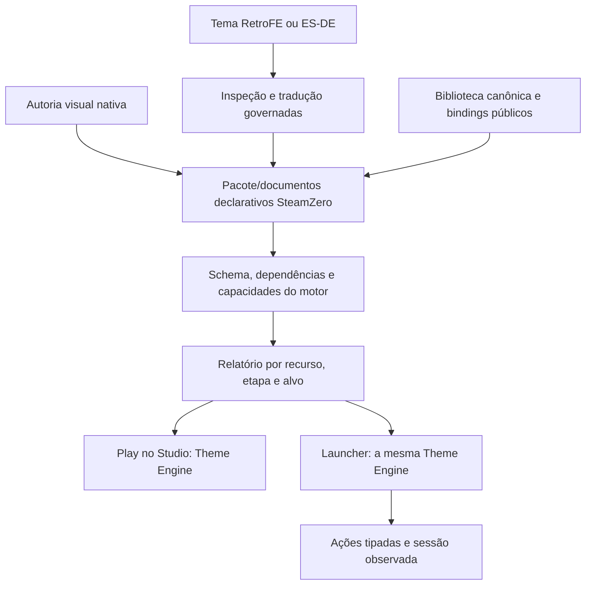

# THEME-ENGINE-AND-STUDIO — plataforma de criatividade declarativa

## 1. Propósito e regra de verdade

Esta é a especificação normativa da **Theme Engine** e do **Theme Studio** do
SteamZero. Ela complementa `AURA-SURFACES.md` e atualiza a dimensão de produto do
framework incremental preservado em `docs/expansion/FRAMEWORK TEMA/`.

A nomenclatura e a separação de responsabilidades seguem a
[direção vigente](../recovery/2026-10-16/DIRECAO.md). A
[definição consolidada de 30/10/2026](#22-definição-consolidada--30102026)
registra o esclarecimento expresso do proprietário: produto nativo primeiro,
Studio visual robusto, assets canônicos compartilhados e reprodução integral
de capacidades RetroFE/ES-DE pelo motor SteamZero. Essa definição é normativa;
o diagnóstico datado e os itens de status continuam distinguindo intenção de
capacidade entregue. Nenhuma enumeração deste documento habilita runtime.

Filosofia central: **renderize, não edite**.

- um asset-fonte pode produzir infinitas variações por receita;
- derivados não são distribuídos como cópias pré-editadas;
- efeitos e composições são não destrutivos;
- GPU realiza a renderização; CPU faz validação, planejamento, decodificação e
  tarefas assíncronas adequadas;
- criatividade usa contratos declarativos, não código arbitrário.

Se o designer precisa abrir Photoshop/GIMP para criar uma variação que a engine
promete — recolor, silhueta, contorno, glow, máscara, composição ou transição — a
capacidade correspondente ainda não está concluída.

## 2. Estado atual honesto

Esta seção descreve fundações e limites, não substitui o catálogo atual de
`docs/status/items/`. O relatório da seção 22 contém a fotografia de 30/10/2026;
evidências históricas adiante conservam sua data, fonte e alcance.

Já existem fundações parciais:

- manifestos, tokens, herança, resolver e fallback de temas;
- temas builtin, catálogo, instalação/importação e preferência;
- preview e edição de tokens/metadados com exportação de pacote;
- contratos parciais de scene graph e projeção QML;
- effect stack allowlisted em `MediaEffectLayer.qml`, incluindo blur, cor,
  saturação, brilho, contraste, sombra, glow, opacidade, máscara, vignette e
  reflexão;
- testes unitários, integração e harness QML para partes dessas capacidades.

Isso torna a **Theme Engine parcial** e o **Theme Studio parcial**. Há contratos
e ferramentas de autoria para partes de efeitos, receitas, movimento e Jornada;
sua existência isolada não conclui a autoria genérica nem o consumo integral de
todos os recursos em preview e Launcher. Scene graph livre ponta a ponta,
transformações completas de logo, extração dinâmica de cores, cache GPU com
orçamento e certificação física exigem seus próprios aceites.

## 3. Arquitetura e fronteiras

```text
Launcher/Central Desktop ── dados e ações semânticas versionadas
        │
Theme Engine ───── scene graph + layout + bindings + efeitos + animação
        │
Qt Quick/RHI ───── Vulkan/OpenGL conforme o host Linux

Theme Studio ───── autoria/preview/validação ──► pacote declarativo
```

- Central Desktop administra organização, configuração e otimização.
- Launcher é a superfície fullscreen que hospeda a experiência de jogo.
- Aura é o tema fullscreen nativo de referência, substituível pelo contrato
  público; não é o nome da Central nem do Launcher.
- Theme Engine renderiza e protege a execução.
- Theme Studio cria pacotes; não é requisito para o runtime carregar um pacote
  válido.
- Captura de save, sessão de jogo, scraping, achievements e cloud pertencem aos
  seus domínios; a engine apenas renderiza contratos publicados por eles.

## 4. Scene graph e layout

O contrato versionado deve oferecer:

- hierarquia arbitrária dentro de limites explícitos;
- IDs estáveis e componentes reutilizáveis;
- posicionamento absoluto e relativo;
- anchors e constraints;
- row, column, grid, stack, flow e overlay;
- z-index, clipping, máscaras e área de hit separada da área visual;
- translate, scale, rotate, skew, origem e perspectiva 3D limitada;
- repetidores para coleção, lista, grid, carousel, wheel e offset converter;
- slots semânticos `home`, `library`, `gameDetail`, `search`, `collections`,
  `saveStates`, `quickMenu`, `osd`, `empty`, `loading`, `error` e `offline`;
- breakpoints por largura, altura, proporção, densidade, handheld/dock e tier;
- layouts para 1280×800, 949×593, Full HD, ultrawide e escala fracionária;
- fallback determinístico quando constraint, asset ou dado não resolver.

O pacote não referencia tabela interna, path privado ou classe QML. Consome um
read model público, versionado e sanitizado.

## 5. Pipeline de imagens

### 5.1 Formatos

Runtime obrigatório: PNG, JPEG, WebP, AVIF e SVG estático sanitizado. GIF/WebP
animado é opcional por capability. BMP, TGA, ICO, TIFF e PSD entram pelo importador
do Studio e são convertidos no staging; PSD não é dependência do runtime.

### 5.2 Ajuste e amostragem

- `contain`, `cover`, `fill`, `crop` e dimensões explícitas;
- aspect ratio protegido por padrão e desligável por elemento;
- crop por centro, ponto focal ou região de interesse declarada/detectada;
- nearest neighbor para pixel art;
- bicubic/Catmull-Rom e Lanczos3 para capa/fanart;
- Scale2x/xBRZ como nodes opcionais de alto custo, nunca pressupostos;
- mipmaps, texture atlas quando benéfico e compressão suportada pelo backend;
- lazy loading, carregamento preditivo e cancelamento quando o item sai da cena;
- placeholder/fonte reduzida enquanto a textura final carrega.

### 5.3 Cache

- chave por hash de conteúdo + receita + tamanho + tier;
- LRU adaptativo em RAM/VRAM;
- teto padrão de 512 MB de VRAM, sem reservar esse valor antecipadamente;
- invalidação quando fonte, receita, escala ou capability mudar;
- derivados são cache descartável, nunca assets duplicados no pacote.

## 6. Effect graph nativo

Nodes combináveis e allowlisted:

- cor: grayscale, sepia, invert, hue rotate, saturation, brightness, contrast,
  duotone, threshold e matrix 4×5;
- blur: Gaussian e box; motion, radial, tilt-shift e bokeh entram por tiers;
- borda: stroke sólido/tracejado, inner/outer shadow, inner/outer glow e rounded
  corners;
- composição: opacity, blend modes, tint, gradient overlay, masks e clipping;
- transformação: mirror, zoom, pixelate, wave/distortion limitada e reflection;
- retro: scanlines, CRT, curvature, bloom, vignette, VHS, grain e light leak;
- avançados: chromatic aberration, depth of field, noise, parallax, neon,
  hologram, Ken Burns e particles com orçamento explícito.

Cada node declara custo, capabilities, limites e fallback. Um node indisponível
produz diagnóstico e degradação conhecida; nunca desaparece silenciosamente nem
derruba a cena.

Shaders arbitrários de terceiros permanecem proibidos. Novos efeitos entram como
nodes builtin revisados; uma futura extensão isolada exige ADR, sandbox, limites,
timeout e cadeia de confiança próprios.

## 7. Transformação de logos por um único asset

A receita trabalha prioritariamente sobre alpha/máscara ou signed distance field:

- versão colorida original;
- grayscale;
- silhueta preta/branca;
- inversão RGB/luminância;
- color shift por hue;
- recolor sólido/gradiente;
- contorno fino/grosso, interno/externo/centralizado;
- dilatação e erosão;
- Sobel/Canny opcional para casos sem alpha;
- preenchimento, glow e shadow combináveis.

Gate obrigatório: um asset sintético/licenciado produz ao menos as variantes
colorida, preta, branca, contorno branco fino/grosso e contorno preto fino/grosso.
Os logos de referência anexados à solicitação não são incorporados ao repositório
sem licença de redistribuição.

## 8. Extração e uso dinâmico de cores

A análise assíncrona, cacheada pelo hash da arte, publica:

- dominant;
- vibrant/lightVibrant/darkVibrant;
- muted/lightMuted/darkMuted;
- complementary/accent;
- background e contrastText acessível.

Algoritmos elegíveis: K-Means, Median Cut e seleção por famílias vibrant/muted.
A extração nunca roda por frame. Falha usa paleta determinística do tema. Bindings
como `{game.colors.vibrant}` são sanitizados; contraste pode promover uma variante
segura antes da renderização de texto essencial.

## 9. Glassmorphism

O node de vidro realiza:

1. captura restrita da região atrás do elemento;
2. blur offscreen;
3. tint por cor fixa ou extraída;
4. blend/opacidade;
5. borda semitransparente;
6. highlight em gradiente;
7. shadow;
8. fallback sem backbuffer blur.

O tier reduz raio, resolução do buffer ou desliga o blur antes de comprometer
foco, texto ou frame budget.

## 10. Estados, animação e transições

Estados nativos: normal, focused, selected, pressed, disabled, loading, missing,
error, offline, playing, idle e menuOpen.

- timeline, keyframes, delay, duration, repeat, sequence e parallel;
- easing linear, in/out, quad, cubic, quart, quint, expo, circ, back, elastic,
  bounce e Bézier cúbico;
- entrada: fade, slide, scale, bounce, elastic, curtain, ripple, pixelate, glitch,
  typewriter, flip, spin, zoom blur, blinds, peel, mosaic, spiral e heartbeat;
- troca de cena: crossfade, wipe, dissolve, cover flow, accordion, flip clock,
  cube e page curl quando o tier permitir;
- interrupção/reversão preserva estado e foco;
- `reducedMotion` substitui ou zera toda animação não essencial.

## 11. Componentes nativos e modos de view

- progress bar linear, circular, segmentada e dotted;
- progresso ligado a valores reais, inclusive `{current}/{total}` filtrado;
- grid, list, wall, wheel, cover flow, carousel 2D/3D, mosaic, timeline e map;
- offset converter com scale, opacity, blur, rotation, translation e z-index por
  distância do selecionado;
- highlight central e tratamento de adjacentes;
- transparência por idle, navegação, foco e menu;
- panels, cards, modals, drawers, badges, tooltips, labels e glyphs semânticos;
- clock, system monitor, recently played, favorites, random game, search, filters
  e statistics como widgets allowlisted;
- weather e integrações remotas somente por provider externo com consentimento,
  cache e estado offline; tema nunca acessa a rede.

## 12. Save-state gallery e OSD

A engine recebe contratos, não controla o emulador:

- thumbnail por slot, timestamp, playtime, compatibilidade e estado;
- grid/carousel de saves com fallback sem captura;
- OSD para volume, mute, brilho, screenshot, save/load state, fast-forward,
  rewind, pause, controle, achievement e rede;
- ícone, texto e progress bar temáveis;
- OSD não pode ocultar erro crítico nem falsificar sucesso.

Captura automática de save-state pertence ao adapter/session manager e exige
prova separada de compatibilidade e preservação.

## 13. Metadados e bindings

Campos públicos possíveis: título, ano, desenvolvedora, publicadora, gênero,
descrição, rating, classificação etária, jogadores, playtime, controles, mods,
links allowlisted, IDs externos, região, idioma, série e franquia.

Expressões seguras permitem condição, formatação, aritmética limitada,
interpolação, filtros e variáveis locais. São proibidos eval, reflexão, filesystem,
rede, processo, shell, Python, JavaScript e QML fornecido pelo pacote.

## 14. Theme Studio

O Studio completo oferece:

- canvas visual com zoom, guides, snap e seleção;
- árvore da cena e componentes reutilizáveis;
- inspector de propriedades e constraints;
- grafo de efeitos por nodes;
- timeline/keyframes/easing;
- editor de breakpoints, states e variantes;
- data bindings assistidos e dados de demonstração sem segredos;
- preview ao vivo e hot reload;
- preview simultâneo Deck/Full HD/ultrawide e tiers;
- simulação de controle, foco, offline, vazio, erro e jogo ativo;
- undo/redo, copy/paste, histórico e comparação antes/depois;
- profiler de FPS, frame time, memória, textura e draw calls;
- validadores de schema, assets, licença, foco, contraste, alvo, reduced motion,
  limites e orçamento;
- criar, salvar, exportar, importar, sobrescrever com confirmação e reabrir sem
  perda;
- pacote e digest reproduzíveis.

O editor atual de tokens, metadados e preview é fundação parcial, não evidência de
canvas, effect graph ou timeline.

Uma primeira fatia de autoria de `assetRecipes` já está disponível no Studio:
temas com receitas próprias ou herdadas podem editar variantes, adicionar,
parametrizar, reordenar e remover nodes allowlisted; temas com assets sem livro
de receitas podem escolher a fonte e inicializá-lo. A primeira alteração de um
tema derivado materializa a declaração herdada no filho. Cada candidato passa
pelo `AssetRecipeBook` e pelo `ThemeResolver` antes de entrar no histórico; uma
rejeição mantém documento e histórico intactos. `assetRecipes` v2 acrescenta
fallback, escolha por tier e breakpoints de resolução com prioridade. O Studio
envia tier e dimensões do alvo à bridge, e o preview usa o renderer nativo
`AssetRecipePreview` com a origem resolvida pela cadeia de herança, confinada à
raiz do tema. O E2E QML pela bridge de loopback comprovou `balanced` em
1280×720 e o breakpoint `wide` em 1920×720; a receita `outlineThin` (largura 6)
chega ao componente do renderer. Isso é uma prévia de alvo simulada no harness
Qt/offscreen de 1100×900, não uma tela física de 1920×720 nem a release instalada.
A autoria/salvar/reabrir e exportar/importar continua coberta em XDG temporário;
nada disso certifica a Jornada no Launcher/Cinema ou o pacote da Engine instalado.
Na imagem Qt 6.11.2 do gate visual, os E2E QML de Jornada e Theme Studio passaram
após ajustes de rolagem e largura dos controles; ainda são provas do checkout,
não de aplicação instalada, sessão física ou desempenho da release.

As mutações do editor são enviadas em sequência por sessão. A resposta só
atualiza o documento se a geração e a sessão ainda forem as atuais; respostas de
uma sessão fechada ou substituída são descartadas. A regressão QML entrega uma
resposta antiga enquanto a nova sessão tem uma edição válida em espera e confirma
que a antiga não sobrescreve a atual. Esta prova é do checkout em Qt/offscreen,
não de input físico nem da release instalada.

### 14.1. Ergonomia de autoria para artwork heterogêneo

O backlog do Studio deve tornar o ajuste de capas e demais artes declarativo,
reversível e aplicável por objeto, sem exigir edição destrutiva dos arquivos-fonte
nem cópias pré-rotacionadas. Em especial:

- **orientação automática**: oferecer `none`, `auto`, `portrait` e `landscape`,
  comparando a orientação da imagem com a orientação do slot/moldura e permitindo
  regras condicionais por sistema, região, categoria de mídia ou variante. `auto`
  deve ser determinístico, explicável no inspector e sempre permitir override;
- **enquadramento e preenchimento**: expor visualmente `contain`, `cover`, `fill`
  e `crop`, além de alinhamento horizontal/vertical (`left|center|right` e
  `top|center|bottom`) e ponto focal. O editor deve deixar claro quando a imagem
  será recortada, distorcida ou terá letterbox;
- **regras por slot, não por asset**: uma mesma categoria de objeto pode declarar
  receitas diferentes para arte japonesa, americana, retrato, paisagem ou mídia
  ausente. A engine continua responsável por renderizar e cachear a variação; o
  pacote não deve acumular assets derivados apenas para resolver orientação ou
  enquadramento;
- **polimento seguro**: preview simultâneo em low/balanced/cinematic, fallback
  legível, high contrast, escala de texto e `reducedMotion` devem prevalecer sobre
  a estética. Toda regra precisa sobreviver a exportar/importar/reabrir sem perda.

Esses controles são requisitos futuros de autoria do Theme Studio e não promovem
por si só o estado do runtime ou do AURA Launcher.

## 15. Pacote, compatibilidade e segurança

O pacote declara schema, API mínima/máxima, autoria, licença SPDX, assets-fonte,
scenes, components, recipes e capabilities. Instalação usa staging, limites,
sanitização, digest, publicação atômica, verify e rollback.

- sem path absoluto, traversal, symlink, arquivo especial ou URL de asset;
- SVG sem script, evento, `foreignObject` ou referência externa;
- limites de arquivo, pixels, profundidade, nodes, efeitos, texturas e animações;
- tema inválido não bloqueia catálogo/startup;
- fallback para builtin seguro;
- migração de schema explícita e reversível;
- tema não substitui texto operacional, código de erro, glyph de controle ou ação
  semântica de segurança;
- assets exigem licença/atribuição; material protegido não é redistribuído como
  fixture de teste.

## 16. Acessibilidade

- alvo interativo ≥48 px;
- foco sempre visível e focus graph sem becos;
- contraste essencial ≥7:1 ou política aprovada equivalente;
- escala de texto realmente consumida;
- high contrast e reduced motion prevalecem sobre o tema;
- modos de daltonismo deuteranopia/protanopia/tritanopia;
- leitor de tela recebe nome, papel, estado e ação;
- cor não é o único canal;
- tema que não consegue adaptar degrada para apresentação segura.

## 17. Desempenho e backends

Alvo do projeto Linux: Qt Quick/RHI com Vulkan ou OpenGL suportado pelo host. O
contrato do tema é backend-neutral; DirectX/Metal não são promessa da 1.0.

Cena física de referência:

- 60 FPS estáveis em 1280×800;
- frame p95 dentro de 16,7 ms;
- home utilizável em até 2 s com cache aquecido;
- VRAM ≤512 MB e orçamento adaptativo;
- decodificação, cor e I/O fora da thread de render;
- batch/atlas/occlusion/lazy/predictive loading medidos, não presumidos;
- tiers `low`, `balanced` e `cinematic` com degradação determinística;
- nenhum efeito pesado causa tela preta, OOM ou perda de input.

FPS, tempo e memória só recebem resultado `passed` com medição na release e no
hardware identificados. Harness offscreen prova contrato, não performance física.

## 18. Integrações futuras

RetroAchievements, providers de mídia, vídeo, presença social, saves em nuvem e
streaming publicam dados por adapters próprios. A Theme Engine pode apresentar
esses dados quando existirem, mas não os implementa e não acessa seus serviços.

## 19. Ondas de entrega

1. consolidar contrato versionado de scene/effect/image e fixtures sintéticas;
2. fechar transformações de asset único e cache de derivados;
3. layouts/repeaters/bindings e breakpoints;
4. extração de cores, glass e effect nodes por tiers;
5. states, timeline e transições;
6. componentes Launcher, OSD e save gallery por contratos;
7. Studio: canvas/árvore/inspector;
8. Studio: effect graph/timeline/bindings/profiler;
9. hardening, acessibilidade, import/export e migrações;
10. release instalada, matriz física, evidência e certificação.

Cada onda segue reprodução/baseline, implementação mínima completa, teste focado,
validação física proporcional, gates integrais no fechamento, commit isolado e
evidência. Não se declara a onda completa a partir de mock ou screenshot estático.

## 20. Definition of Done

Theme Engine só vira `complete` quando:

1. um único asset gera todas as variantes de logo exigidas sem derivados no pacote;
2. scene graph, layouts, repeaters, bindings, efeitos e animações funcionam ponta
   a ponta em pacote externo seguro;
3. grid, list, wheel, cover flow, carousel, flow e stack são declarativos;
4. cor dinâmica, glass, cache e tiers possuem fallback e diagnóstico;
5. múltiplas resoluções, controle e acessibilidade passam;
6. pacote inválido/pesado volta ao tema seguro;
7. metas de FPS, frame time, startup e VRAM são medidas no Deck;
8. instalação, reexecução, atualização, rollback e remoção preservam dados;
9. release instalada possui capturas e métricas ligadas ao commit.

Theme Studio só vira `complete` quando:

1. canvas, árvore, inspector, constraints, effect graph e timeline existem;
2. designer cria as variantes previstas sem editor externo ou terminal;
3. preview cobre resoluções, states, dados e acessibilidade;
4. undo/redo e recuperação preservam o documento;
5. criar→salvar→exportar→importar→reabrir é byte/semanticamente estável;
6. validadores bloqueiam pacote inseguro, incompatível ou acima do orçamento;
7. o pacote produzido roda na Theme Engine instalada;
8. evidência física e relatório mostram o fluxo real de autoria e consumo.

Conclusão da Theme Engine ou do Studio não promove automaticamente Central
Desktop, Launcher ou Aura. As cinco capacidades mantêm estados e provas
independentes; IDs legados continuam preservados até migração explícita.

## 21. Jornadas de experiência, menus e etapas

A navegação completa da experiência é um documento sidecar versionado
`experience-journey-v2`; leitores também migram documentos v1 para v2. Ela não é
uma extensão informal do manifesto `theme-manifest-v1`, que continua rejeitando
propriedades desconhecidas. Os contratos estão em
`src/steamzero/schemas/experience-journey-v1.schema.json` e
`src/steamzero/schemas/experience-journey-v2.schema.json`.

- O documento separa a organização visual da árvore do grafo de conexões. Links
  apontam para IDs estáveis de menus/etapas, e várias origens podem apontar para
  o mesmo menu sem copiar sua cena ou seus assets.
- A implementação inicial publica limites de proteção de **4 MiB por documento
  serializado**, **4.096 menus**, **16.384 conexões**, **8.192 posições de
  organização**, **64 filtros por menu** e **512 contextos de voltar**. São
  limites de recursos do contrato, não um limite de profundidade. Ao se aproximar
  deles, a UI/runtime deve avisar e oferecer diagnóstico; listas grandes usam
  virtualização. Complexidade de validação e roteamento é O(V+E) em menus e
  conexões. Estes tetos não substituem medição de memória/tempo do Engine e do
  Launcher em hardware/release identificados.
- Ciclos iniciados por input explícito são válidos. Ciclos só automáticos são
  diagnosticados para impedir execução sem saída. Referências ausentes não são
  corrigidas silenciosamente.
- Fontes, campos, tipos e valores vêm de read models públicos versionados. Filtros
  combinam como AND, são tipados e allowlisted; ordenação usa os mesmos campos.
  A v2 acrescenta agrupamento por campo publicado e bindings declarativos entre
  menus, que só acrescentam filtros AND no destino.
  SQL, eval, script, QML, shell e acesso a tabelas internas não fazem parte do
  contrato. Dados desconhecidos, zero resultados e fonte indisponível têm
  estados e recuperação distintos.
- O contexto de navegação preserva menu de origem, seleção, filtros, rolagem e
  foco. Respostas de ações antigas são descartadas depois de uma rota mais nova.
  Ao voltar da sessão, o destino é o contexto capturado, não uma Home presumida.
- Cada menu e etapa visual pode declarar tema próprio. A omissão herda AURA com
  motivo `not-customized`; escolha explícita de AURA tem motivo separado. Tema
  inexistente e recurso visual incompatível têm diagnósticos próprios e fallback
  por trecho. Cobertura é calculada apenas para etapas usadas. Origem visual e
  capability operacional são resultados independentes.
- Launch, pausa, retomada, save/load e exit são ações semânticas governadas pelo
  domínio/adapters. Uma animação de fade não confirma uma operação. A etapa
  seguinte observa sucesso/falha/timeout publicados pela sessão; herança visual
  nunca habilita uma operação indisponível.
- O mesmo documento salvo/reaberto deve alimentar Studio Preview, Theme Engine e
  Launcher/AURA Cinema. O caminho de aceitação inclui três ou mais menus,
  facetas diferentes que compartilham destinos, temas por etapa, aviso de
  herança, round-trip/export/import, retorno contextual e erros recuperáveis.

### Matriz de superfície e operação

| Etapa/superfície | Fonte e navegação | Dono operacional | Prova necessária |
|---|---|---|---|
| Plataformas, gêneros, anos, fabricante, hardware, emulador e outras facetas | Campos/tipos/valores de read model público; filtros combinados seguem no contexto | Read model + runtime do Launcher | Campos novos aparecem sem tela codificada por campo; vazio, unknown e fonte indisponível têm contagem/recuperação |
| Menu de jogos compartilhado | Várias origens usam o mesmo ID; conexão e filtros não copiam cena | Navegação do Launcher | Entrar por plataforma e outra faceta; Voltar restaura filtros, jogo, rolagem e foco de cada origem |
| Fade de entrada | Aparência própria ou AURA; limitado e interrompível | Resultado de launch do adapter/sessão | Mostrar sucesso, falha, retry e timeout; fade nunca é o oráculo de que o jogo abriu |
| Jogo e bezel | Composição da etapa mais dados publicados da sessão | Adapter de launch/sessão e capability de bezel | Jogo ativo, bezel suportado/ausente, erro e saída observados separadamente |
| Pausa e retomada | Menu compartilhável com aparência própria ou AURA | Capabilities pause/resume do adapter | Só entrar após confirmação; retomar ou falhar sem perder a origem |
| Saves | Fonte publicada do domínio de saves; save comum e save-state não se confundem | Domínio/adapters de saves | Listar, carregar, cancelar, falhar e voltar; preservar o estado real publicado pelo adapter |
| Fade de saída e retorno | Aparência por etapa; destino é o contexto de jogo salvo | Resultado de exit do adapter/sessão | Saída confirmada ou falha governada; voltar ao mesmo jogo/filtros/foco e depois à faceta anterior |
| OSD, loading, vazio, erro e offline | Estado/mensagem/ações de recuperação publicados | Domínio responsável pela operação | Mensagem e ação reais, timeout/retry e foco utilizável; sem tela morta |

Antes de aplicar, a matriz de cobertura mostra origem e versão de cada etapa
usada. A etiqueta de herança conta apenas omissões ou escolhas explícitas de
AURA; referências ausentes e incompatibilidades aparecem em linhas próprias,
mesmo quando seu fallback visual também usa AURA. A lista de capabilities do
adapter não deriva da aparência escolhida.

O estado atual é **parcial**. A branch de continuidade contém o schema v2, o
serviço transacional e o painel de Jornadas anexado ao Theme Studio, com árvore,
conexões, filtros, bindings, agrupamento, temas por menu/etapa, aviso de
herança, histórico e operações de arquivo. A bridge autenticada de loopback
publica `journey.studio.*` sobre `JourneyStudioService` e os read models
públicos do Desktop. O teste QML da bridge cria e edita menus pela interface,
salva/reabre a mesma jornada e usa a composição da etapa selecionada.

`journey.studio.engine-preview` consulta os resultados filtrados no servidor,
limita bindings ao catálogo de campos públicos, resolve a cobertura da etapa e
passa `preview.items` ao `DesktopDashboard.editor_preview`/`ThemeEditorManager`.
O resolver native materializa os `sceneLayouts` declarados, e o QML reutiliza
`ThemeStudioCanvas`. Um teste de bridge confirma que o documento reaberto com o
tema `org.steamzero.asset-recipes-demo` produz somente o título filtrado da
Jornada, sem a amostra estática Axiom Verge. Referência de tema ausente ou slot
incompatível cai explicitamente em AURA e devolve a causa; high contrast e
reduced motion usam os probes do dashboard na execução normal.

Outro teste edita `maxItems` no tema filho de `asset-recipes-demo`, salva e
reabre o pacote, e confirma que o Theme Engine mantém a edição na prévia da
Jornada: dos três registros filtrados, só os dois primeiros chegam à cena. A
cobertura também usa `sceneSurfaces` herdado da cadeia `extends`, sem declarar
incompatibilidade falsa. Isso verifica o consumo nativo do documento salvo no
Theme Engine neste checkout, com fixtures e registros sintéticos isolados.

Na continuação de 2026-10-04, uma Jornada salva no Studio foi exportada e
reaberta como cópia ativa pelo `JourneyStore` consumido pelo Launcher. O teste
de integração percorre quatro menus, filtros tipados por plataforma/gênero/ano
e desenvolvedor, destino compartilhado, tema e retorno contextual; `/journey/current` e
`/cinema` recebem a mesma seleção. Para o tema XML de fixture, o Launcher usa o
compilador e o blob store ES-DE existentes, publica a cena compilada na resposta
do Cinema e a QML `SceneEsdeView` desenha o elemento. O caminho foi exercitado
com fixtures/licenças sintéticas; não certifica uma release instalada nem o
acervo real.

No perfil RetroArch Flatpak, a configuração gerenciada aplica o bezel AURA e o
read model publica as capabilities de pause/resume, save-state, disco e saída
de acordo com a sessão. Saída exige confirmação e request/session ID; `closing`
é pendente até o watcher confirmar `closed`. Outros perfis não herdam essas
capabilities por aparência.

Na continuidade após o PR #250, o Theme Studio aceita um PNG-fonte para o slot
`bezel`, com validação de conteúdo/dimensões, limite de tamanho e licença do
manifesto. O rascunho mostra o asset, e undo/redo, save/reopen, export e
importação pelo instalador preservam os bytes. A Jornada persiste `bezelResource`
como `aura-default` ou URI lógica `asset://bezels/{theme}@{version}-{sha256}.png`;
ela não aceita caminho livre, URL remota ou código de tema. O catálogo expõe
origem, versão, licença, formato e compatibilidade para o RetroArch Flatpak; URI
ausente, digest/versão obsoletos e formatos incompatíveis têm diagnósticos e
recuperação selecionando AURA.

Na próxima sessão RetroArch Flatpak, o launcher revalida o URI contra o pacote
instalado e cria somente seus arquivos de overlay/config dentro da pasta privada
da sessão. A configuração própria é passada junto à configuração gerenciada de
controles em um único `--appendconfig`; `config_save_on_exit` fica desativado
para preservar `retroarch.cfg` de terceiros, e a limpeza ocorre após a saída ser
observada. A seleção é de próximo lançamento, não troca ao vivo. O read model
usa `launch-configured-unconfirmed` e nunca afirma `applied=true`: o adapter
confirma os bytes e a configuração que enviou, não uma leitura do parâmetro
`input_overlay` pelo RetroArch nem a composição final de pixels.

A saída confirmada enquanto suspenso revalida ID, PID/start ticks e grupo de
processos; envia TERM seguido de CONT apenas para o grupo próprio validado, sem
escalar a SIGKILL. `closing` permanece pendente até o watcher observar `closed`.
No modo isolado, todos os homes XDG continuam privados e o processo QML recebe o
socket Wayland original absoluto depois de validar o endpoint. Essas provas são
testes focados do checkout, incluindo processo e socket descartáveis. Qt no
compositor real, input, aplicação de pixels durante gameplay, release instalada
e métricas físicas seguem pendentes. AURA UI, Theme Studio, Theme Engine, AURA
Launcher e capabilities operacionais continuam com estados independentes.
Theme Studio, Theme Engine, AURA UI, AURA Launcher e os adapters de sessão
continuam com critérios e provas independentes.

## 22. Definição consolidada — 30/10/2026

Leitura por assunto:

- [Produto e responsabilidades](#222-as-responsabilidades-do-produto).
- [Biblioteca canônica](#224-biblioteca-canônica-um-master-muitas-utilizações) e
  [wheel de fonte única](#225-caso-obrigatório-wheel-monocromática-e-foco-colorido).
- [Autoria visual](#226-autoria-visual-da-biblioteca-ao-tema-executável),
  [importação/Play](#227-importar-e-dar-play-pelo-motor-steamzero) e
  [resposta do motor](#228-demanda-consulta-ao-motor-e-resposta-útil).
- [Equivalência entre preview e Launcher](#2210-o-que-significa-o-mesmo-documento-no-preview-e-no-launcher).
- [Diagnóstico atual](#2211-diagnóstico-atual-o-que-existe-e-o-que-falta-provar),
  [aceites e medições](#2212-matriz-de-aceitação-e-prova-de-qualidade) e
  [continuidade](#2213-integração-no-plano-e-critérios-de-fechamento).

### 22.1. Autoridade, finalidade e leitura do relatório

Esta seção incorpora o esclarecimento expresso do proprietário em 30/10/2026.
Seu propósito é impedir que a implementação reduza o SteamZero a um importador
de paletas, um editor de XML ou um invólucro de outro frontend. Complementa a
direção de 16/10, preservando segurança, contratos, IDs e evidências anteriores.
Quando uma descrição anterior limitar o produto a essas interpretações, a
definição desta seção prevalece quanto à intenção e ao aceite do produto.

O SteamZero é uma ferramenta de **automação, organização e experiência de jogo**.
Deve preparar cada plataforma com os recursos, configurações e otimizações
suportados por seus runtimes, mantendo escolhas e padrões compreensíveis.
Seu outro braço é a jornada audiovisual: navegar, escolher, lançar, jogar e
retornar em uma experiência coerente. Os braços compartilham serviços e dados,
com responsabilidades distintas.

As palavras abaixo têm significados diferentes neste relatório:

| Afirmação | Significado |
|---|---|
| Requisito normativo | Comportamento que o produto deve entregar; não afirma implementação |
| Fundação existente | Código/contrato reutilizável localizado no checkout; não certifica a jornada |
| Diagnóstico observado | Resultado datado com escopo e fonte identificados |
| Entregue e certificado | Critérios aplicáveis comprovados na candidata, versão e hardware indicados |

O catálogo `docs/status/items/` permanece a única fonte do estado atual. Esta
seção é o contrato e relatório consolidado, não um catálogo concorrente.

### 22.2. As responsabilidades do produto

| Parte | Responsabilidade | Relação com as demais |
|---|---|---|
| Central Desktop | Organizar biblioteca/mídia, configurar plataformas e emuladores, escolher padrões e otimizações, apresentar diagnóstico e readback | Usa os serviços canônicos; publica escolhas que o lançamento respeita |
| Launcher | Apresentar e operar a jornada fullscreen: navegação, foco, menus, sessão e retorno | Hospeda a Theme Engine, fornece contexto/dados públicos e encaminha ações aos serviços |
| Theme Engine | Interpretar e executar composição declarativa: imagens, texto, vídeo, áudio, efeitos, movimento, estados e interação visual | É o motor comum dos temas nativos e dos temas externos traduzidos |
| Theme Studio | Criar e editar temas/jornadas pela interface, importar, compor, validar, pré-visualizar e preparar o pacote | Expõe as capacidades públicas do motor e dos serviços, com ferramentas e diagnósticos |
| Aura | Demonstrar a qualidade e os recursos nativos em um tema fullscreen | Usa o mesmo contrato público e caminho de execução dos demais temas |
| Serviços de plataforma/sessão/mídia | Manter identidades, configurações, assets, disponibilidade e operações reais | Autoridade sobre seus dados e efeitos; o desenho do tema não inventa suporte |

Na linguagem do proprietário, o Launcher é o motor que lança os temas. Na
arquitetura, Theme Engine nomeia o componente de renderização dentro dessa
experiência. Essa separação técnica conserva a intenção: dar Play em um tema
deve executar sua experiência pelo SteamZero.

O tema pode apresentar uma configuração ou operação publicada em contextos
compatíveis. A autoridade operacional continua no serviço: um fade não confirma
launch; uma animação de disco não confirma troca; um indicador não confirma que
o emulador aplicou uma otimização.

### 22.3. Produto nativo primeiro e compatibilidade integral

A função primária da plataforma criativa é construir e executar **temas próprios
do SteamZero**, com recursos nativos robustos. Importar temas é uma entrada
adicional para a mesma plataforma. O Studio não deve depender de um formato
externo para criar nem limitar sua criatividade ao que um importador entende.

A meta de compatibilidade é reproduzir pelo motor SteamZero todos os recursos
de experiência dos formatos RetroFE e ES-DE: aparência, movimentos, efeitos,
transições, áudio, vídeo, informação, navegação e etapas funcionais. Aeon Nox e
os temas ES-DE auditados são casos de referência iniciais, não o limite final
desse objetivo. A matriz deve crescer por versão/formato/recurso até cobrir o
universo declarado; uma amostra não autoriza alegar compatibilidade universal.

Uma limitação encontrada abre trabalho de engine, tradução, serviço ou autoria.
Não redefine automaticamente o requisito como “parecido” ou “subconjunto
suficiente”. Enquanto uma capacidade necessária estiver ausente, o resultado
integral permanece pendente, com diagnóstico e experiência segura.

O objetivo adicional é superar as limitações do fluxo de criação das referências:
composição visual, reutilização de assets, variações não destrutivas, recursos
nativos extensíveis e organização. “Mais robusto” precisa ser demonstrado por
essas capacidades e por jornadas completas. Não é uma afirmação de exclusividade
de um efeito em todas as versões dos demais projetos, nem uma medição atual de
superioridade, consumo ou desempenho.

### 22.4. Biblioteca canônica: um master, muitas utilizações

A autoria e o Launcher devem escolher mídia na biblioteca canônica do SteamZero.
O mesmo asset pode ser usado por vários temas, cenas e instâncias visuais sem
duplicação persistente do conteúdo para cada consumidor. Um tema guarda referências
e receitas, não sua cópia particular do acervo inteiro.

| Conceito | Regra de organização |
|---|---|
| Master/asset-fonte | Conteúdo original de qualidade preservada, com identidade e revisão/hash verificáveis |
| Associação semântica | Liga asset à plataforma, jogo, gênero ou outra entidade e a um papel de mídia |
| Papel de mídia | Logo/wheel, ícone, capa, fanart, cartucho, disco, screenshot, background, vídeo, som ou fonte, conforme contrato publicado |
| Variante artística | Arte distinta, regional, alternativa ou de outro estilo; pode ser um master diferente |
| Receita | Declara como apresentar/transformar a fonte; não destrói nem sobrescreve o master |
| Referência do tema | Seleciona asset específico ou binding contextual por entidade/papel, com fallback declarado |
| Cache derivado | Resultado regenerável por fonte+receita+dimensões+perfil; tem orçamento e pode ser descartado |

“Um asset não pode ser duplicado” significa que o mesmo conteúdo não deve virar
novos masters físicos por tema, nome de arquivo ou uso visual. Não significa
restringir uma plataforma a um único desenho: logos diferentes e artes diferentes
continuam permitidos e organizados. Conteúdos visualmente parecidos não devem ser
fundidos por adivinhação; nome igual não prova identidade. Desduplicação por bytes
e escolha da melhor versão artística são decisões distintas.

O autor pode selecionar explicitamente uma imagem ou escolher “logo desta
plataforma”, “fanart deste jogo”, “cartucho”, “disco” ou outra fonte publicada.
Também pode importar arte de fora. A ingestão deve registrar origem, licença,
atribuição, dimensões/formato e vínculo, detectar conteúdo já existente e mostrar
conflitos. Referências não resolvidas, associação ambígua e fonte ausente têm
diagnóstico; não se substitui silenciosamente o asset exigido para declarar
paridade. Várias instâncias podem usar receitas diferentes sobre o mesmo master.

O acervo pessoal RetroFE do proprietário é uma fonte candidata de mídia para
esse fluxo. Este relatório não move, remove, converte nem importa esse acervo.
Uma futura ingestão será planejada, não destrutiva, com verificação e preservação
dos originais. Uso privado e redistribuição são permissões distintas.

Qualidade máxima significa preservar a melhor fonte legítima disponível, não
aumentar dimensões artificialmente. SVG sanitizado ou raster com resolução,
alpha, detalhe e proporção adequados deve suportar os tamanhos de uso; fontes
limitadas geram aviso. A engine decodifica/renderiza no tamanho adequado à cena
e ao orçamento. Um master grande não obriga uma textura gigante por instância.

A raiz física segue os serviços e o perfil de dados existentes; este texto não
cria outra pasta/catalogação paralela nem fixa paths privados em pacotes. Há
fundações em `MediaRegistry`, `ThemeAssetStore`, importadores e resolver de mídia.
Sua integração para a biblioteca inteira, todos os papéis e todos os consumidores
ainda deve ser comprovada. Em particular, a fonte canônica preservada não pode
ser tratada como cache descartável só porque um store existente é reconstruível.

Remover um tema não remove mídia de outro consumidor. Coleta e retenção devem
considerar referências vivas de temas, biblioteca, rascunhos e versões protegidas;
não basta presumir que só manifestos instalados têm ownership. Atualizar um master
não troca silenciosamente a versão pinada de todos os temas. Backup/restauração
dos masters e metadados são independentes da recriação do cache.

Exportação deve oferecer dependências verificáveis e portabilidade. Quando
permitido, um pacote transportável pode levar cada fonte necessária uma vez;
importá-lo deve reutilizar conteúdo já presente no destino. Uma cópia de
transporte/backup não justifica masters redundantes permanentes por tema.
Dependência externa ausente ou sem permissão de redistribuição deve ser informada.

A economia deve ser demonstrada com contagens e bytes separados: masters únicos,
repetição evitada na ingestão, compartilhamento entre consumidores, pacote de
transporte e cache derivado em disco/RAM/VRAM. Aplicar efeitos em runtime pode
trocar custo de armazenamento por custo de renderização; menos espaço ocupado
não prova automaticamente menor uso de GPU ou maior fluidez.

### 22.5. Caso obrigatório: wheel monocromática e foco colorido

Este é o exemplo de aceitação apresentado pelo proprietário. No tema de
referência, o foco pode ser indicado pela troca entre arquivos monocromáticos e
coloridos. No tema nativo SteamZero, a mesma intenção deve poder ser construída
com um master colorido e receitas por estado/posição.

| Estado/contexto visual | Apresentação configurável pelo autor | Fonte |
|---|---|---|
| Itens laterais sem foco | Grayscale ou silhueta preto/branco escolhida, escala e opacidade próprias | Mesmo master da entidade |
| Item que entra no centro | Transição de posição, escala, cor/saturação e demais parâmetros declarados | Mesmo master, sem substituição obrigatória de arquivo |
| Item central/focado | Cor original ou saturação configurada, contorno branco/preto, glow/sombra opcionais | Master e receita selecionada |
| Saída do centro | Transição inversa/interrompível para a aparência lateral | Mesma identidade e fonte |
| Arte ausente/erro | Placeholder e diagnóstico com foco utilizável | Fallback declarado, sem falso sucesso |
| Reduced motion/alto contraste | Adaptação explícita e foco acessível | Mesmo contrato, perfil identificado |

Grayscale e silhueta não são sinônimos: preservar luminância de um logo é
diferente de preencher sua máscara de alpha com uma cor sólida. Stroke é
contorno da forma, não um retângulo ao redor da imagem. O inspector deve tornar
essas escolhas visíveis. A composição preserva alpha, bordas, proporção e margem
do contorno, evitando cortes quando o objeto cresce ou se aproxima da borda.

Foco de navegação, item central, seleção confirmada e estado de sessão são
conceitos separados. A receita pode associá-los de modo explícito; a plataforma
não presume que um evento visual confirma uma ação. Há indicador de foco além
da cor, com alternativas de teclado/controle e acessibilidade.

Roteiro mínimo de prova:

1. Importar um master colorido licenciado; reutilizá-lo em duas composições.
2. Pela UI, montar wheel com laterais monocromáticas, centro colorido e stroke.
3. Configurar escala de entrada/saída, easing, duração e interrupção; pré-visualizar.
4. Navegar nos dois sentidos e rapidamente: logo, metadados, vídeo e áudio devem
   corresponder à seleção atual; callbacks antigos não podem sobrescrevê-la.
5. Salvar, fechar, reabrir, exportar/importar e executar no Launcher.
6. Conferir um único master compartilhado, hash original intacto e ausência de
   novos PNGs pré-editados persistentes para cada estado. Cache deve ser medido
   separadamente e sua limpeza não pode perder a fonte.
7. Comparar pixels/quadros-chave e tempos na referência e na candidata; medir
   recursos e testar fallback, reduced motion e fonte inválida.

Esse roteiro ainda não foi concluído integralmente. As fundações de receitas
não autorizam apresentá-lo como capacidade já certificada.

Se uma importação trouxer dois arquivos que são artes realmente distintas, o
tradutor não deve descartar um deles nem inventar cor ausente. Identificar
variações deriváveis e propor a receita exige equivalência verificável e plano
de importação. A preservação de fidelidade precede a otimização; a edição nativa
pode depois substituir conscientemente o par por um master e receitas.

### 22.6. Autoria visual: da biblioteca ao tema executável

Criar pela interface é requisito de produto, não apenas uma conveniência para
alterar campos existentes. O criador deve poder:

- iniciar um tema vazio ou usar componentes/modelos, escolher alvo e montar cenas;
- buscar mídia canônica, importar fontes e criar bindings contextuais;
- desenhar e organizar árvore, camadas, slots, constraints, recortes e máscaras;
- escolher wheel/lista/grid/carrossel e personalizar a geometria e o comportamento;
- compor receitas e efeitos, editar estados, eventos, keyframes e transições;
- inserir áudio/vídeo e definir início, parada, repetição, volume e sincronização;
- conectar menus/etapas, filtros e fontes/ações tipadas dos serviços;
- simular resolução, proporção, controle, acessibilidade e estados de erro;
- inspecionar compatibilidade e consumo, desfazer/refazer e recuperar rascunhos;
- salvar, reabrir, exportar/importar e executar o tema resultante no Launcher.

Biblioteca, canvas, árvore, inspector, grafo, timeline e painel de Jornada são
ferramentas da mesma autoria, com IDs/bindings preservados. Controles devem
mostrar unidade, faixa, contexto e resultado; predefinições são editáveis e
reutilizáveis. Uma capacidade necessária não pode ficar disponível somente em
um tema de demonstração ou exigir editar XML/QML/JSON/terminal para ser usada.

Importar e criar do zero convergem no mesmo modelo editável. A origem importada
é rastreável, mas não deve virar um objeto opaco que o Studio só consegue
reproduzir sem permitir editar seus recursos suportados. Não há exigência de
reexportar toda edição nativa de volta ao formato externo: ele pode não expressar
os recursos adicionais do SteamZero. Exportação nativa deve preservar tudo.

### 22.7. Importar e dar Play pelo motor SteamZero

Fluxo de destino:



“Um script simples” pode automatizar a entrada por um conversor confiável do
projeto. O payload de tema continua declarativo: XML não é uma autorização para
executar código externo. O caminho comum inspeciona includes, fontes, assets,
eventos e dependências, traduz para IR/documentos versionados e informa perdas.
O tradutor conserva semântica, unidades, hierarquia e origem de cada demanda.

Ao dar Play, o motor deve executar todo o comportamento suportado, não apenas
desenhar uma miniatura. Etapas que precisem de biblioteca, ações ou sessão recebem
contexto publicado. Prévia de ações usa simulação explicitamente identificada;
um teste de lançamento real é uma operação governada, com resultado observado,
não um efeito colateral oculto de abrir o preview.

Abrir RetroFE/ES-DE por fora pode ser uma integração separada, mas não comprova
esta capacidade. A meta exige renderização e comportamento no SteamZero, sem
dependência do executável original para reproduzir o tema.

### 22.8. Demanda, consulta ao motor e resposta útil

O Studio deve informar ao motor a composição pretendida e suas dependências;
o motor responde com base no contrato e no contexto real do alvo. Um botão
“Play” habilitado ou uma contagem de elementos reconhecidos não é essa resposta.
Reutilizar registries, schemas, resolver e diagnósticos existentes; este relatório
não institui outra API, catálogo de capacidades ou executor paralelo.

| Dimensão da resposta | Conteúdo necessário |
|---|---|
| Origem | Pacote/versão/hash, cena/elemento/evento/propriedade e origem traduzida quando houver |
| Demanda | Efeito, binding, ação, asset, tempo ou comportamento solicitado, com parâmetros |
| Alvo | Engine/API, resolução/proporção, tier, acessibilidade, contexto de sessão e dispositivo relevante |
| Tradução | Preservada, transformada com equivalência comprovada, parcial, inválida ou não reconhecida |
| Execução | Primitiva efetivamente disponível e consumida pelo renderer/serviço, dependência e motivo |
| Resultado | O que foi exibido/tocado/observado; o que permanece sem confirmação ou medição |
| Recuperação | Correção possível, fallback explícito e como testar novamente sem perder o documento |

Esses são campos conceituais; nomes e schemas públicos só serão definidos no
contrato versionado correspondente. Não se anuncia que essa resposta completa
já existe. O criador deve poder localizar o elemento na UI e entender a causa
sem ler logs ou editar código.

As etapas de evidência são separadas: reconhecido → importado → renderizado e
reproduzido → navegável → integrado à sessão → validado em fidelidade/desempenho.
Uma etapa não promove a seguinte. Áudio precisa de prova de reprodução, não de
contagem de um node não visual. Imagem com erro de decode não conta como arte
renderizada só por possuir URI.

O modo de aceite integral reprova qualquer perda necessária, dependência ausente
ou resultado desconhecido. A prévia parcial pode continuar utilizável, claramente
identificada, com fallback seguro. Isso não autoriza concluir o objetivo com uma
paleta aproximada. A meta de compatibilidade permanece aberta até as perdas
serem resolvidas e verificadas.

### 22.9. Cobertura funcional e audiovisual exigida

| Família | Exigência integral pelo motor e serviços SteamZero |
|---|---|
| Geometria/composição | Coordenadas, proporções, anchors, camadas, transformações, recortes, máscaras, alpha e desenho fiel dos componentes |
| Imagens/tipografia | Fonte correta, métricas, alinhamento, cor, quebra/rolagem, logos e mídia contextual, preservação de qualidade |
| Listas/wheels | Layout/offset por distância, foco central, adjacentes, escala, seleção, salto/paginação, limites e contexto |
| Eventos/tempo | Entrada/saída de menu e jogo, jump, idle, estados; delays, sequência/paralelo, easing, loops e interrupção sem perder input |
| Vídeo | Fonte contextual, troca assíncrona correta, enquadramento, reprodução/loop/parada, estado ausente e liberação de recursos |
| Áudio | Música, cues de navegação/seleção/entrada/saída, ganho/mute/fades e política de mistura/interrupção; sem áudio órfão ao trocar cena |
| Dados | Plataformas, jogos, gêneros, categorias, franquias, metadados e contagens filtradas provenientes de fontes públicas |
| Jornada | Inicialização/splash, seleção de plataforma, jogos/detalhes, categorias, opções, busca, filtros e favoritos |
| Sessão | Launch, pending/sucesso/erro/timeout, gameplay e operações suportadas, saída e retorno ao contexto capturado |
| Operação e recuperação | Vazio, carregamento, offline, pacote/asset inválido, fonte indisponível, cancelamento e retry sem duplicar operação |
| Adaptabilidade | Resoluções/proporções, texto/contraste, controle/teclado, reduced motion e tiers com diagnóstico explícito |
| Persistência | Salvar/reabrir/exportar/importar preservando tema, Jornada, dependências, IDs, bindings, receitas e movimento |

As seções 4–21 detalham primitivas adicionais do motor, inclusive recursos
nativos que ultrapassam a simples tradução das referências. O conjunto de
efeitos não é uma lista decorativa: cada recurso prometido precisa de renderer,
validação, controle de autoria, limites, recuperação e evidência. Adicionar um
enum, botão ou schema sem execução não fecha a capacidade.

Funções que a referência obtém por configuração/helper fora do XML também entram
no inventário. Devem ser expressas por ação/fonte semântica dos serviços
SteamZero ou registradas como lacuna; não desaparecem porque não são um node de
tema. Não se copia outro supervisor, catálogo de jogos ou instalador para
contornar uma integração.

### 22.10. O que significa “o mesmo documento no preview e no Launcher”

Significa: **aquilo que o autor criou, configurou e salvou é o que o Launcher
executa**, com os mesmos assets/revisões, receitas, bindings, estados, eventos e
comportamentos. Não deve haver um preview bonito e uma implementação diferente,
manual ou reduzida para o Launcher.

“Documento” é a unidade lógica de autoria: manifesto, cenas, receitas,
referências e Jornada sidecar quando aplicável. Não exige um arquivo monolítico,
mudança imediata dos schemas atuais ou embedding dos bytes de toda a biblioteca.
IR e artefatos compilados são permitidos, desde que preservem a semântica e a
procedência do mesmo conteúdo. O ponto de verdade continua o pacote/documento
persistido, não duas composições independentes mantidas à mão.

A prévia pode usar rascunho ainda não salvo e dados de exemplo. Nesse caso deve
mostrar essa revisão e contexto. Depois de salvar/reabrir, a mesma revisão deve
ser executável no Launcher. Editar um rascunho não autoriza sobrescrever o tema
ativo ou o acervo do usuário. Resolução, tier, dados e capabilities diferentes
podem produzir adaptações declaradas; diferenças ocultas não são aceitáveis.

### 22.11. Diagnóstico atual: o que existe e o que falta provar

Baseline desta consolidação: `a6c74b28d046a1f1d94d869ac7f2dbe7a39b24b1`,
sem alteração de fonte/runtime nesta sessão documental. A
[auditoria de 30/10](../09-operations/evidence/2026-10-03-journey-engine-preview/README.md#2026-10-30--aeon-nox-e-es-de-como-aceite-integral-do-studiomotor)
e sua [matriz agregada](../09-operations/evidence/2026-10-03-journey-engine-preview/studio-frontend-parity.json)
registram hashes, escopo e contraexemplos. As contagens não são métricas de
fidelidade visual.

| Capacidade | Fundação/evidência localizada | Limite atual para esta promessa |
|---|---|---|
| Fontes canônicas e compartilhamento | `media_registry.py`, `theme_assets.py`, `theme_acquire.py`, `retrofe_media_import.py` | Não há prova da biblioteca visual unificada para todos os papéis e consumidores; não promover store de cache a master preservado |
| Variantes não destrutivas | `asset_recipes.py`, schemas v1/v2, `AssetRecipePreview.qml`, controles e testes | Não certifica a wheel completa com um master, todas as receitas e consumo no Launcher |
| Movimento e efeitos nativos | `scene_motion.py`, `theme_effects.py`, `MediaEffectLayer.qml`, ferramentas de autoria | Primitivas parciais não comprovam equivalência de todos os eventos/tempos importados |
| Tradução RetroFE | 385 XMLs Aeon Nox compilados individualmente; seis variantes raiz | Descoberta normal recusa limite de 64; layout principal: 620 animações → 332 registros IR, idle/menuIdle/easing e assets compartilhados têm perdas |
| Tradução ES-DE | 849 XMLs Linear/Modern/Slate; 56 configurações variante×proporção, snes/pt_BR/primeira fonte/cor | Includes resolvidos na amostra, porém propriedades degradadas; não cobre demais sistemas, idiomas, fontes, cores nem todos os temas ES-DE |
| Feedback de fidelidade | Contraexemplos próprios no compilador e no renderer real | coverage=1.0 pode omitir cor/evento/easing; `drawnCount` pode contar imagem inválida |
| Execução de cena importada | `SceneEsdeView.qml` e prova Qt própria | Cor/alpha divergem; menu/sound não executados nessa superfície; não comprova paridade de navegação/áudio |
| Autoria e persistência | Painéis de tema/Jornada, histórico, recipes e testes Qt/HTTP; correção `40988da9` preserva assets aninhados | Canvas/graph condicionado ao ID demo; não há jornada genérica integral sem edição de código nem atomicidade certificada em falha de publicação |
| Tema/Jornada no Launcher | `theme_scene.py`, `journey_studio.py`, `JourneyStore` e testes de consumo contextual | Casos sintéticos/fluxos focais não certificam experiência integral Aeon Nox/ES-DE ou hardware |
| Fluidez e qualidade física | Metas e instrumentos previstos na direção vigente | Não foram medidos nesta auditoria; nenhuma conclusão de FPS/GPU/VRAM/áudio físico |

A prova Qt própria aprovada observou defeitos em dois cenários: texto vermelho
vira `#e8eef6`, alpha=0 resulta em Loader.opacity=1, menu/sound não desenhados;
Image.Error mantém drawnCount=1 e fallback invisível. “Teste diagnóstico passou”
significa que a limitação foi demonstrada, não que a reprodução foi aprovada.

Theme Studio e Theme Engine permanecem parciais; eixos históricos de integração,
verificação e instalação pertencem aos escopos registrados. Os itens de frontend
complete descrevem seus slices/importadores delimitados. Não representam a meta
integral acima. Essa distinção deve aparecer em qualquer reporte futuro.

### 22.12. Matriz de aceitação e prova de qualidade

| Aceite | Prova exigida | Reprova quando |
|---|---|---|
| Autoria nativa completa | Uma pessoa constrói a jornada visual pela interface, configura dados/ações/mídia e salva/reabre | Requer editar XML/JSON/QML, terminal, tema demo especial ou reconstrução manual para executar |
| Wheel de master único | Roteiro 22.5 completo, pixels/estados e inventário de fonte/cache | Exige pares pré-editados para simular um efeito prometido, perde alpha ou corta contorno |
| Biblioteca intercambiável | Dois temas/cenas compartilham fontes; nova importação reutiliza conteúdo; remoção de um preserva o outro | Duplica master por uso ou perde dependências/dados na remoção/recuperação |
| Tradução integral | Inventário rastreável de recursos por formato/versão e comparação de cada requisito necessário | Ignora propriedade/evento, trunca layout, confunde percentual de parser com fidelidade |
| Movimento e navegação | Replays de input, quadros-chave e tempos incluindo navegação rápida/interrupção/idle/retorno | Mostra cena estática, easing diferente sem equivalência ou perde foco/contexto |
| Áudio e vídeo | Gravação/observação sincronizada e logs de ciclo de vida no alvo, com erro e recuperação | Cue ausente, mídia atrasada de outra seleção, áudio órfão ou só existência do node |
| Todas as etapas | Splash→plataformas→jogos/categorias/opções/busca→launch→retorno, incluindo falha | Parte da experiência roda fora do motor ou o serviço não confirma a operação |
| Preview/Launcher equivalentes | Mesma revisão persistida/dependências/contexto comparados nos dois consumidores | Usa implementação exclusiva ou comportamento reduzido no Launcher |
| Resposta honesta do motor | Relatório por demanda e resultado, localizável na UI, com unsupported/unknown/partial explícitos | Retorna sucesso total com perda, asset inválido ou execução não observada |
| Desempenho e recuperação | Medições repetíveis na release/hardware, cache frio/quente, erro, restart e preservação | Usa offscreen como prova física, omite travamentos ou perde fonte/rascunho/sessão |

Fixar versões/hashes dos temas, assets e candidata, sistema, Qt/backend, hardware,
saída de vídeo/áudio, resolução/escala, controles, tamanho do catálogo, rota de
input, duração e estado do cache. A referência original e o SteamZero recebem
cenários equivalentes, com capturas/vídeo, áudio e resultados de operação. Assets
privados não entram no repositório público; fixtures redistribuíveis exigem licença.

Antes da comparação, definir por recurso a equivalência exigida e as tolerâncias
justificadas de posição, cor/alpha, tipografia, duração, easing e sincronismo de
áudio/vídeo. Diferenças de backend não podem ser usadas como dispensa genérica.
Qualquer diferença intencional, inclusive melhoria nativa, é identificada e não
oculta perda no ensaio de paridade; não relaxar critérios depois para obter selo.

A direção vigente propõe inicialmente 60 fps, frame time p95≤16,7 ms e
p99≤33,3 ms em navegação aquecida em 1280×800 e 1920×1080. A seção 17 acrescenta
home aquecida≤2 s e orçamento de VRAM≤512 MB. São metas de projeto, não resultados
desta sessão; congelar cenário/tier/instrumento antes do ensaio e registrar
carregamento frio, memória, cache e travamentos. Cache hit e número de nodes
não substituem frame time real. Orçamentos de tiers e codecs precisam de prova
no backend/dispositivo identificado.

FPS apresentado na tela exige instrumentação do compositor; frequência do
render loop não o substitui. O aceite técnico atual em `SZ-THEME-ENGINE` e
`tools/theme_perf_probe.py` distingue essas provas e não certifica FPS apresentado.
A meta permanece, mas deve receber instrumento e evidência próprios antes de
qualquer afirmação de que foi atingida.

“Fluido e amigável” também exige observar a criação: tarefas concluídas,
controles encontráveis, feedback compreensível, latência de edição, recuperação
e ausência de trabalho manual desnecessário. Não foi definido aqui um tempo
máximo arbitrário para criar um tema complexo; o ensaio registra tempo, erros,
retrabalho e ajuda necessária para justificar a conclusão de usabilidade.

Adaptações por acessibilidade e limites do dispositivo são explícitas e testadas.
O perfil de fidelidade original e o perfil adaptado são identificados; fallback
seguro não recebe rótulo de reprodução integral sem as condições pertinentes.

### 22.13. Integração no plano e critérios de fechamento

O trabalho continua nos itens e marcos existentes, não em uma reescrita paralela:

| Marco/item existente | Responsabilidade desta definição |
|---|---|
| R2 / serviços de mídia | Qualidade, identidade, procedência e organização de fontes canônicas compartilhadas |
| R3 / Launcher e sessão | Contexto, navegação, launch/return e autoridade operacional recuperável |
| R4 / Theme Engine | Runtime comum, assets/receitas, composição/movimento/mídia e resposta de capacidades |
| R5 / RetroFE e ES-DE | Inventário/tradução fiel e casos reais pinados, sem substituir engine por execução externa |
| R6 / Aura | Demonstração nativa dos recursos pelo contrato público |
| R9 / Theme Studio | Autoria genérica e robusta; suas primeiras ferramentas já acompanham R4–R6 |
| R10 / aceite conjunto | Comparação de fidelidade/fluidez/usabilidade e jornada na candidata instalada |

Primeiro mapear cada perda observada à primitiva/serviço existente e registrar
o baseline; fechar um slice vertical de execução, autoria, feedback e prova por
vez. A wheel da seção 22.5 é um caso concreto para essa integração. Ampliar cobertura de
eventos, layouts, mídia e etapas sem manter caminhos exclusivos por tema. Não
implementar primeiro uma lista enorme de controles sem o motor correspondente,
nem declarar a engine completa enquanto seus recursos não são autoráveis.

A primeira release utilizável pode ter escopo menor declarado. Isso não fecha
a plataforma criativa integral nem retira seus requisitos. Theme Studio só fica
pronto para este objetivo quando a autoria completa e seus pacotes passam os
aceites; Theme Engine quando executa os recursos com fidelidade e orçamento;
Launcher quando opera a experiência e a sessão; cada tema quando seu próprio
pacote é validado. Nenhum desses resultados promove os demais automaticamente.

### 22.14. Continuidade e prevenção de interpretações erradas

Antes de alterar temas, mídia visual, importação, Studio ou Launcher, ler esta
seção junto à direção vigente e consultar os itens de status. Uma divergência
de implementação é uma lacuna a corrigir; não uma nova definição de produto.
Mudança material deste contrato exige orientação explícita e registro, sem
apagar evidências históricas.

Todo handoff deve identificar requisito, código/contrato reutilizado, resultado
real, perda remanescente, testes, candidata e prova física aplicável. Preservar
os IDs e as evidências; distinguir sempre planejado, implementado, integrado,
instalado e medido. Não usar “suporte a RetroFE/ES-DE”, “Studio pronto” ou “motor
superior” sem declarar o escopo e a prova que sustentam a frase.

Esta consolidação altera documentação e aceites, não executa migração de mídia,
instalação, release, autenticação ou testes físicos. A integral funcional anterior
continua sem resultado válido após SIGTERM (saída 143) do pai rtk; esta pendência não
invalida o relatório documental nem permite alegar fechamento daquele lote.
O checkpoint de publicação da branch permanece condicionado aos gates já
registrados. O diagnóstico datado fica preservado no relatório de evidência,
e os próximos lotes devem atualizar o catálogo quando entregarem capacidades.


Atualização técnica posterior, 30/10/2026: o checkpoint funcional pendente acima
recebeu uma integral válida na fonte `e7bb579cda1e549a5f287b06bb3b9731dea72f25`: 7.117
testes aprovados, 48 skips, saída 0, cobertura 85,70961552128492% contra o
baseline 85,66169677501884%, sem sinais ou alteração do perfil observado.
Todos os guardas críticos e os oito hashes anteriores foram preservados. O
[recibo e os limites](../09-operations/evidence/2026-10-03-journey-engine-preview/studio-runner-cancellation.json)
registram a correção de cancelamento, a fixture de sinais e o display virtual
privado. A causa externa do sinal histórico ao RTK permanece desconhecida.
Isso fecha o gate técnico do checkout; não entrega a wheel nem promove Studio,
Engine, Launcher, Aura, compatibilidade, instalação ou hardware. Os requisitos
desta seção permanecem integrais; o próximo slice obrigatório é o roteiro 22.5.


Atualização de implementação, 31/10/2026: o primeiro incremento da wheel nativa
já possui autoria genérica, master preservado compartilhado, receitas/movimento,
persistência/round-trip, renderer comum e execução do tema salvo no Launcher RHI.
[Provas e limites](../09-operations/evidence/2026-10-03-journey-engine-preview/studio-native-wheel.json). O fechamento da fonte aprovou 7.181 testes/48 skips
e cobertura com branches de 85,72395128552097%, acima de 85,71972259810555%.
Domínio `686d0b7e` e integração `d9392bec` foram separados. Isto não encerra os
requisitos da seção 22, não promove eixos/gaps nem substitui instalação,
fidelidade integral ou aceite físico.
