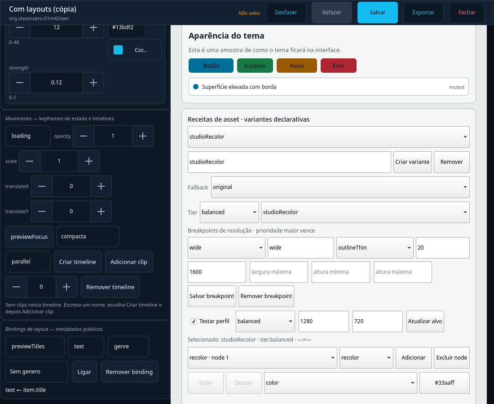
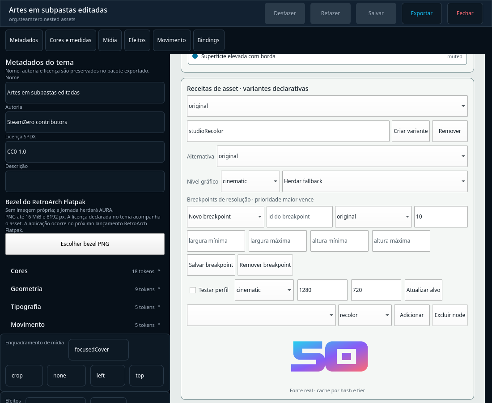
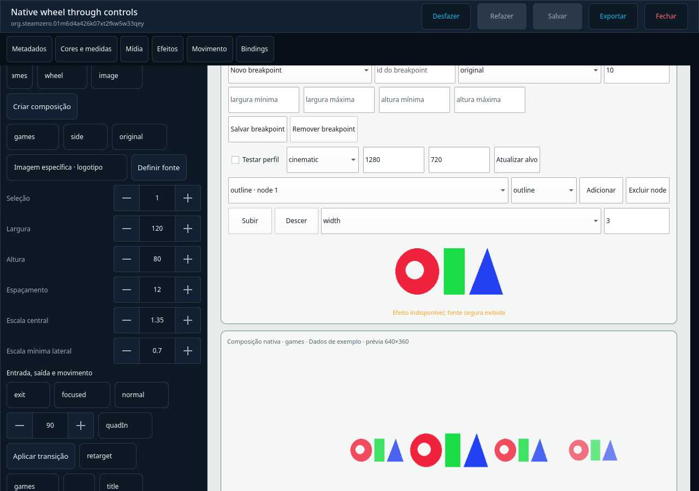
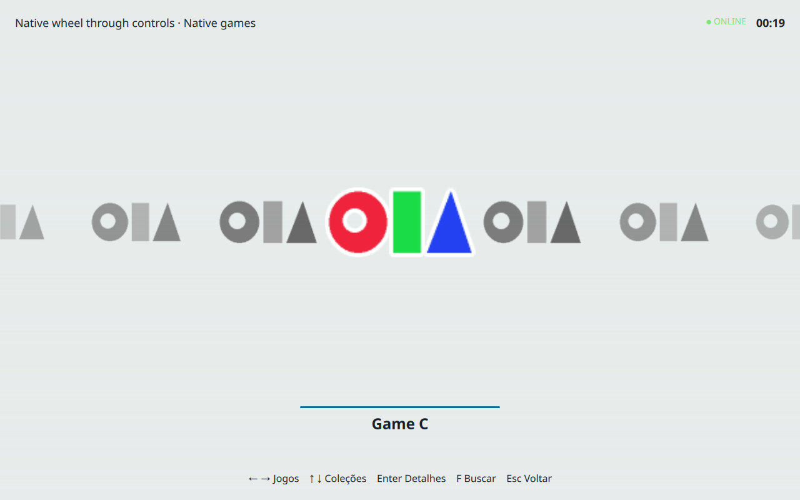
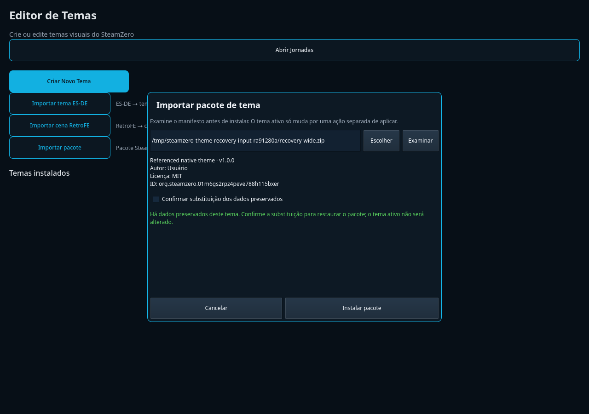
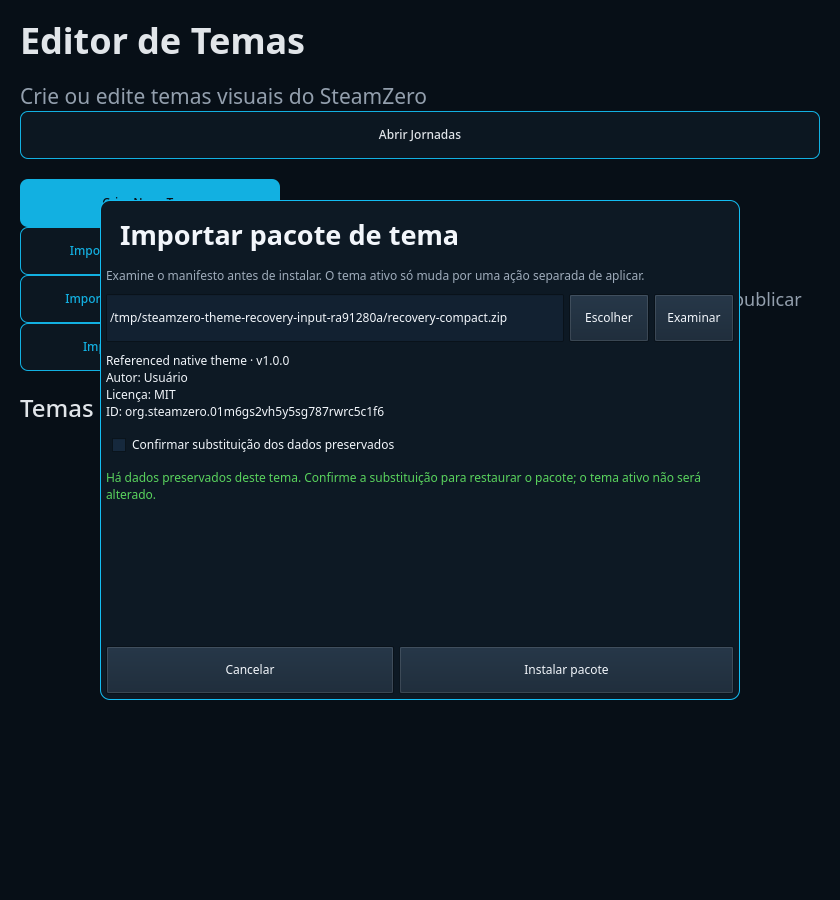
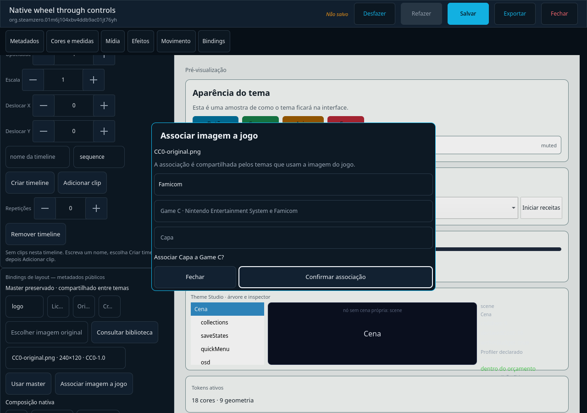
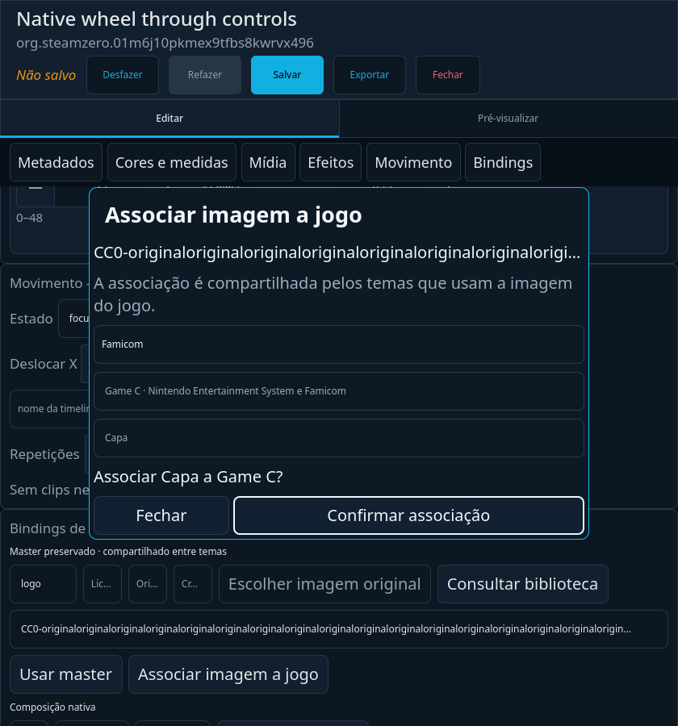
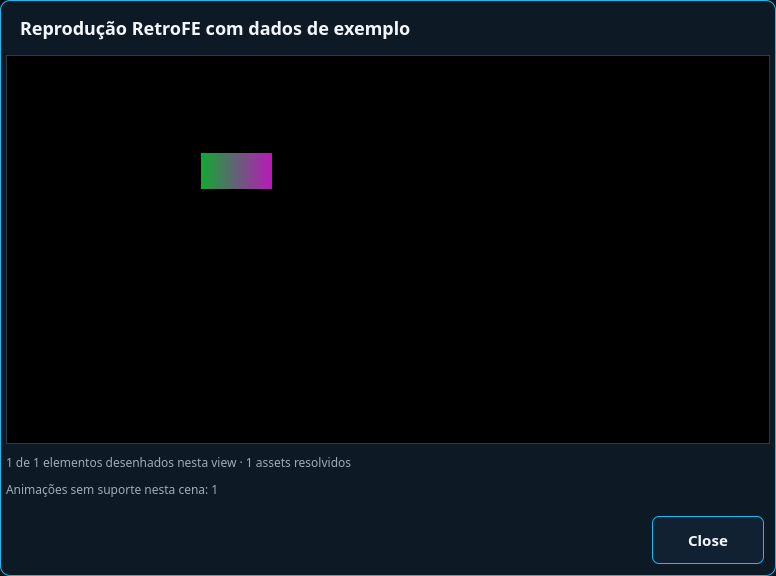
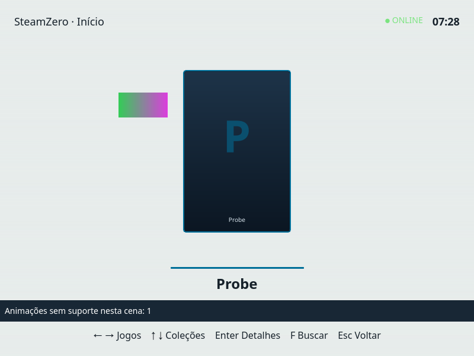

# Preview da composição de Jornada — 2026-10-03

## Escopo e estado

Este registro documenta uma extensão local/offscreen do painel de Jornadas no
checkout `/home/misael/Projects/Steam Zero/Canonical/2026-09-21`, branch
`codex/v1-v3-theme-journey-2026-10-01`, baseado em
`09033bd5919f25317ff4449b8426f0223e21cecd`. O delta funcional foi commitado
localmente em `461499d43322f6b8e3d68a2cddaa5bf98ef8e583`; não foi enviado,
instalado ou validado fisicamente.

### Atualização da branch — bridge e resolver native

Depois do registro inicial deste diretório, a branch acrescentou ações
allowlisted `journey.studio.*` ao `DesktopControlServer`. O harness QML usa o
catálogo de contratos e faz requests autenticados por loopback; cria menus,
aplica filtros e bindings, salva/reabre a jornada e exporta/importa uma cópia.
Isso é prova da bridge no checkout, não da release instalada.

`journey.studio.engine-preview` lê novamente a jornada pela geração esperada,
calcula a consulta a partir do read model público no servidor, resolve a
cobertura da etapa e chama `DesktopDashboard.editor_preview` com o modelo
filtrado em `preview.items`. O `ThemeEditorManager` resolve os bindings nativos
de `sceneLayouts`; `ThemeStudioCanvas` consome a mesma composição. O teste de
round-trip reabre uma jornada filtrada por gênero, usa o tema
`org.steamzero.asset-recipes-demo` e verifica que `previewTitles` contém apenas
`Synthetic Platformer`, sem `Axiom Verge`. Temas ausentes/incompatíveis usam
AURA com diagnóstico. Cada sessão de tema aberta para a consulta é cancelada.

Um segundo round-trip cria um tema filho de `asset-recipes-demo`, altera
`previewTitles.maxItems` para 2 no Theme Studio, salva e reabre o pacote, e então
executa a mesma jornada no Theme Engine. A prévia recebe os três registros
filtrados, materializa apenas os dois primeiros e mantém a edição persistida. A
cobertura avalia `sceneSurfaces` herdado pela cadeia `extends`, então a herança
visual não é tratada como slot ausente.

A mesma route retorna manifesto, declaração, preview e coverage. O read model
aceita somente campos já publicados e projetados pelo servidor; nenhum registro
arbitrário vem do QML. Os probes do dashboard determinam `highContrast` e
`reducedMotion` no preview normal. A rota também valida a geração antes/depois
da consulta. O canvas corre em Qt offscreen; não medimos pixels de release,
frame time, VRAM ou input físico.

## Testes focados

```text
rtk .venv/bin/python tools/run_tests_isolated.py \
  tests/unit/test_theme_editor.py \
  tests/integration/test_experience_journey_bridge_e2e.py \
  tests/integration/test_experience_journey_e2e.py \
  tests/integration/test_desktop_ui_bridge.py \
  tests/integration/test_ui_action_inventory.py \
  tests/unit/test_desktop_contracts.py \
  tests/unit/test_journey_studio.py \
  tests/unit/test_experience_journey.py \
  tests/integration/test_theme_authoring_e2e.py \
  tests/integration/test_theme_scene_runtime_e2e.py -q --tb=short
132 passed em 56,14 s
```

Guard real antes/depois: `files=12818`, `directories=2068`,
`bytes=1372834271`, `max_mtime_ns=1791029212908907544`.

O teste da bridge cria quatro menus, três conexões para um destino compartilhado,
filtros por gênero e ano, salva/reabre e testa a cena native com o resultado
reaberto. A projeção preserva o registro selecionado e omite o path privado. O
harness do componente cobre bridge ausente, resposta tardia, erro visível e
retry. O teste de autoria de tema e o teste separado do renderer de cena foram
repetidos para preservar os fluxos já existentes.

O caso de tema editado verifica separadamente a persistência do manifesto, a
declaração efetiva reaberta e os itens realmente materializados pelo Engine.

O harness de autoria mede o `GET /status` contra `DesktopControlServer`. Três
leituras reais do snapshot completo levaram 4,95 s, 5,52 s e 6,18 s. A espera QML
desse caso foi ajustada de 5 s para 10 s, continuando a exigir a resposta do
servidor; a execução isolada passou em 27,85 s. A repetição do conjunto focal
depois das correções passou com 132 testes.

O primeiro gate integral após publicar as ações da bridge terminou com
**6593 passed, 47 skipped e 1 failed em 3367,80 s**. A única falha foi
`tests/unit/test_capability_matrix.py::test_committed_matrix_matches_the_code`:
o documento gerado listava 137 ações enquanto o código já publicava 151. A
matriz foi regravada pelo comando previsto (`make update-capability-matrix`),
o delta revisado foi de 14 ações `journey.studio.*`, e o teste focal passou
**7/7**; `make capability-matrix` também passou.

A repetição integral final passou: **6594 passed, 47 skipped, 0 failed em
2420,39 s (40:20)**, código de saída 0. O guard ficou idêntico antes/depois:
`files=12818`, `directories=2068`, `bytes=1372834633`,
`max_mtime_ns=1791031942518989555`. O log bruto está em
[`full-tests-2026-10-03.log`](full-tests-2026-10-03.log); a falha intermediária
e seu diagnóstico estão em
[`full-tests-2026-10-03-matrix-drift-failed.log`](full-tests-2026-10-03-matrix-drift-failed.log).
Na primeira janela, o guard identificou escritas externas em `logs/core.jsonl`
e `state.db` pelo daemon da release já ativo; a repetição final partiu do estado
resultante e não detectou nova escrita durante os testes.

## Liberação serial necessária

| Path | Delta mínimo restante | Dono/dependência | Prova de liberação |
|---|---|---|---|
| `desktop_contracts.py`, `desktop_ui.py` | ações allowlisted e bridge autenticada, incluindo `engine-preview`, publicadas nesta árvore | integração serial do workstream atual; sharedPaths devem permanecer no commit de integração | loopback verifica edição, round-trip, geração, fallback de referência ausente e cena native com linhas filtradas; shell Main/instalada ainda não exercitada |
| `desktop_dashboard.py`, `theme_editor.py` | `editor_preview` recebe read model público e usa probes do dashboard; tema editado/reaberto e `sceneSurfaces` herdados alimentam o resolver native | integração local comprovada pelos testes de bridge, sem build/instalação | testar a mesma composição pela janela Main instalada e medir pixel/tempo em hardware/release |
| Launcher e Cinema | consumir grafo, filtros, tema/slot e contexto persistidos | LauncherShell/Main/Home seguem com owner codex-aura-launcher-exit ativo | mesmo documento no Launcher, retorno de contexto, saída/recuperação |
| sessão e adapters | ligar ações semânticas a capacidades reais de launch/pause/resume/save/load/exit | bridge e contratos atuais de adapter | sucesso, falha, timeout, late response, capability ausente e preservação do host |

`desktop_contracts.py`, `desktop_dashboard.py` e `desktop_ui.py` compõem o
commit funcional local `461499d`; `Main.qml`, Launcher e adapters de sessão não
foram alterados. Theme Engine, Studio, Launcher/Cinema e sessão permanecem
parciais.

## Estado do checkout e da release instalada

Ponteiros locais lidos em 2026-10-03, antes do commit funcional abaixo e sem
fetch:

| Superfície | Identidade observada | Situação desta entrega |
|---|---|---|
| Branch | `codex/v1-v3-theme-journey-2026-10-01` | HEAD observado antes do commit: `09033bd5919f25317ff4449b8426f0223e21cecd`; checkpoint funcional local posterior: `461499d43322f6b8e3d68a2cddaa5bf98ef8e583` |
| Ref local `origin/main` | `c9d3196bab819ad9a9b9f602bb5257f40c60a7b7` | ref local não atualizada durante esta continuação; nenhum push foi feito |
| Ref local da branch remota | `9bd5947c1e75a319191948b11be36c5398881fc8` | ref de acompanhamento local não atualizada; nenhum push foi feito |
| Ponteiro instalado | `/opt/steamzero/current` → `/opt/steamzero/releases/2.0.0rc1-5715d7962691` | a branch desta entrega não está instalada; ponteiro apenas lido |

O checkout e `/opt/steamzero/current` são superfícies distintas. Esta revisão não
abriu uma instância do código-fonte nem atribui à release instalada as mudanças
locais. O inventário KWin consultado sem input não encontrou janela do SteamZero;
o desktop estava em outra aplicação. A interação física foi pausada antes de
ativar uma janela ou guardar captura. Isto é um bloqueio ambiental da inspeção,
não um defeito observado no produto.

## Capacidade entregue, prova e gap

| Capacidade | Comportamento pela UI/serviço | Prova local e identidade | Artefato | Prova física | Gap restante |
|---|---|---|---|---|---|
| Documento de Jornada v2 | editor cria menus conectados, filtros e bindings públicos, sort, agrupamento, temas por etapa, histórico e arquivo | QML de autoria dirigido contra bridge autenticada real por loopback; focados passaram | `ExperienceJourneyPanel.qml`, `JourneyStudioService`, schemas v1/v2, teste bridge | não executada fisicamente | branch não instalada; navegação/retorno no Launcher pendentes |
| Preview de consulta | mostra contagem, diagnóstico/recuperação e até 64 linhas públicas filtradas | loopback contra `DesktopControlServer`; QML exercita erro, late response e retry | `check_experience_journey_bridge_e2e.qml` | não executada | shell Main e release instalada não exercitadas |
| Cena XML ES-DE | componente fornece o modelo filtrado ao renderer existente sem substituir a resposta compilada | contrato/harness do componente e teste isolado de `SceneEsdeView`; round-trip não provado nessa bridge | `ThemeScenePreview.qml`, `check_theme_scene_preview.qml` | não executada | precisa de prova loopback do documento persistido/reaberto na cena XML |
| Cena native `sceneLayouts` | bridge envia rows públicos filtrados ao ThemeEditorManager; tema editado/reaberto limita a lista e `ThemeStudioCanvas` usa a resolução resultante | teste loopback round-trip verifica filtros, fallback, herança de superfícies e edição persistida | ação `journey.studio.engine-preview`, `test_experience_journey_bridge_e2e.py` | não executada fisicamente | sem oracle de pixels, tempo ou release instalada |
| Cobertura visual/AURA | ação native retorna cobertura; tema/slot ausente cai em AURA com causa | `ThemeEditorManager` real na bridge; ausência de tema produz `theme-reference-missing` e fallback declarado | `journey.studio.engine-preview`, testes bridge | não executada fisicamente | capabilities de sessão desconhecidas; falta janela Main instalada |
| Theme Engine/Launcher/Cinema | Engine native recebe o documento reaberto; Launcher/Cinema ainda não consomem Jornada | prova local do resolver Engine; nenhuma prova no Launcher/Cinema | checkout desta branch | não executada | handoff serial ao workstream Launcher e integração session/adapters |
| Sessão de jogo | aparência declarada é separada de launch/pause/resume/save/load/exit | contratos de domínio apenas; nenhum adapter acionado por este fluxo | `experience_journey.py` | não executada | capabilities precisam vir do adapter e as transições aguardarem seu resultado |

SHA-256 dos arquivos que sustentam esta prova local:

```text
404f36be3a2cfdf42c3d3e7dd2dc0f841b30d15022e4bf761f34d2843e334e32  src/steamzero/ui/qml/ExperienceJourneyPanel.qml
9fdc6690c6729a72ef3e815997285103ff01008c27fb5993e2ca4ceeca8b435d  src/steamzero/ui/qml/ThemeScenePreview.qml
3a969e0b6b62c928df7df8364e90620770ed769380d937cbc4f395362efcf7bf  src/steamzero/adapters/desktop_contracts.py
03e76864b802480abc5f974ae4f4ac4f65c0196f87554b741757d3e8ace8db39  src/steamzero/adapters/desktop_dashboard.py
eba075e766946e804f93df5b3a0cf1af6ac0abf4d029ed4d32bbf201f26fce69  src/steamzero/adapters/desktop_ui.py
1cf72884b90322f90181f2a37735a6c130ed3f8e133ea9f853b9433fb9347769  src/steamzero/adapters/journey_studio.py
66991eaca917da754c6a37f49b70f978e30e248a58eb19cfad1b6989177bfc14  src/steamzero/domain/experience_journey.py
3157beef5e138d67359ea721bfdca58d99e1f1ddcd74014e5b2f99eeff775fa5  src/steamzero/domain/theme_editor.py
f7067d0e151c04e2835c32bfb46ee9404edffccd9986b0b3bf0956d7a5830266  src/steamzero/schemas/experience-journey-v1.schema.json
625a33daac5decf60ce85b6b576fc923366c4cdfcfceb3185e6a8fffa614909f  src/steamzero/schemas/experience-journey-v2.schema.json
03dc16b6ebc921dac164aa059dac9f4606c90908f88be9515ee87621000576e7  tests/integration/test_experience_journey_bridge_e2e.py
ded5fe990f214bad3e588fd7b264558fe5f0d61e9098a2a0dc1f36ffdef3032c  tests/qml/check_theme_scene_preview.qml
8cb3cb23ec87e32b8ce8b77f0dacfaa87ab8516960d34bd692a05ad7e2bd1be6  tests/integration/test_experience_journey_e2e.py
de9c5644ad95fb54e9bd761a6b21789dd04a6c8ebe318c351d9dcea712b5fdc8  tests/integration/test_theme_authoring_e2e.py
069402c55b50ad62b3153699a64dd8f846a4321bfeda787dd3c7b3dc4366d91a  tests/qml/check_experience_journey.qml
3e63df4269e7e015d037d5b0590bb85f328bdcb82f313685fef4e84fa26ce9ee  tests/qml/check_experience_journey_bridge_e2e.qml
df460db0ff4c99ade8b577ff4a47f88cc64d14855cf2049742066110f2944b16  tests/qml/check_theme_authoring_e2e.qml
9cc1389f73609a7f5c78bab11e22d7939f5265c69ad809819b031b092bee6f78  tests/unit/test_experience_journey.py
bab1885198689f2042729f7dc5f980b8ebae90f23091e2f5fe9f3a2fa265204e  tests/unit/test_journey_studio.py
5ec1d14ac598bdcdad2803e3476513e40e9fd6290228860af16be83845e47c41  tests/unit/test_theme_editor.py
```

Os testes focados de bridge/Engine passaram: **132 passed em 56,14 s**, com
guarda XDG idêntica. Depois, `tests/unit/test_capability_matrix.py` passou
**7/7** após a matriz ser regenerada. O resultado integral final está registrado
acima com seu log bruto. A primeira tentativa integral posterior falhou somente
pela matriz gerada obsoleta; a correção não alterou código de runtime e a rodada
final aprovou todos os testes. O registro histórico de execuções anteriores
continua no [`WORKLOG.md`](../../../WORKLOG.md).

## Matriz de etapa, aparência e capacidade operacional

| Etapa usada | Tema declarado | Origem esperada | Motivo/fallback | Capacidade operacional |
|---|---|---|---|---|
| `menu:<id>` | custom, herdar AURA, ou omitido | tema do menu; AURA se omitido/herdado | referência ausente e cena/slot incompatível precisam diagnóstico separado | não requer operação de sessão |
| `entryFade` | `sessionStages` ou omitido | tema atribuído ou AURA | sem declaração, AURA por padrão | fade não confirma launch |
| `gameplay` | `sessionStages` ou omitido | tema atribuído ou AURA | sem declaração, AURA por padrão | launch depende do adapter |
| `pause` | `sessionStages` ou omitido | tema atribuído ou AURA | sem declaração, AURA por padrão | pause depende do adapter |
| `saves` | `sessionStages` ou omitido | tema atribuído ou AURA | sem declaração, AURA por padrão | listar/salvar/carregar dependem de capabilities distintas |
| `bezel`, `osd` | `sessionStages` ou omitido | tema atribuído ou AURA | bezel ainda não tem slot declarativo no contrato atual | exibir não habilita controle do jogo |
| `exitFade` | `sessionStages` ou omitido | tema atribuído ou AURA | sem declaração, AURA por padrão | fade não confirma término |
| `loading`, `empty`, `error`, `offline` | `sessionStages` ou omitido | tema atribuído ou AURA | falta de componente deve aparecer como incompatibilidade/fallback | estado visual não prova operação |

Nesta árvore, a bridge monta manifestos para cobertura visual e separa esse
resultado das capabilities operacionais. O adapter da sessão ainda não fornece
capabilities nesta rota; nenhum badge visual prova pause, saves, bezel ou exit.

## B_VISUAL da Jornada — roteiro preparado, não executado

Pré-condição para retomar: integrar e identificar uma release governada que
contenha o checkpoint desejado, autorização específica vigente para instalação e mesa
sem atividade simultânea. A release apontada agora é a base anterior; esta branch
não foi instalada. Na inspeção read-only de 2026-10-03, a mesa estava ocupada por
outra aplicação e não havia janela SteamZero identificada; nenhum input foi
enviado e nenhuma captura do desktop foi mantida.

Roteiro depois que a bridge, os consumidores e a candidata estiverem disponíveis:

1. Confirmar release/SHA, rollback, daemon/doctor, resolução, escalas, locale,
   tema ativo, dispositivo de input e estado XDG; identificar a janela instalada.
2. Criar um documento sintético por controles acessíveis: **Plataformas → Jogos**,
   **Gêneros → Jogos**, com pelo menos três menus, submenu compartilhado, IDs
   estáveis e ordenação. Adicionar filtros combinados e um campo público novo via
   catálogo; observar desconhecido, zero resultados e fonte indisponível.
3. Selecionar uma plataforma e um gênero e confirmar que os bindings restringem
   o menu de Jogos. Voltar por ambos os percursos e comparar filtro, seleção,
   rolagem e foco com a origem correta. Testar um ciclo de input válido e um ciclo
   automático sem saída; registrar diagnóstico e recuperação.
4. Atribuir temas diferentes a menu, gameplay e bezel; deixar pausa, saves e
   fades sem atribuição. Antes de aplicar, conferir contagem AURA, origem/versão,
   motivo e acesso a personalizar; remover uma referência e declarar um slot
   incompatível para observar diagnósticos distintos.
5. Editar efeito e movimento no tema, desfazer/refazer, salvar, fechar, reabrir,
   exportar/importar como cópia e executar exatamente esse documento na Preview
   e na Engine. Capturar a cena, conferir seleção, pixels/tempo, asset ausente,
   binding ausente, tier reduzido, `highContrast` e `reducedMotion`.
6. No Launcher/Cinema, abrir o mesmo documento isolado, percorrer os menus,
   confirmar retorno contextual e testar loading/vazio/erro/offline. Não agregar
   biblioteca pessoal, iniciar jogo real ou alegar sessão operacional a partir de
   uma transição visual.
7. Com adapter controlado e conteúdo seguro, testar launch, pause/resume, save e
   load separados, exit, capacidade ausente, falha, retry, timeout e resposta
   tardia. Repetir resposta obsoleta e atual: descarte só a obsoleta e preserve a
   resposta válida; conferir busy, geração, foco e retorno ao contexto.
8. Repetir navegação com teclado e gamepad separadamente. Registrar cada cenário
   como passou/falhou/não executado/inconclusivo, com release, passos, artefato,
   log, input e hash. Não inferir contraste, área de toque, FPS ou resolução.

| Critério físico | Estado em 2026-10-03 | Bloqueio/resultado |
|---|---|---|
| B_VISUAL preparação e identificação da janela | parcialmente observado, sem input | mesa ocupada por outra aplicação; janela SteamZero não identificada |
| Journey UI, três menus e bindings | não executado fisicamente; loopback local passou | branch com Jornada v2/bridge não está instalada |
| Retorno contextual na UI/Launcher | não executado fisicamente | consumidor Launcher e estado de sessão não integrados |
| Cobertura/herança AURA e erro/recuperação | não executado fisicamente; fallback de tema ausente passou por loopback | exige candidata instalada e input observado |
| Mesmo tema salvo/reaberto em Preview/Engine | resolver native passou por loopback no checkout; pixels físicos não executados | branch e bridge não estão na release ativa |
| Launcher/Cinema | não executado | consumidor e seleção de Jornada não integrados |
| sessão, capabilities, teclado/gamepad | não executado | adapters reais não ligados a este fluxo; gamepad não observado |
| capturas e hashes físicos | não produzido | nenhuma captura foi feita/guardada durante esta inspeção |

Nenhum defeito físico de Jornada foi confirmado nesta inspeção. As ausências
acima são provas não executadas ou integração ainda inexistente, não aprovação.

### Matriz física RC-01 solicitada pelo roteiro B_VISUAL

| Critério | Estado | Razão objetiva e próxima observação segura |
|---|---|---|
| A. Loading, erro e retry | não executado | não abri a aplicação; na candidata, observar estados reais e só provocar erro por mecanismo já disponível |
| B. Prontidão v2 | não executado | não há leitura visual da aplicação nesta rodada; comparar estado conhecido/desconhecido/bloqueado no dado publicado |
| C. Unidades de armazenamento | não executado | quatro vistas e valores subjacentes precisam ser observados na janela instalada |
| D. Primeira dobra da Home | não executado | requer janela da aplicação e escalas oferecidas; não foi redimensionada nenhuma janela |
| E. Foco, escala e rolagem | não executado | Tab/setas/rolagem e gamepad não foram enviados; cinco superfícies ainda precisam ser medidas separadamente |
| F. Importação ES-DE/RetroFE no shell | não executado | nenhuma fixture foi importada nem diálogo aberto |
| G. Seletor nativo | não executado | nenhum `FolderDialog`/`FileDialog` foi aberto |
| H. Resposta tardia e geração | não executado fisicamente | exige operação real com correlação observável; harness QML não substitui a ordem observada na sessão |
| Theme Studio, catálogo, temas portados e AURA Cinema | não executado | janela SteamZero não identificada; nenhum consumidor foi ativado |

Classificação de achados físicos: nenhum achado de produto confirmado. O único
resultado é ambiental: havia outra aplicação em primeiro plano e a listagem de
janelas não identificou SteamZero; por segurança, não houve input.

## Atualização — perfis de assetRecipes

Em 2026-10-03, o Theme Studio ganhou schema `assetRecipes` v2 mantendo leitura
de v1. A autoria permite escolher fallback, uma receita por tier, e breakpoints
de largura/altura com prioridade. O resolver usa breakpoint correspondente de
maior prioridade, depois perfil do tier e por fim fallback. Edição passa pelo
bridge allowlisted e validação transacional; salvar/reabrir conserva o livro.

O preview QML enviou `balanced`, 1280×720 à bridge HTTP real de teste e recebeu
`studioRecolor` com origem `tier:balanced`. A UI também salvou um breakpoint
`wide` (largura mínima 1600). Naquele checkpoint, a jornada QML havia exercitado
apenas o alvo por tier; a revalidação abaixo acrescenta o segundo alvo por
breakpoint.

Verificação após o ajuste final de tipos: os módulos focados de receita,
ThemeEditor, contratos e bridge mais a autoria QML passaram com **133 testes**.
`tests/integration/test_qml_handheld_offscreen.py` passou com **58 testes**.
Ruff, formato, mypy, fronteiras, independência e `git diff --check` passaram;
os testes usaram `XDG_STATE_HOME=/tmp/steamzero-codex-isolated-state`, ausente
antes e depois.

O resultado é do checkout/offscreen: não instala nem identifica o pacote da
Engine na release, não mede pixels ou desempenho na sessão e não integra
Launcher/Cinema ou capabilities de sessão. Esses itens e B_VISUAL seguem
pendentes.

## Integral da fatia de perfis — 2026-10-04

`rtk env XDG_STATE_HOME=/tmp/steamzero-codex-isolated-state .venv/bin/python
tools/run_tests_isolated.py tests -q` terminou em **2595,78 s (43:15)**:
**6614 passed, 47 skipped, 1 failed**. O runner confirmou que o estado
temporário não existia antes nem depois. Log completo:
[`full-tests-2026-10-04-profile-v2.log`](full-tests-2026-10-04-profile-v2.log).

A única falha foi
`tests/unit/test_project_status.py::test_committed_catalog_and_generated_views_are_consistent`.
O teste encontrou três `scopeDigest` e a view `COVERAGE.md` desatualizados
porque o próprio log integral recém-criado está dentro do diretório de
evidência coberto pelos escopos Roadmap, Theme Engine e Theme Studio. Nenhum
teste de produto falhou. A tentativa anterior foi interrompida em 25% e está
preservada em
[`full-tests-2026-10-04-profile-v2-interrupted-25pct.log`](full-tests-2026-10-04-profile-v2-interrupted-25pct.log).
Os digests foram renovados depois deste registro e a governança foi reexecutada.

### Revalidação da governança

Após o registro, os digests Roadmap, Theme Engine e Theme Studio foram
recalculados pelo comando `tools/project_status.py digest --item`, as três
views foram regeneradas e `tools/project_status.py check` retornou
`STATUS-CHECK: OK`. `tests/unit/test_project_status.py` passou com **13 testes**
e guard XDG ausente antes/depois. `git diff --check` também passou. A falha da
integral permanece preservada como ocorrência de ordenação documental: o
teste de catálogo foi executado antes da renovação dos hashes do log novo.

Commits funcionais locais deste recorte: `3aeb3b4f0f42ade22aadb1a531576427ed958151`
(schema, editor e resolver) e `c839f64c3257ccb4d318ecf4357b37a052cf8f28`
(bridge compartilhada). Ainda falta o commit documental e o push autorizado;
estes commits não foram verificados por CI remoto.

## Revalidação QML de breakpoint — 2026-10-04

`tests/integration/test_theme_authoring_e2e.py` agora envia dois previews pelos
controles QML e pela bridge HTTP real do `DesktopControlServer`: `balanced` em
1280×720 resolve `studioRecolor`; `wide` em 1920×720 resolve `outlineThin`.
O segundo callback atualiza o `AssetRecipePreview`, cujo componente confirma
fonte pronta, contorno ativo, largura 6 e ausência de fallback. O teste passou
isolado com **1 passed em 18,91 s**, usando XDG temporário ausente antes/depois.

A investigação corrigiu a observação anterior sobre o segundo XHR: nesta jornada
ele retorna HTTP 200 e o callback QML aplica a seleção. A falha intermediária era
da asserção do teste, que tentava consultar um `id` QML como propriedade do
painel; a prova agora inspeciona as propriedades públicas do renderer.

Capturas da jornada no checkout/offscreen:




O harness continua em 1100×900; 1920×720 é o alvo enviado ao resolver, não a
resolução física da janela. As capturas não identificam nem validam a release
instalada, não medem pixels de uma sessão SteamZero e não substituem B_VISUAL.

## Gate visual na imagem do CI — 2026-10-04

Após os ajustes de viewport e controles, a imagem `ghcr.io/misael-art/steamzero-qml-visual@sha256:8b832ec124ae72aa59a4de3b5c00ccf3f03b41a7e688f45c10daf767290041cd` executou `tests/integration/test_experience_journey_e2e.py` e `tests/integration/test_theme_authoring_e2e.py`: **2 passed em 16,81 s**. A correção usa a largura do `contentItem` da jornada, mantém o diálogo de remoção dentro do painel e deixa o preview ao vivo do Studio rolável; os controles de edição se ajustam ao viewport compacto. O teste percorre os dois alvos de receita e a interação da Jornada.

O guard de `XDG_STATE_HOME=/tmp/steamzero-codex-isolated-state` reportou `exists=False` antes e depois. A imagem confirma QML/bridge do checkout em Qt 6.11.2. Não executa a aplicação instalada, não captura uma janela SteamZero física e não fecha B_VISUAL nem o desempenho da release.


## Continuidade do Theme Studio — assets em subpastas,30/10/2026

Direção expressa do proprietário: foco no Studio. Assunção serial do workstream
WS-2026-10-STUDIO-DRAFT-HISTORY na branch de continuidade, base
021ce1e32863b077b6fd43e7d8de8b955cd6a3a0. Único checkout/executor. Antes dos
arquivos, cessão de theme_editor.py/test_theme_editor.py registrada dos claims
de WS-2026-10-JOURNEY-LAUNCHER-SESSION. O lote Launcher permanece bloqueado,
com seus três commits, guardas e comparação pendentes; esta frente não os fecha.
Fonte/testes/commit/push/PR268 autorizados; sem auth/instalação/release/merge/boot.

Baseline controlado:4 failed,1 passed,52 deselected/0,80s nos novos casos.
Salvar um tema com assets/logos/platform/logo.svg e
assets/backgrounds/platform/logo.svg apagava ambos, apesar de nomes/refs
permanecerem no manifesto; a variante com upload também perdia arquivos.
Um arquivo aninhado sem leitura era ignorado em vez de impedir a sobrescrita.
Recusar overwrite sem confirmação já preservava o tema (o caso aprovado).

A causa foi reproduzida também no Qt/HTTP real: a arte decodifica antes da
edição; após nome/undo/redo/Salvar/Fechar/reabrir, o preview fica indisponível.
O harness relata “Salvar removeu a arte aninhada; preview indisponível ao reabrir”,
com7 casos QML aprovados e1 reprovado. A primeira corrida de27,20s teve a mensagem
oculta pela truncagem do assert; agora o log bruto Qt fica no destino de captura
local e FAIL/Loc também entram no resumo. Uma coleta posterior parou antes do
save por usar como booleano o retorno void de QtTestImage.save; o PNG existia,
mas essa passagem não prova o defeito do produto. Log preservado em
baseline-capture-harness-failure.log. Corrigido apenas o uso desse retorno;
goldens, timeouts, critérios e dados dos testes anteriores permanecem iguais.

Correção mínima no salvamento: reutiliza core.fs.iter_files para enumerar
arquivos regulares recursivamente e preserva o caminho relativo à pasta assets.
Os uploads continuam vencendo somente o mesmo caminho completo. Não há
achatamento por basename, criação de variantes derivadas ou outro instalador.
Os bytes são reunidos antes da remoção existente do destino; erro de leitura
de arquivo preserva tema, rascunho, histórico e upload para nova tentativa.
Esta prova de erro é de leitura antes da sobrescrita; não certifica atomicidade
de diretório em crash ou erro de escrita durante a publicação existente.

Resultado focal final: **100 passed/7,46s** (editor, herança, efeitos, pacote e
jornada de autoria) e **3 passed/30,97s** (autoria Qt/HTTP real e guardas de saída).
Cinco casos Python novos e um percurso Qt adicional aos cinco anteriores.
Metadados por gestos, undo/redo, save/reopen e imagem decodificada no painel real;
export/import posterior pela API pública do dashboard preserva cada byte,
manifesto e URI. No domínio, também há save repetido byte a byte idêntico,
nomes iguais em subpastas diferentes, arquivo não referenciado, upload e
leitura PermissionError controlada seguida de retentativa. A recusa de overwrite
preserva bytes/histórico. O runner preservou o estado pessoal monitorado.



[Baseline antes do save](studio-nested-assets/01-baseline.png). Dois PNGs1100×900,
230.857bytes, revisados individualmente; SVG/PNG de fixtures CC0-1.0, sem acervo
ou perfil pessoal. Qt6.11.2/offscreen/software, source e bridge em XDG temporário.
Não é release instalada, hardware, fidelidade de outro tema ou medição GPU/FPS.

Ruff check/format focados aprovados. Oito hashes congelados (quatro desta frente
mais quatro do Launcher pendente), capturas seladas no diretório local
build/agent-runs/studio-nested-assets. Preparar gates estáticos e integral única
quando MemAvailable>=3GiB e disco>=8GiB. Comparar integral à base aprovada
fba166f8/85,66169677501884%, mantendo os guardas de qualidade do Launcher;
coreCI comparável>=85,50677260258396%. Sem reduzir baseline/limiar ou repetir a
mesma fonte por sorte. Push apenas após checkpoint de gates, status e commits
coerentes. Eixos/gaps existentes preservados; aceite instalado do Studio continua
pendente. Próxima prova independente: falhas de escrita/publicação do tema e
recuperação sem perda; registrar baseline antes de ampliar o salvamento.


### Checkpoint local de retomada

| Item | Commit local | Prova |
|---|---|---|
| Preservação de assets em subpastas | `40988da9fdf2cda16ef8256057392091dbcec23f` | 100 testes de domínio/7,46s +3 testes Qt/30,97s;2 PNGs revisados |

Ruff check/format736, mypy307, independência, fronteiras e status aprovados
após os oito hashes congelados. Revisão de diff, bytes dos assets, tamanho e
procedência das imagens concluída. Nenhum eixo/gap existente promovido.

**Integral ainda pendente.** O monitor fez7 leituras em300s:
2475856–2837792KiB disponíveis, abaixo de3.145.728KiB exigidos.
Terminou75 antes de iniciar o runner; nenhum full-result.json foi produzido.
Não encerrar aplicações alheias nem alterar swap/guarda. A candidata ainda não
foi enviada: remoto/PR268 permanecem emfba166f8, CI antigo é apenas baseline.
Este commit local não constitui backup GitHub nem fechamento integral do lote.

Checkpoint local Studio 40988da9fdf2cda16ef8256057392091dbcec23f:103 focados aprovados (100 domínio/7,46s+3 Qt/30,97s),2PNG230.857bytes revisados,8hashes commitados incluindo4 Launcher pendentes. Integral não iniciada:7 leituras/300s,2475856–2837792KiB<3145728KiB, helper75. Retomar após MemAvailable>=3GiB/disco>=8GiB: uma integral serial/nice10 no runner isolado, cobertura>=85,66169677501884% e guardas antigos/novos presentes, então checkpoint documental e um push nominal da continuidade/PR268/SHA remoto, CI terminal/core>=85,50677260258396%. Sem instalação/auth/release/merge/deploy/boot ou novo aceite físico. Próximo baseline só depois desse gate: falhas de escrita/publicação preservando tema anterior.

Comando do checkout atual quando o preflight estiver satisfeito (helper local
reutilizado, guarda3GiB, observação e propagação de sinais):

```bash
rtk proxy bash -lc '
. .steamzero-dev/env.sh
env -u PYTHONPATH .venv/bin/python build/agent-runs/studio-nested-assets/observe_command.py full
'
```

O comando portátil é tools/run_tests_isolated.py tests -q --cov=steamzero,
serial/nice10, após conferir>=3GiB MemAvailable e>=8GiB livres. O JSON integral
fica em build/agent-runs/studio-nested-assets/coverage-full.json e é comparado
sem arredondamento a r3-empty-return/coverage-full.json. Os8 hashes e guardas
bitrot/resource/linux/screencast/modelo, além do salvamento do Studio, precisam
ser conferidos. Históricos reprovados do Launcher continuam preservados.
Sem ações de host; instalação/versão em execução/rollback não revalidados.

### 2026-10-30 — Aeon Nox e ES-DE como aceite integral do Studio/motor

**Conclusão: a lista anterior de pendências do Studio é necessária, mas não
suficiente para prometer reprodução integral dessas referências.** A meta inclui
aparência, comportamento, efeitos, transições e todas as etapas executadas pelo
motor SteamZero. Importar XML, apresentar elementos genéricos ou abrir o frontend
original não satisfaz esse aceite. Não há prova atual de impossibilidade
arquitetural; também não há evidência que autorize garantir paridade futura antes
da implementação e comparação real.

Auditoria somente leitura, fonte SteamZero em
`6d2216ad375b85dad3d3958c14a21ec33a1fb380`. Metadados agregados, hashes dos
compiladores/renderizador e contraexemplos próprios estão na
[matriz de evidência](studio-frontend-parity.json). Nenhum XML, asset, gamelist,
configuração ou conteúdo do acervo das referências foi publicado. Nenhum frontend
nativo foi executado. A pasta de temas do perfil ES-DE estava vazia; a referência
efetivamente auditada foram os temas Linear, Modern e Slate embutidos no AppImage
local pinado pelo hash da matriz, lido com unsquashfs, sem executá-lo.

| Referência/caminho | Verificação feita | Limite observado |
|---|---|---|
| Aeon Nox | 385 XMLs lidos e compilados individualmente, incluindo seis variantes raiz, splash e layouts de coleções | A descoberta normal da pasta inteira recusa o limite de 64 layouts; compilar arquivos isolados não prova importação do pacote |
| Aeon Nox, layout principal | 620 animações de entrada; 332 registros de animação na IR | Eventos idle/menuIdle e algoritmos de interpolação se perdem; contagens não são porcentagem de fidelidade |
| Aeon Nox, mídia | 53 imagens estáticas do layout principal usam caminhos compartilhados externos à raiz aceita | O confinamento recusa esses caminhos; falta resolução governada de assets compartilhados, sem liberar traversal |
| ES-DE | 849 XMLs inspecionados; 56 combinações variante×proporção dos três temas compiladas | Apenas snes/pt_BR e primeiro esquema/fonte; não cobre todos os sistemas, idiomas, fontes e cores |
| ES-DE, propriedades | Includes resolvidos nas 56 combinações | itemScale/controllerSize/folderLinkSize, pillarboxThreshold e scrollFadeIn têm perdas por interpretação incompatível de valores; Modern/Slate também demandam cues de som |
| Compilador, fixture própria | coverage=1.0/degraded=0 com texto e animação | fontColor e easing desaparecem; onIdle também pode desaparecer sem diagnóstico. Essa métrica não certifica capacidade |
| Renderizador real, fixture própria | SceneEsdeView em Qt/offscreen/software | Texto vermelho resulta #e8eef6; alpha=0 chega ao Loader como opacity=1; menu/sound são classificados como não desenhados nessa superfície |
| Feedback de mídia, fixture própria | Image.Error para arquivo deliberadamente ausente | drawnCount continua 1 e o fallback fica invisível; contador declarado não prova pixels válidos |

A prova Qt executou dois cenários diagnósticos no renderizador real dentro de um
teste Python: **1 passed/0,45s**. O teste aprova a observação dos defeitos, não a
paridade. Estado pessoal monitorado antes/depois idêntico. Não mediu FPS, GPU,
memória, áudio físico ou criação por uma pessoa. Primitivas nativas de movimento,
efeitos, receitas e contratos tipados já existem; os resultados apontam perdas
nos caminhos de tradução, consumo e autoria, não ausência de toda a engine.

#### Aceite ampliado obrigatório

1. **Demanda e resposta verificáveis.** O Studio transforma a composição e as
   ações solicitadas em documento/IR validado pelos contratos e registries
   existentes. O motor devolve capacidade por recurso, evento, binding, asset e
   etapa: suportado/executado, parcial, indisponível ou desconhecido, com causa
   e localização. Separar reconhecido, importado, renderizado, navegável,
   operacional e medido. Perda silenciosa ou capacidade desconhecida reprova
   o modo de reprodução integral. Fallback mantém navegação, mas declara perda.
   Não há aqui promessa de um intérprete irrestrito de linguagem natural.
2. **Assets e composição completos.** Resolver fontes e mídia compartilhada
   com raízes autorizadas/URIs lógicas, licença e diagnóstico; preservar
   geometria, cor, tipografia, alpha, camadas, recortes, máscaras, vídeos,
   bindings e receitas. Variantes derivadas continuam renderizadas a partir
   do asset-fonte. Importação grande deve preservar layouts e escolhas sem
   truncar ou aumentar limites cegamente.
3. **Movimento e interação equivalentes.** Eventos idle, entrada/saída/jump de
   menu e entrada/saída de jogo, sequências, pausas, easing, interrupção e
   retomada precisam atravessar IR e runtime. Mapear os tempos reais, inclusive
   sequências longas, aos orçamentos governados; menus/listas/carrosséis/grids,
   vídeo e cues de áudio não podem virar apenas representações genéricas.
4. **Todas as etapas funcionais.** Inventariar também o que vive fora do XML:
   inicialização/splash, plataformas, jogos, categorias, franquias, Options,
   busca, filtros, favoritos, ajustes, iniciar e retornar à seleção anterior.
   Cada ação usa o serviço canônico do SteamZero e disponibilidade real;
   nenhum tema executa scripts/helpers arbitrários do frontend de referência.
5. **Autoria visual genérica.** Cada primitiva e ação necessária fica acessível
   no Studio para qualquer pacote compatível, com seleção, árvore, inspector,
   timeline, estados, bindings e componentes reutilizáveis. Um autor deve
   construir/ajustar essas cenas sem editar XML, QML, código ou usar terminal,
   salvar/exportar/reabrir preservando tudo, com undo/redo e erros recuperáveis.
   O gate atual de canvas/graph por ID de demonstração não satisfaz isso.
6. **Mesmo documento até o Launcher.** Preview, Theme Engine e Launcher
   consomem o mesmo pacote persistido, preservando foco, seleção, filtro,
   posição e contexto ao lançar/retornar e após falhas. Retorno seguro e tema
   ausente, asset inválido, indisponibilidade e recuperação são parte do aceite.
7. **Comparação e fluidez medidas.** Fixar hash/versão de cada referência e
   candidata, assets licenciados, cenário, catálogo, resolução e hardware.
   Comparar capturas e quadros-chave, sequência de input, tempos, áudio e
   comportamento nos dois runtimes. Cobrir as variantes e estados acordados,
   ampliando a amostra ES-DE além das 56 configurações iniciais. Medir frame
   time, travamentos, memória e carregamento frio segundo a direção vigente;
   observar uma jornada real de autoria completa para julgar clareza e esforço.
   Nenhuma medição offscreen substitui o aceite da release no hardware.

Concluir esses aceites com evidência é o que permitirá afirmar que o objetivo
foi cumprido. Apenas fechar tarefas genéricas de canvas, inspector, timeline e
salvamento não permite essa afirmação. Theme Studio, Theme Engine, Launcher e
cada tema conservam aceites independentes. Os itens de frontend marcados
complete referem-se ao slice/importador já delimitado, não à reprodução integral.
As lacunas novas foram registradas nos itens existentes, sem promover seus
cinco eixos. Os aceites e capacidades do item Theme Engine permaneceram sob
claim da frente de Jornada; este diagnóstico fica referenciado pelos itens
Studio/frontends. A ampliação desta pasta de evidência exige apenas renovação
mecânica de scopeDigest nos itens Engine/Aura/plano que a incluem, registrada
como revalidação de escopo compartilhado, sem novo carimbo de capacidade.

#### Checkpoint de execução e continuidade

A RAM liberou a tentativa integral pendente do lote anterior. Ela iniciou com
4.539.292 KiB disponíveis (guarda de 3.145.728 KiB), mas terminou **143** após
2.464,19s: o observador registrou SIGTERM15 vindo do processo pai rtk. A última
porcentagem impressa foi 41%; não houve full-result.json nem cobertura integral
válida. Isso substitui o bloqueio anterior por RAM como situação atual; a
causa de o pai ter emitido o sinal ainda precisa de diagnóstico. Não houve
retentativa cega, redução de limiar ou promoção do resultado parcial.

A auditoria e a prova focada estão concluídas; o fechamento funcional anterior
continua pendente da integral. Os oito hashes de fonte/testes ficaram intactos.
Antes de retomar: diagnosticar o ciclo de vida/timeout do wrapper rtk, conferir
ausência de filhos temporários, RAM/disco e então executar uma integral
observada com os mesmos critérios de cobertura/guardas. Push do conjunto e
CI/PR268 continuam condicionados ao checkpoint; remoto fba166f8 é apenas a
base anterior. Nada instalado/publicado, sem autenticação nova, merge, boot ou
deploy. O link local de release aponta para 2.0.0rc1-59ecc2d8f0f6; execução e
rollback não foram revalidados. Sem ação física requerida para esta auditoria;
a certificação final depende de teste autorizado da release no hardware.


### 2026-10-30 — cancelamento do runner antes da wheel de fonte única

Continuidade serial em `216ac710`, árvore inicialmente limpa, remoto `fba166f8`,
PR #268 aberto. A suíte antiga não recebe aprovação retrospectiva: o observador
encerrou 143 às 13:27:34, mas `full.log` foi alterado até 13:31:14 e registra
7112 passed/48 skipped/2682,07 s; falta recibo do runner e snapshot final.
Esses artefatos antigos foram preservados, sem regravar seus logs/cobertura.

O [código RTK v0.43.0](https://github.com/rtk-ai/rtk/blob/v0.43.0/src/main.rs#L2242)
repassa SIGTERM ao filho quando recebe SIGINT/SIGTERM. O sender registrado no
log antigo confirma o salto RTK→observador, mas não identifica quem sinalizou
o RTK. Não há prova de timeout ou OOM; essa causa externa permanece desconhecida.

Regressão com runner e pytest reais: baseline **2 failed/11,60 s**; SIGTERM
matava o runner e deixava pytest vivo, enquanto SIGINT retornava antes de
aguardar o filho. O runner agora inicia pytest em grupo próprio e, ao
interromper, encerra/aguarda o filho antes de verificar o state home e remover
a árvore temporária. SIGTERM retorna 143; SIGINT retorna 130. Uma mutação
controlada continua reprovando com 86, inclusive no cancelamento. Só o grupo
criado pela invocação é sinalizado; nenhuma guarda/cobertura foi reduzida.

**54 testes focados aprovados/4,21 s**, incluindo quatro casos reais de
sinal×mutação e os testes existentes do bootstrap. Os stubs dos testes antigos
foram movidos para a nova função que supervisiona o filho, mantendo todas as
assertivas de estado/atribuição/erros. Logs em
`build/agent-runs/studio-runner-cancellation/`. Integral e gates estáticos do
checkpoint ainda pendentes. Sem prova instalada/hardware, instalação,
autenticação, release, merge, deploy, boot ou migração de mídia pessoal.


#### Diagnóstico da primeira integral desta tarefa e ambiente corrigido

A execução serial desta tarefa encontrou E/F nos testes Qt. Foi interrompida
deliberadamente pelo supervisor próprio para diagnóstico (saída143/1525,33 s,
fontes e testes congelados, snapshot final do perfil inalterado). Este resultado
não é aprovação integral e não sobrescreve a tentativa histórica. O SIGINT
inicial direto ao pytest não o encerrou: os testes Cast deixavam handlers
instalados no processo. A regressão própria executou os24 casos da classe: eles
passaram, mas a comparação dos handlers falhou. A fixture agora os restaura
por teste, e o caso de sinal instala seu próprio handler sem depender da ordem.

**104 focados/8,00 s aprovados**: isolamento, bootstrap e Cast. O cancelamento do
runner preserva as guardas e aguarda/encerra pytest; o fallback de10 s alcançou
o filho que havia herdado o handler Cast. A causa do sinal externo histórico
ao RTK permanece não identificada; o vazamento explica a sobrevivência de pytest
nesse mecanismo, não quem sinalizou o RTK.

Duas reproduções focadas sem DISPLAY falharam: RHI não cria contexto OpenGL;
mesmo o probe `qml6 --version` aborta sem display. **As mesmas20 fixtures de
assetRecipes e tema default passaram/3,59 s** com `xvfb-run -a`, tela privada
1920×1080×24 e TCP desativado, usando o Xvfb já instalado. Nenhum skip, golden,
limiar, timeout ou dependência foi alterado. Essa prova é Qt/offscreen/RHI, não
compositor do operador, input físico, áudio físico ou desempenho de GPU.

Logs preservados em `build/agent-runs/studio-runner-cancellation/`: `full.log`,
`full-result.json`, `diagnostic-interrupt.json`, `diagnostic-stop.json`,
`qt-diagnostic.log`, `qt-software-diagnostic.log`, `qt-private-display.log`,
`signal-leak-baseline.log` e `focused-signal-isolation.log`. Nova integral só
depois dos checks estáticos e da prova focal dos harnesses afetados, em display
virtual privado, mesmos baselines de cobertura/guardas e uma operação pesada.


**Prova focal do ambiente antes da retomada:** 65 passed/569,12 s nos harnesses
handheld, autoria real e primeiro caso da matriz de controles (que executa os
cenários declarados), com Xvfb privado e state home do perfil inalterado. Log
`qt-interface-focused.log`. Os gates estáticos integrais também passaram:
Ruff check/format (736 arquivos), mypy (307 arquivos), independência, fronteiras e status. Próxima
execução: integral serial `full-private-display`, fail-fast em erro (sem skips
novos; aprovação só após todos os testes), mesmas fontes/guardas/cobertura,
preflight de 3 GiB/8 GiB, nice10. Logs separados da tentativa interrompida.
Baseline remoto consultado: oito checks aprovados no run 41027298894/PR #268
para a cabeça já publicada; isso não valida as mudanças locais desta tarefa.


#### Checkpoint técnico aprovado — e7bb579c

Commit funcional `e7bb579cda1e549a5f287b06bb3b9731dea72f25`. A integral final em display privado passou:
**7117 passed,48 skipped,19 warnings/2326,94 s**, runner e supervisor 0;
2339,29 s monotônicos, sem sinais e sem alteração dos arquivos testados. O state
home do perfil ficou idêntico. A cobertura com branches ficou
**85,70961552128492% ≥85,66169677501884%**, delta+0,047918746266077505 pp.
Todos os arcos/linhas críticos antigos e novos, os oito hashes anteriores e
a atribuição inicial de LauncherBridge.model foram conferidos.

[Recibo verificável do checkpoint](studio-runner-cancellation.json) contém
contagens, hashes, contexto, guardas, comparação e limites. Os logs brutos e a
comparação por módulo permanecem no destino oficial local, sem regravar logs
antigos. Ruff check/format (736 arquivos), mypy (307 arquivos), independência, fronteiras e status
passaram; a documentação final recebe somente nova validação de status/diff.
A correção não reduz cobertura, limiares, timeouts de testes ou assertivas antigas.

O gate funcional anteriormente pendente fica resolvido neste checkout. Isso não
encerra o Studio, a engine, o Launcher ou a compatibilidade. A origem do sinal
externo histórico ao RTK continua desconhecida. Próximo slice obrigatório:
wheel de fonte única da seção 22.5; ainda não implementada. Sem instalação,
autenticação nova, release, merge, deploy, boot ou prova física. Push/novo CI
seguem o fechamento documental governado do PR #268.


#### Incremento nativo de wheel — 31/10/2026, validação na fonte

A autoria genérica escolhe um master canônico compartilhado, cria uma composição,
edita receitas e transições, salva e reabre pelo mesmo documento. O Launcher
consome a mesma revisão lógica e o mesmo SceneRepeater/SceneRecipeImage. O percurso
Qt real usa cliques/teclas, bridge e backend, nove registros, mudança rápida de
seleção, retenção/retorno de instâncias, grayscale lateral e centro colorido com
contorno no RHI. Os casos de persistência cobrem dois consumidores sem cópias,
ZIP portátil em perfil vazio, falha de escrita e recuperação do master original.

[Recibo e limites](studio-native-wheel.json) distingue provas e lacunas.
[Wheel no RHI](native-wheel-2026-10-31/01-wheel-rhi.png),
[tema salvo no Launcher RHI](native-wheel-2026-10-31/02-launcher-rhi.png) e
[Studio compacto/software, com efeitos indisponíveis explícitos](native-wheel-2026-10-31/03-studio-compact-software.png)
são capturas de fixtures isoladas; não são a release instalada.
A captura PCM virtual confirma o sinal final de 880 Hz, com potência mais de
20 vezes superior à de 440 Hz da seleção anterior. A prova adicional sem saída
de áudio mantém os quadros e exige estado parcial e diagnóstico. Não certifica
áudio físico nem desempenho/fluidez no hardware.

Baselines e contraprovas estão preservados nos diretórios oficiais locais
`build/agent-runs/studio-runner-cancellation/` (início) e
`build/agent-runs/studio-native-wheel/` (fechamento). A leitura inicial de espaço
consultava tmpfs (máximo 7,3 GiB); foi corrigida para distinguir a área temporária
do disco do checkout. Dois preflights não iniciaram AV por espaço/RAM, sem afrouxar
o mínimo do gate. A fixture privada de áudio precisou publicar metadata/portas,
usou identidades seriais para não confundir portas recriadas e explicitou buffer
curto da captura. O buffer antigo ainda continha o sinal anterior; isso não foi
atribuído ao reprodutor como causa comprovada.

O CI anterior 41133040350, cabeça 59a91da7, teve Python/smokes aprovados e falha
visual na abertura da galeria. Cobertura remota 85,54615876625684% contra
85,50677260258396%. O teste local agora aguarda polish e exige recebimento real
do toque; não se afirma causa histórica definitiva nem aprovação remota nova.

O checkpoint final de fonte está aprovado conforme o fechamento r6 abaixo.
Os eixos, gaps e aceites físicos permanecem abertos. Contorno uniforme/inner/SDF,
associações contextuais completas, autoria/composição integral e paridade externa
continuam trabalho obrigatório. O atalho pessoal abre a produção já instalada,
2.0.0rc1/59ecc2d8f0f6; este incremento não foi instalado. Sem autenticação nova,
release, merge, deploy, alteração de boot ou interação no desktop ocupado.


Tentativas integrais do incremento: `full-20261031` parou na coleta por basename
igual de dois testes novos; contrato unitário renomeado, modo de importação
preservado e coleta completa de 7.226 testes aprovada. `full-20261031-r2` teve
1.265 passed/45 skipped/1 failed em 376,67 s: o relatório filtrado por plataforma
recebia o campo global `preservedSources` e lia registros sem associação. Três
contraprovas confirmaram a causa, inclusive corrupção de registro global afetando
auditoria Switch. A leitura/contagem agora só ocorre no relatório global; o teste
antigo de igualdade do relatório permanece intacto. 51 testes focados/1,97 s
aprovados. Ambas as tentativas mantiveram fontes e perfil observados inalterados,
sem sinais; nenhuma aprova a integral. Manifestos de fontes anteriores preservados
junto ao candidato r3. Qualidade de decode em escala física/DPR também permanece
aceite pendente, além do contorno e demais lacunas do recibo.


A integral `full-20261031-r5` aprovou a árvore congelada r3: **7.181 passed,
48 skipped, 24 warnings/2.171,38 s**, saída0, sem sinais, com1.294 arquivos e
perfil observado inalterados. Cobertura com branches **85,71972259810555%**,
acima de85,70961552128492%; todos os guardas críticos anteriores permanecem
cobertos. O domínio foi separado no commit `686d0b7e`; a integração compartilhada
ainda aguarda o fechamento final.

A revisão de ownership acrescentou uma contraprova de mídia real: ocultar Cinema
ou um ancestral mantinha reprodução, owner e estado (seis falhas, teste1failed/
4,16s). A fonte agora depende da visibilidade efetiva, e a criação atrasada também
valida visibilidade/seleção. Revelar retoma o owner atual. **11 testes focados/
41,57s** aprovados preservam PCM da seleção final, pixels, erros e navegação;
[saída virtual com dois casos de parada confirmados](native-wheel-2026-10-31/06-visibility-and-audio-output.json).
O [novo manifesto congelado](studio-native-wheel-tested-files-visibility.json)
difere de r5 somente em LauncherCinema e nos dois arquivos de teste AV.
O checkpoint integral final usa85,71972259810555% como baseline, sem reduzir
limiar. A reprodução virtual não certifica latência ou áudio físico.


Fechamento funcional `full-20261031-r6`: **7.181 passed,48 skipped,26 warnings/
2.183,57s**, saída0, sem sinais e com todos os1.294 arquivos/perfil observados
inalterados. Cobertura agregada com branches **85,72395128552097%** contra
85,71972259810555% da r5. Guardas críticos conferidos; nenhum módulo perdeu
linhas ou arcos em relação à r5. Ganhos observados foram duas linhas de cache
e um arco de sessão, sem atribuir causalidade à mudança de visibilidade.

O domínio está em `686d0b7e10442fbf11d06baba7f0db7da2f4c6c8`; a integração de
adapters/QML/testes ficou por último em `d9392bec9d3132e58bfc0812ec0dc892014ff28d`.
Os dois harnesses antigos de software exigem agora fallback explícito e valores
aplicados zerados quando os efeitos não são desenhados; as exigências RHI e os
goldens permanecem iguais. Ruff check/format740, mypy307, independência,
fronteiras e status passaram. A documentação final recebe revisão e validação
de status, sem repetir a integral por alteração documental.

Este fechamento entrega o primeiro incremento na fonte. O trabalho continua
nos papéis contextuais publicados, associações canônicas completas, autoria
ampliada, contorno fiel, decode físico/DPR e paridade RetroFE/ES-DE. Nenhum eixo,
gap ou aceite físico foi promovido. A produção e o atalho continuam no contexto
já descrito; sem instalação, release, nova autenticação, merge, deploy ou boot.


#### Continuidade nativa — 02/11/2026, fonte em validação

O [recibo de mídia contextual e herança](studio-native-context.json) registra
causas, provas e limites por lacuna, preservando os recibos anteriores. O WIP de
31/10 foi assumido serialmente na branch existente, sem checkout ou executor
paralelo. As provas focadas cobrem papéis canônicos nos dois consumidores,
texto literal sem requisição HTTP, fonte/revisão no round-trip, dependências de
herança e preservação dos consumidores na remoção. A primeira integral foi encerrada de modo controlado para corrigir a seleção/cópia
do tema primário no bundle da Central. A rodada r2 validou a fonte corrigida,
com cobertura, mas reprovou somente nas três referências antigas de contorno;
a rodada final r3 está em execução.

| Classe do achado | Incremento ou pendência |
|---|---|
| Defeito reproduzido | Rótulo interpretado como markup buscava imagem HTTP; cor/alpha eram perdidos; limites do compilador omitiam perdas |
| Implementação parcial | WIP de mídia contextual reconciliado com registro/projetor e fronteiras existentes; papéis sem mídia mantêm diagnóstico |
| Integração ausente | Timelines importadas ainda não têm executor no consumidor comum; eventos/easing não suportados permanecem lacunas, agora explícitas |
| Validação instalada/física | Candidata não instalada; sessões Qt/fixtures e pixels não certificam gameplay, input, áudio físico ou fluidez |
| Planejamento sem implementação | Capacidades componíveis e experiências seguem seus itens C0–C6; nenhum catálogo de plataformas foi promovido |
| Hipótese em investigação | Log histórico confirma host26.04/cachePython3.14.9/container24.04/OpenSSL3.0.13; símbolo exato do carregamento de `_ssl` não consta no log |

Contorno uniforme substitui ampliação da máscara por dilatação limitada de
alpha; demanda de decode considera escala e DPR. Os casos DPR1/1,5/2 passaram,
as três referências revistas foram atualizadas em `1f6be082` após a orientação
do operador para prosseguir. As imagens anteriores permanecem no Git; nenhuma
tolerância ou assertiva de comparação foi relaxada. O backend de efeitos é RHI com OpenGL
selecionado em QSG_RHI_BACKEND; a configuração legada QT_QUICK_BACKEND=opengl
foi reproduzida como timeout e corrigida no harness, sem aumentar timeout.
O contrato de teste do contorno verifica largura, em lugar da antiga escala da
máscara; as tolerâncias de pixels não foram reduzidas.

Publicação, CI novo, aceites instalados e backup privado externo permanecem
separados. Produção59ecc2d8 não foi alterada; nenhuma autenticação, ação de
boot, merge, release ou upload privado foi executada.


A revisão de integração reproduziu escolha do tema errado quando a ordem física
no ZIP trazia o pai primeiro. A Central agora lê a identidade primária explícita;
“importar como cópia” renomeia somente o filho e o ponteiro do bundle, preserva
os pais e usa ULID completo para não colidir no mesmo instante. São131 testes
de tema/segurança,54 de integração contexto/Launcher e127 de Dashboard/bootstrap/
Qt/renderização aprovados em baterias focadas, sem somar essas contagens como
uma suíte única. Recusas de pacote malformado, symlinks, revisão conflitante e
publicação interrompida têm prova própria. Havendo publicação incerta do filho,
suas dependências são preservadas para recuperação.

A rodada inicial da integral durou1157,71s, foi cancelada pelo próprio executor,
e manteve1308 hashes e o state home pessoal observado(13013 arquivos) inalterados;
não é aprovação parcial. As duas regressões Launcher identificadas nessa rodada
foram corrigidas sem remover suas assertivas: ausência de capa não muda a seleção
do layout autorado, mas publica resourceResolutionState parcial e diagnóstico;
o guard de receita no renderer software sempre produz booleano. A r2 foi iniciada
às04:05:01UTC de02/11 pelo mesmo supervisor/runner, com novo manifesto congelado.

O bundle com herança exige o leitor desta candidata; nenhuma equivalência com a
release instalada antiga foi certificada. A proteção de remoção implementada
cobre filhos instalados que declaram extends; referências de rascunhos, jornadas
e preferências ainda exigem integração/aceites próprios. A reprodução integral
de timelines/eventos/easing/menu/som importados e a matriz de hardware permanecem
abertas, mesmo quando o diagnóstico do parser melhora.


Resultado r2: **7.219 passed,48 skipped,3 failed,22 warnings/2.989,55s**,
saída1,1308 hashes congelados e estado pessoal observados inalterados. As únicas
falhas foram outlineThin/outlineThick/outlinedShadow. Cobertura com branches
**85,75578539652244%>=85,72395128552097%**;294 módulos com fonte inalterada
não perderam linhas/arcos cobertos e171 casos críticos passaram. R2 não constitui
gate integral aprovado. Após a revisão das referências,22 testes de pixels e
contagem passaram em6,43s. O rótulo real de fidelidade também passou a usar
renderedCount; a contraprova Qt falhou antes e33 focados passaram depois.

R3 iniciada09:27:20UTC02/11:1309 entradas congeladas, supervisor existente,
uma suíte serial/nice10 com software OpenGL e limites de threads. Resultado,
coverage e hashes ainda devem ser conferidos. Os registros ignorados ficam em
build/agent-runs/studio-native-wheel/full-20261102-continuity-r3*; manifesto em
build/agent-runs/continuity-20261102/tested-files-r3.json. Não editar fonte nem
repetir a suíte durante a execução.

O log histórico do CI foi obtido pelo helper Git já disponível, sem login novo,
e confirma o cache Python3.14.9 do hostUbuntu26.04.1 usado no contêiner24.04.4,
com OpenSSL3.0.13 instalado. O símbolo exato de `_ssl` não está nesse log.
A candidata ainda precisa do smoke remoto verde; `0cfd1b62` registra a correção
de ambiente/dependências, `fddf91c0` a camada de domínio e `1f6be082` as imagens
revisadas. A integração compartilhada aguarda os gates finais.

A revisão visual dos nove mockups foi solicitada como etapa posterior ao
fechamento integral do pedido anterior. Seu prompt não foi iniciado, respeitando
a ordem e a exclusividade do executor. Pendências executáveis anteriores seguem
nos itens e workstream existentes.


Sete capturas sintéticas foram revisadas e preservadas em
[studio-native-context/](studio-native-context/), total302.741bytes, com dimensões
reais e SHA256 no recibo. Studio1280×900 e840×900 com texto ampliado; as duas
variantes de autoria chegam ao Launcher1280×800. Não são duas resoluções do
Launcher. As três provas independentes de contorno correspondem a DPR1/1,5/2.
São capturas da fonte em Qt isolado, não da release instalada.






Atualização após R3: **7.221 passed,48 skipped,1 failed documental,22 warnings/
3.058,56s**, saída1, sem sinais,1309 entradas congeladas e estado pessoal
inalterados. Cobertura85,74876854203798%>=85,72395128552097%;171 casos críticos
passaram. Em294 módulos inalterados, duas linhas de retry SQLite(cache84/85)
não foram exercidas nesta rodada; não houve regressão agregada. A única falha
é test_committed_catalog_and_generated_views_are_consistent: atualizações desta
própria documentação durante a execução tornaram digests/visões obsoletos.
Corrigir e repetir somente a validação de status, conforme exceção explícita do
AGENTS§6; manter o resultado integral com saída1, sem chamar essa rodada de verde.

Depois da integral, o novo teste exclusivo de pixels RHI recebeu o mesmo guard
de seleção por backend dos testes RHI anteriores. A imagem canônica8b832 é de
software; sonda mínima nela reproduziu falha de inicialização OpenGL, sem baixar
imagem nova. Todas as assertivas e tolerâncias de pixels permanecem. Quatro
focados RHI passaram em7,66s com estado real preservado. Nenhuma fonte de runtime
mudou após R3. Manifesto público studio-native-context-tested-files-r3.json e
recibo discriminam o delta exclusivo de teste e os limites da prova.

A falha documental foi corrigida:13 testes oficiais de status passaram em19,86s,
estado pessoal inalterado, make status-check OK. RHI4pass/7,66s e software1pass/
3pulos explícitos/2,82s após o único delta de teste. Conferência pós-R3 confirma
que todas as outras entradas congeladas permanecem idênticas. Integração
compartilhada commitada por último em4236bde0f9e3f476eb9634861271ac3092b4c5dd.
Este é checkpoint de fonte: pacote não editable/Qt instalado e CI ainda pendentes;
WORKLOG de fechamento será acrescentado ao concluir o lote aplicável.


Aceite adicional do pacote não editable: wheel limpo do commit
1dbbdfa16be9e64ed515661a7d5e2a3cd7a35bc6,4.002.807bytes, SHA256
 d3b51a889420ddb1a82f031eec6552b2c2bdfaf2e503c3732947bf1f071441e9.
TLS/defaultCA, dependências somente binárias com hashes, instalação não editable,
pipcheck, versão, doctor, portas e2jornadas Qt passaram em78,96s.644 recursos
empacotados batem com o manifesto testado;237 módulos de aplicação vieram
exclusivamente do pacote instalado. Os percursos de teste existentes foram
reutilizados com os imports QML apontando ao pacote. Perfil/venv temporários
removidos e estado real inalterado. Quatro capturas adicionais08–11 revisadas.
Isto comprova pacote/Qt em perfil sintético, não ativação em/opt, acervo real,
gameplay, hardware ou desempenho. O TLS local usa OpenSSL3.6.4; Ubuntu exige CI.

Observação preservada: resposta GET/themes a cliente Qt já encerrado registrou
BrokenPipeError na bridge, sem reprovar os dois percursos. Tratar fechamento
controlado do cliente em próximo incremento; não apresentar transporte sem erro.
A revisão dos nove mockups permanece posterior ao fechamento integral do pedido
anterior. Nenhuma permissão de host foi ampliada.


### 2026-11-02 — Consumidores, recuperação e aceite instalado do incremento

Remoção e rollback que excluem um tema agora recusam preferência ativa, rascunhos
de tema/Jornada e dependências salvas/undo/redo; contexto desconhecido ou acima
do orçamento recusa sem apagar. GC inclui os manifestos anteriores do staging
no mesmo conjunto de digests vivos. Prévia de importação distingue manifesto
instalado de dados preservados, oferece confirmação explícita e permite reimportar
antes de desfazer a preferência. Planos antigos revalidam ID/versão; rollback
de preferência valida ownership. Busca e metadados permanecem texto literal;
cliente desconectado recebe diagnóstico fixo sem traceback ou token.

Domínio/testes0ab4bbc7, integração compartilhada5dbfda30 e documento980b477c.
Integral oficial7260passed/48skipped/22warnings/3310,94s, exit0;3747arquivos de
fonte/documentação e state pessoal13013arquivos inalterados. Cobertura com
branches85,75618340013686%>=85,74876854203798%;172guardas críticos passam
sem skips.301módulos inalterados: uma aresta incidental de saída do loop de
sessão não exercida; sem regressão agregada. Ruff742/mypy307, independência,
fronteiras e status passaram. Evidência/fechamento documental posterior validado
separadamente conforme AGENTS§6; a fonte continua idêntica ao gate congelado.

Wheel não editable980b477c,4.007.822bytes, SHA256
680ceefb55dd565e3867685b78c60cec3741eb9913b9b45dc924392d90479a3c:
9etapas e12jornadas aprovadas/88,88s,644recursos e237módulos exclusivamente
instalados; confirmação pela UI/HTTP/importador e rollback com readback em
1280x900 e840x900. Capturas12–13 e fontes exatas dos auxiliares preservadas no
recibo studio-native-context. As primeiras falhas pertenciam ao roteiro que
digitava antes do posicionamento do campo (width0); os registros permanecem,
sem alteração da aplicação nem redução de assertivas. Perfil/venv removidos e
state real preservado. O aviso DESKTOP-CLIENT-DISCONNECTED-001 foi observado
no encerramento Qt sem traceback, confirmando a correção do defeito anterior.

CI anterior41460758888 terminou success8/8 para head370b59e5. Checkout sintético
fcfe145d tem a mesma árvore20f30053855376b16d9d43fb59668278a9c21242; não houve
merge. Ubuntu SSL/CA/hashdeps/noneditable/pipcheck/smoke passou; cobertura core
85,53545616571003%>=85,50828822733423%, arquivos de cobertura com SHA conferido.
Isto fecha o bloqueio candidato SSL, não comprova o símbolo dlopen histórico.
O arquivo110842162bytes continua manual e não foi baixado.

Host59ecc2d8f0f6 intacto, rollback/runtime/hardware não requalificados; sem login,
senha, instalação de host, boot, merge, release, deploy ou backup privado enviado.
O push limpo deste incremento reutiliza PR268, e seu próprio CI ainda deve ser
conferido. Seguem elegíveis proveniência de rollback, associações canônicas,
composição/autoria ampliada e executor de playback importado;9mockups seguem
posteriores ao pedido original.


## 2026-11-03 — proveniência da recuperação de temas e frontends

O catálogo vincula o desfazer à operação, ao tema e ao conteúdo publicado. A
publicação usa o journal e o backup do Core. A limpeza preserva os arquivos
necessários ao desfazer e recusa registros ou backups que não pode verificar.
Links de diretório são recusados na instalação, remoção e recuperação. O
Histórico direciona operações de tema ao catálogo. A CLI confere o frontend
e seu destino antes de desfazer. Os commits funcionais são f7d2d2cc e eb41577f.

O R4 aprovou 7.308 testes com 48 skips e cobertura de 85,7842796% sobre
85,7561834%. Os 3.751 arquivos congelados e o estado real observado ficaram
idênticos. O recibo conserva a recusa de cobertura do R1, o cancelamento
diagnosticado do R2 e a recusa de isolamento do R3 após início da instalação
de produção durante a janela. [Recibo e limites](studio-native-context.json)

O wheel b183a3fe passou em nove etapas e 58 casos em perfis descartáveis.
A prova inclui interrupções do processo, falhas controladas de recuperação,
recusas pela CLI e HTTP, e confirmação pelo painel Qt com leitura de volta.
A origem instalada foi conferida para 644 recursos e 242 módulos.





## 2026-11-03 — associação canônica de imagens

O Studio associa um master preservado ao jogo e papel de imagem escolhidos.
O Launcher consome essa associação, inclusive em bibliotecas exclusivamente
Steam. O Histórico restaura a associação e a capa anterior. Os commits
funcionais são da147340, 27acfbef e e37c7275.

A execução integral R6 aprovou 7.319 testes, com 48 skips e cobertura de
85,8459403% sobre 85,7842796%. O pacote 50fe36ba passou em nove etapas e
62 casos com perfis descartáveis. A validação inclui confirmação no Studio
pela interface Qt e pela ponte HTTP, leitura e renderização no Launcher,
e recuperação da capa anterior após desfazer. A comprovação de hardware
e a convergência dos coletores legados permanecem abertas.
[Recibo, tentativas anteriores e manifesto](studio-native-context.json)






## 2026-11-04 — reprodução de entrada RetroFE no Studio

O Studio reabre uma cena RetroFE salva pelo ID e a reproduz com dados de
exemplo. O motor compartilhado executa opacidade e posição na entrada. A
preferência de movimento reduzido aplica o estado final sem interpolação.
Eventos e propriedades que o motor ainda não executa aparecem no diagnóstico.

A execução integral R2 aprovou 7.319 testes, com 48 skips e cobertura de
85,8543961% sobre 85,8459403%. A prova do pacote 637d05bb em ambiente
descartável passou nas nove etapas e em 63 casos. A jornada abriu a cena
persistida pela interface Qt e pela ponte HTTP e verificou a imagem na posição
final, a perda explícita e a recusa de um ID inválido. A seleção do mesmo
documento RetroFE na Jornada e no Launcher permanece pendente.
[Recibo e manifesto](studio-native-context.json)




## 2026-11-05 — preservação de cenas importadas e aviso do Launcher

O diagnóstico reproduziu colisão entre ID de cena e sidecar, coleta do único
asset importado, publicação parcial e cache que ocultava desaparecimento de
blob. A correção reutiliza transação/rollback, valida identidade e revisão e
protege os assets usados pela cena atual e pela revisão recuperável. Studio,
Jornada e Launcher consomem a mesma resolução; o aviso de perda fica legível
acima da navegação. Não há promoção de aceites físicos ou de animações não
suportadas.

| Item | Commit | Evidência |
|---|---|---|
| Identidade, publicação transacional e GC de cenas | e8c5eada | testes de colisão nos dois sentidos, falha controlada, recuperação, GC e rollback |
| Studio/Jornada/Launcher e resolução de assets | 44f51d47 | fonte/Qt, mesmo ID nativo preservado, desaparecimento e retorno de blob |
| Proteção das units não gerenciadas | dd026fec |44 testes focados; unit privada do host parada/desabilitada por autorização própria |
| Sondagem de processos e cursor inválido determinísticos | b392dc94 |68 testes focados; rejeição anterior à abertura do banco e procfs controlado |
| Aviso legível e navegação preservada | 6461ed8b |Qt verifica contraste configurado e posição acima do rodapé; pacote4a894a87 e capturas abaixo |

Integral **R6:7351 passed/48 skipped/22 warnings,2494,49s**; supervisor0,
fontes congeladas e perfil preservados, limpeza normal, cobertura com branches
85,8776727996022% >=85,87214763246588%. Ruff, mypy307, independence/boundaries e
catálogo aprovados. Duas CPUs, prioridade reduzida, reserva3GiB e guarda térmica
temporária; nenhuma intervenção da guarda. Os resultados não aprovados R4/R5
permanecem no [recibo estruturado](studio-native-context.json), incluindo a
instabilidade dos testes de perda do observador ainda sem causa comprovada.

Pacote **4a894a8723b213285c9a014b552708a82d291c4d**: nove etapas e17 casos
aprovados em54,96s;644 recursos e241 módulos conferidos na instalação não
editable. SHA-256 do wheel de4.022.383bytes:
`39efd2dee7daf6638eb4884e75d1443fd6905ef8ee558057303e18fdf8941542`.
Perfil preservado, ambiente temporário removido e nenhum acionamento do host.
O arquivo de metadados gerado foi conferido byte a byte com o wheel e preservado
fora do fonte; checkout continuou limpo. [Recibo do pacote e casos](studio-diagnostic-20261105-package.json).

As imagens são do **pacote instalado em perfil sintético de QA**, sem ativação
em `/opt` ou aceite físico. A captura principal foi inspecionada: aviso branco
legível e separado dos controles de navegação.



[Baseline anterior do pacote fedee5cb](20261105-01-baseline.png) ·
[Erro controlado com navegação preservada](20261105-03-recuperacao.png).

A instabilidade dos três casos de owner-loss em R5 não foi reproduzida nos14
casos focados, nos3 casos focados instrumentados ou na integral R6. O ensaio
instrumentado estreito teve exit1 pelo mínimo global de85% (cobria apenas10,84%),
sem reduzir o limiar. A causa da instabilidade e da recriação temporária de
runtime/pulse em R4 segue desconhecida. Esses registros não são apagados por
uma rodada posterior aprovada. A causa dos reboots do host também não foi
comprovada; a contenção do painel privado tem seu recibo próprio no handoff.
