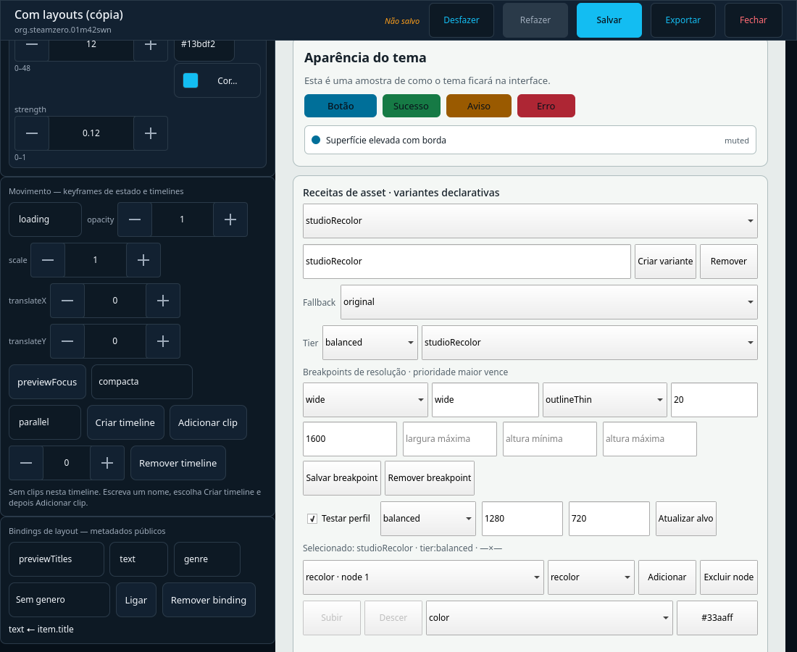
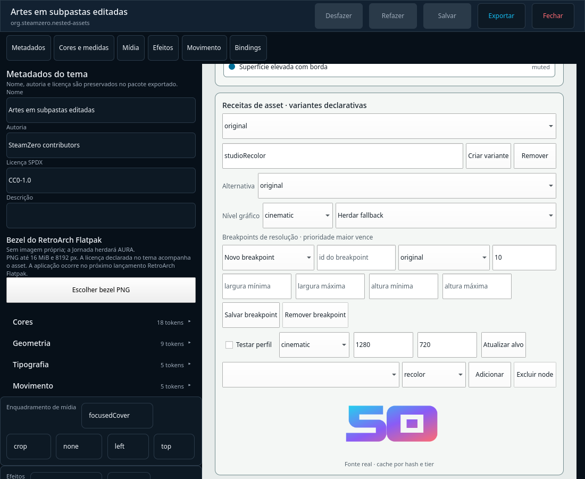

# Preview da composição de Jornada — 2026-10-03

## Escopo e estado

Este registro documenta uma extensão local/offscreen do painel de Jornadas no
checkout `/home/misael/Projects/Steam Zero/Canonical/2026-09-21`, branch
`codex/v1-v3-theme-journey-2026-10-01`, baseado em
`09033bd5919f25317ff4449b8426f0223e21cecd`. O delta funcional foi commitado
localmente em `461499d43322f6b8e3d68a2cddaa5bf98ef8e583`; não foi enviado,
instalado ou validado fisicamente.

### Atualização da branch — bridge e resolver native

Depois do registro inicial deste diretório, a branch acrescentou ações
allowlisted `journey.studio.*` ao `DesktopControlServer`. O harness QML usa o
catálogo de contratos e faz requests autenticados por loopback; cria menus,
aplica filtros e bindings, salva/reabre a jornada e exporta/importa uma cópia.
Isso é prova da bridge no checkout, não da release instalada.

`journey.studio.engine-preview` lê novamente a jornada pela geração esperada,
calcula a consulta a partir do read model público no servidor, resolve a
cobertura da etapa e chama `DesktopDashboard.editor_preview` com o modelo
filtrado em `preview.items`. O `ThemeEditorManager` resolve os bindings nativos
de `sceneLayouts`; `ThemeStudioCanvas` consome a mesma composição. O teste de
round-trip reabre uma jornada filtrada por gênero, usa o tema
`org.steamzero.asset-recipes-demo` e verifica que `previewTitles` contém apenas
`Synthetic Platformer`, sem `Axiom Verge`. Temas ausentes/incompatíveis usam
AURA com diagnóstico. Cada sessão de tema aberta para a consulta é cancelada.

Um segundo round-trip cria um tema filho de `asset-recipes-demo`, altera
`previewTitles.maxItems` para 2 no Theme Studio, salva e reabre o pacote, e então
executa a mesma jornada no Theme Engine. A prévia recebe os três registros
filtrados, materializa apenas os dois primeiros e mantém a edição persistida. A
cobertura avalia `sceneSurfaces` herdado pela cadeia `extends`, então a herança
visual não é tratada como slot ausente.

A mesma route retorna manifesto, declaração, preview e coverage. O read model
aceita somente campos já publicados e projetados pelo servidor; nenhum registro
arbitrário vem do QML. Os probes do dashboard determinam `highContrast` e
`reducedMotion` no preview normal. A rota também valida a geração antes/depois
da consulta. O canvas corre em Qt offscreen; não medimos pixels de release,
frame time, VRAM ou input físico.

## Testes focados

```text
rtk .venv/bin/python tools/run_tests_isolated.py \
  tests/unit/test_theme_editor.py \
  tests/integration/test_experience_journey_bridge_e2e.py \
  tests/integration/test_experience_journey_e2e.py \
  tests/integration/test_desktop_ui_bridge.py \
  tests/integration/test_ui_action_inventory.py \
  tests/unit/test_desktop_contracts.py \
  tests/unit/test_journey_studio.py \
  tests/unit/test_experience_journey.py \
  tests/integration/test_theme_authoring_e2e.py \
  tests/integration/test_theme_scene_runtime_e2e.py -q --tb=short
132 passed em 56,14 s
```

Guard real antes/depois: `files=12818`, `directories=2068`,
`bytes=1372834271`, `max_mtime_ns=1791029212908907544`.

O teste da bridge cria quatro menus, três conexões para um destino compartilhado,
filtros por gênero e ano, salva/reabre e testa a cena native com o resultado
reaberto. A projeção preserva o registro selecionado e omite o path privado. O
harness do componente cobre bridge ausente, resposta tardia, erro visível e
retry. O teste de autoria de tema e o teste separado do renderer de cena foram
repetidos para preservar os fluxos já existentes.

O caso de tema editado verifica separadamente a persistência do manifesto, a
declaração efetiva reaberta e os itens realmente materializados pelo Engine.

O harness de autoria mede o `GET /status` contra `DesktopControlServer`. Três
leituras reais do snapshot completo levaram 4,95 s, 5,52 s e 6,18 s. A espera QML
desse caso foi ajustada de 5 s para 10 s, continuando a exigir a resposta do
servidor; a execução isolada passou em 27,85 s. A repetição do conjunto focal
depois das correções passou com 132 testes.

O primeiro gate integral após publicar as ações da bridge terminou com
**6593 passed, 47 skipped e 1 failed em 3367,80 s**. A única falha foi
`tests/unit/test_capability_matrix.py::test_committed_matrix_matches_the_code`:
o documento gerado listava 137 ações enquanto o código já publicava 151. A
matriz foi regravada pelo comando previsto (`make update-capability-matrix`),
o delta revisado foi de 14 ações `journey.studio.*`, e o teste focal passou
**7/7**; `make capability-matrix` também passou.

A repetição integral final passou: **6594 passed, 47 skipped, 0 failed em
2420,39 s (40:20)**, código de saída 0. O guard ficou idêntico antes/depois:
`files=12818`, `directories=2068`, `bytes=1372834633`,
`max_mtime_ns=1791031942518989555`. O log bruto está em
[`full-tests-2026-10-03.log`](full-tests-2026-10-03.log); a falha intermediária
e seu diagnóstico estão em
[`full-tests-2026-10-03-matrix-drift-failed.log`](full-tests-2026-10-03-matrix-drift-failed.log).
Na primeira janela, o guard identificou escritas externas em `logs/core.jsonl`
e `state.db` pelo daemon da release já ativo; a repetição final partiu do estado
resultante e não detectou nova escrita durante os testes.

## Liberação serial necessária

| Path | Delta mínimo restante | Dono/dependência | Prova de liberação |
|---|---|---|---|
| `desktop_contracts.py`, `desktop_ui.py` | ações allowlisted e bridge autenticada, incluindo `engine-preview`, publicadas nesta árvore | integração serial do workstream atual; sharedPaths devem permanecer no commit de integração | loopback verifica edição, round-trip, geração, fallback de referência ausente e cena native com linhas filtradas; shell Main/instalada ainda não exercitada |
| `desktop_dashboard.py`, `theme_editor.py` | `editor_preview` recebe read model público e usa probes do dashboard; tema editado/reaberto e `sceneSurfaces` herdados alimentam o resolver native | integração local comprovada pelos testes de bridge, sem build/instalação | testar a mesma composição pela janela Main instalada e medir pixel/tempo em hardware/release |
| Launcher e Cinema | consumir grafo, filtros, tema/slot e contexto persistidos | LauncherShell/Main/Home seguem com owner codex-aura-launcher-exit ativo | mesmo documento no Launcher, retorno de contexto, saída/recuperação |
| sessão e adapters | ligar ações semânticas a capacidades reais de launch/pause/resume/save/load/exit | bridge e contratos atuais de adapter | sucesso, falha, timeout, late response, capability ausente e preservação do host |

`desktop_contracts.py`, `desktop_dashboard.py` e `desktop_ui.py` compõem o
commit funcional local `461499d`; `Main.qml`, Launcher e adapters de sessão não
foram alterados. Theme Engine, Studio, Launcher/Cinema e sessão permanecem
parciais.

## Estado do checkout e da release instalada

Ponteiros locais lidos em 2026-10-03, antes do commit funcional abaixo e sem
fetch:

| Superfície | Identidade observada | Situação desta entrega |
|---|---|---|
| Branch | `codex/v1-v3-theme-journey-2026-10-01` | HEAD observado antes do commit: `09033bd5919f25317ff4449b8426f0223e21cecd`; checkpoint funcional local posterior: `461499d43322f6b8e3d68a2cddaa5bf98ef8e583` |
| Ref local `origin/main` | `c9d3196bab819ad9a9b9f602bb5257f40c60a7b7` | ref local não atualizada durante esta continuação; nenhum push foi feito |
| Ref local da branch remota | `9bd5947c1e75a319191948b11be36c5398881fc8` | ref de acompanhamento local não atualizada; nenhum push foi feito |
| Ponteiro instalado | `/opt/steamzero/current` → `/opt/steamzero/releases/2.0.0rc1-5715d7962691` | a branch desta entrega não está instalada; ponteiro apenas lido |

O checkout e `/opt/steamzero/current` são superfícies distintas. Esta revisão não
abriu uma instância do código-fonte nem atribui à release instalada as mudanças
locais. O inventário KWin consultado sem input não encontrou janela do SteamZero;
o desktop estava em outra aplicação. A interação física foi pausada antes de
ativar uma janela ou guardar captura. Isto é um bloqueio ambiental da inspeção,
não um defeito observado no produto.

## Capacidade entregue, prova e gap

| Capacidade | Comportamento pela UI/serviço | Prova local e identidade | Artefato | Prova física | Gap restante |
|---|---|---|---|---|---|
| Documento de Jornada v2 | editor cria menus conectados, filtros e bindings públicos, sort, agrupamento, temas por etapa, histórico e arquivo | QML de autoria dirigido contra bridge autenticada real por loopback; focados passaram | `ExperienceJourneyPanel.qml`, `JourneyStudioService`, schemas v1/v2, teste bridge | não executada fisicamente | branch não instalada; navegação/retorno no Launcher pendentes |
| Preview de consulta | mostra contagem, diagnóstico/recuperação e até 64 linhas públicas filtradas | loopback contra `DesktopControlServer`; QML exercita erro, late response e retry | `check_experience_journey_bridge_e2e.qml` | não executada | shell Main e release instalada não exercitadas |
| Cena XML ES-DE | componente fornece o modelo filtrado ao renderer existente sem substituir a resposta compilada | contrato/harness do componente e teste isolado de `SceneEsdeView`; round-trip não provado nessa bridge | `ThemeScenePreview.qml`, `check_theme_scene_preview.qml` | não executada | precisa de prova loopback do documento persistido/reaberto na cena XML |
| Cena native `sceneLayouts` | bridge envia rows públicos filtrados ao ThemeEditorManager; tema editado/reaberto limita a lista e `ThemeStudioCanvas` usa a resolução resultante | teste loopback round-trip verifica filtros, fallback, herança de superfícies e edição persistida | ação `journey.studio.engine-preview`, `test_experience_journey_bridge_e2e.py` | não executada fisicamente | sem oracle de pixels, tempo ou release instalada |
| Cobertura visual/AURA | ação native retorna cobertura; tema/slot ausente cai em AURA com causa | `ThemeEditorManager` real na bridge; ausência de tema produz `theme-reference-missing` e fallback declarado | `journey.studio.engine-preview`, testes bridge | não executada fisicamente | capabilities de sessão desconhecidas; falta janela Main instalada |
| Theme Engine/Launcher/Cinema | Engine native recebe o documento reaberto; Launcher/Cinema ainda não consomem Jornada | prova local do resolver Engine; nenhuma prova no Launcher/Cinema | checkout desta branch | não executada | handoff serial ao workstream Launcher e integração session/adapters |
| Sessão de jogo | aparência declarada é separada de launch/pause/resume/save/load/exit | contratos de domínio apenas; nenhum adapter acionado por este fluxo | `experience_journey.py` | não executada | capabilities precisam vir do adapter e as transições aguardarem seu resultado |

SHA-256 dos arquivos que sustentam esta prova local:

```text
404f36be3a2cfdf42c3d3e7dd2dc0f841b30d15022e4bf761f34d2843e334e32  src/steamzero/ui/qml/ExperienceJourneyPanel.qml
9fdc6690c6729a72ef3e815997285103ff01008c27fb5993e2ca4ceeca8b435d  src/steamzero/ui/qml/ThemeScenePreview.qml
3a969e0b6b62c928df7df8364e90620770ed769380d937cbc4f395362efcf7bf  src/steamzero/adapters/desktop_contracts.py
03e76864b802480abc5f974ae4f4ac4f65c0196f87554b741757d3e8ace8db39  src/steamzero/adapters/desktop_dashboard.py
eba075e766946e804f93df5b3a0cf1af6ac0abf4d029ed4d32bbf201f26fce69  src/steamzero/adapters/desktop_ui.py
1cf72884b90322f90181f2a37735a6c130ed3f8e133ea9f853b9433fb9347769  src/steamzero/adapters/journey_studio.py
66991eaca917da754c6a37f49b70f978e30e248a58eb19cfad1b6989177bfc14  src/steamzero/domain/experience_journey.py
3157beef5e138d67359ea721bfdca58d99e1f1ddcd74014e5b2f99eeff775fa5  src/steamzero/domain/theme_editor.py
f7067d0e151c04e2835c32bfb46ee9404edffccd9986b0b3bf0956d7a5830266  src/steamzero/schemas/experience-journey-v1.schema.json
625a33daac5decf60ce85b6b576fc923366c4cdfcfceb3185e6a8fffa614909f  src/steamzero/schemas/experience-journey-v2.schema.json
03dc16b6ebc921dac164aa059dac9f4606c90908f88be9515ee87621000576e7  tests/integration/test_experience_journey_bridge_e2e.py
ded5fe990f214bad3e588fd7b264558fe5f0d61e9098a2a0dc1f36ffdef3032c  tests/qml/check_theme_scene_preview.qml
8cb3cb23ec87e32b8ce8b77f0dacfaa87ab8516960d34bd692a05ad7e2bd1be6  tests/integration/test_experience_journey_e2e.py
de9c5644ad95fb54e9bd761a6b21789dd04a6c8ebe318c351d9dcea712b5fdc8  tests/integration/test_theme_authoring_e2e.py
069402c55b50ad62b3153699a64dd8f846a4321bfeda787dd3c7b3dc4366d91a  tests/qml/check_experience_journey.qml
3e63df4269e7e015d037d5b0590bb85f328bdcb82f313685fef4e84fa26ce9ee  tests/qml/check_experience_journey_bridge_e2e.qml
df460db0ff4c99ade8b577ff4a47f88cc64d14855cf2049742066110f2944b16  tests/qml/check_theme_authoring_e2e.qml
9cc1389f73609a7f5c78bab11e22d7939f5265c69ad809819b031b092bee6f78  tests/unit/test_experience_journey.py
bab1885198689f2042729f7dc5f980b8ebae90f23091e2f5fe9f3a2fa265204e  tests/unit/test_journey_studio.py
5ec1d14ac598bdcdad2803e3476513e40e9fd6290228860af16be83845e47c41  tests/unit/test_theme_editor.py
```

Os testes focados de bridge/Engine passaram: **132 passed em 56,14 s**, com
guarda XDG idêntica. Depois, `tests/unit/test_capability_matrix.py` passou
**7/7** após a matriz ser regenerada. O resultado integral final está registrado
acima com seu log bruto. A primeira tentativa integral posterior falhou somente
pela matriz gerada obsoleta; a correção não alterou código de runtime e a rodada
final aprovou todos os testes. O registro histórico de execuções anteriores
continua no [`WORKLOG.md`](../../../WORKLOG.md).

## Matriz de etapa, aparência e capacidade operacional

| Etapa usada | Tema declarado | Origem esperada | Motivo/fallback | Capacidade operacional |
|---|---|---|---|---|
| `menu:<id>` | custom, herdar AURA, ou omitido | tema do menu; AURA se omitido/herdado | referência ausente e cena/slot incompatível precisam diagnóstico separado | não requer operação de sessão |
| `entryFade` | `sessionStages` ou omitido | tema atribuído ou AURA | sem declaração, AURA por padrão | fade não confirma launch |
| `gameplay` | `sessionStages` ou omitido | tema atribuído ou AURA | sem declaração, AURA por padrão | launch depende do adapter |
| `pause` | `sessionStages` ou omitido | tema atribuído ou AURA | sem declaração, AURA por padrão | pause depende do adapter |
| `saves` | `sessionStages` ou omitido | tema atribuído ou AURA | sem declaração, AURA por padrão | listar/salvar/carregar dependem de capabilities distintas |
| `bezel`, `osd` | `sessionStages` ou omitido | tema atribuído ou AURA | bezel ainda não tem slot declarativo no contrato atual | exibir não habilita controle do jogo |
| `exitFade` | `sessionStages` ou omitido | tema atribuído ou AURA | sem declaração, AURA por padrão | fade não confirma término |
| `loading`, `empty`, `error`, `offline` | `sessionStages` ou omitido | tema atribuído ou AURA | falta de componente deve aparecer como incompatibilidade/fallback | estado visual não prova operação |

Nesta árvore, a bridge monta manifestos para cobertura visual e separa esse
resultado das capabilities operacionais. O adapter da sessão ainda não fornece
capabilities nesta rota; nenhum badge visual prova pause, saves, bezel ou exit.

## B_VISUAL da Jornada — roteiro preparado, não executado

Pré-condição para retomar: integrar e identificar uma release governada que
contenha o checkpoint desejado, autorização específica vigente para instalação e mesa
sem atividade simultânea. A release apontada agora é a base anterior; esta branch
não foi instalada. Na inspeção read-only de 2026-10-03, a mesa estava ocupada por
outra aplicação e não havia janela SteamZero identificada; nenhum input foi
enviado e nenhuma captura do desktop foi mantida.

Roteiro depois que a bridge, os consumidores e a candidata estiverem disponíveis:

1. Confirmar release/SHA, rollback, daemon/doctor, resolução, escalas, locale,
   tema ativo, dispositivo de input e estado XDG; identificar a janela instalada.
2. Criar um documento sintético por controles acessíveis: **Plataformas → Jogos**,
   **Gêneros → Jogos**, com pelo menos três menus, submenu compartilhado, IDs
   estáveis e ordenação. Adicionar filtros combinados e um campo público novo via
   catálogo; observar desconhecido, zero resultados e fonte indisponível.
3. Selecionar uma plataforma e um gênero e confirmar que os bindings restringem
   o menu de Jogos. Voltar por ambos os percursos e comparar filtro, seleção,
   rolagem e foco com a origem correta. Testar um ciclo de input válido e um ciclo
   automático sem saída; registrar diagnóstico e recuperação.
4. Atribuir temas diferentes a menu, gameplay e bezel; deixar pausa, saves e
   fades sem atribuição. Antes de aplicar, conferir contagem AURA, origem/versão,
   motivo e acesso a personalizar; remover uma referência e declarar um slot
   incompatível para observar diagnósticos distintos.
5. Editar efeito e movimento no tema, desfazer/refazer, salvar, fechar, reabrir,
   exportar/importar como cópia e executar exatamente esse documento na Preview
   e na Engine. Capturar a cena, conferir seleção, pixels/tempo, asset ausente,
   binding ausente, tier reduzido, `highContrast` e `reducedMotion`.
6. No Launcher/Cinema, abrir o mesmo documento isolado, percorrer os menus,
   confirmar retorno contextual e testar loading/vazio/erro/offline. Não agregar
   biblioteca pessoal, iniciar jogo real ou alegar sessão operacional a partir de
   uma transição visual.
7. Com adapter controlado e conteúdo seguro, testar launch, pause/resume, save e
   load separados, exit, capacidade ausente, falha, retry, timeout e resposta
   tardia. Repetir resposta obsoleta e atual: descarte só a obsoleta e preserve a
   resposta válida; conferir busy, geração, foco e retorno ao contexto.
8. Repetir navegação com teclado e gamepad separadamente. Registrar cada cenário
   como passou/falhou/não executado/inconclusivo, com release, passos, artefato,
   log, input e hash. Não inferir contraste, área de toque, FPS ou resolução.

| Critério físico | Estado em 2026-10-03 | Bloqueio/resultado |
|---|---|---|
| B_VISUAL preparação e identificação da janela | parcialmente observado, sem input | mesa ocupada por outra aplicação; janela SteamZero não identificada |
| Journey UI, três menus e bindings | não executado fisicamente; loopback local passou | branch com Jornada v2/bridge não está instalada |
| Retorno contextual na UI/Launcher | não executado fisicamente | consumidor Launcher e estado de sessão não integrados |
| Cobertura/herança AURA e erro/recuperação | não executado fisicamente; fallback de tema ausente passou por loopback | exige candidata instalada e input observado |
| Mesmo tema salvo/reaberto em Preview/Engine | resolver native passou por loopback no checkout; pixels físicos não executados | branch e bridge não estão na release ativa |
| Launcher/Cinema | não executado | consumidor e seleção de Jornada não integrados |
| sessão, capabilities, teclado/gamepad | não executado | adapters reais não ligados a este fluxo; gamepad não observado |
| capturas e hashes físicos | não produzido | nenhuma captura foi feita/guardada durante esta inspeção |

Nenhum defeito físico de Jornada foi confirmado nesta inspeção. As ausências
acima são provas não executadas ou integração ainda inexistente, não aprovação.

### Matriz física RC-01 solicitada pelo roteiro B_VISUAL

| Critério | Estado | Razão objetiva e próxima observação segura |
|---|---|---|
| A. Loading, erro e retry | não executado | não abri a aplicação; na candidata, observar estados reais e só provocar erro por mecanismo já disponível |
| B. Prontidão v2 | não executado | não há leitura visual da aplicação nesta rodada; comparar estado conhecido/desconhecido/bloqueado no dado publicado |
| C. Unidades de armazenamento | não executado | quatro vistas e valores subjacentes precisam ser observados na janela instalada |
| D. Primeira dobra da Home | não executado | requer janela da aplicação e escalas oferecidas; não foi redimensionada nenhuma janela |
| E. Foco, escala e rolagem | não executado | Tab/setas/rolagem e gamepad não foram enviados; cinco superfícies ainda precisam ser medidas separadamente |
| F. Importação ES-DE/RetroFE no shell | não executado | nenhuma fixture foi importada nem diálogo aberto |
| G. Seletor nativo | não executado | nenhum `FolderDialog`/`FileDialog` foi aberto |
| H. Resposta tardia e geração | não executado fisicamente | exige operação real com correlação observável; harness QML não substitui a ordem observada na sessão |
| Theme Studio, catálogo, temas portados e AURA Cinema | não executado | janela SteamZero não identificada; nenhum consumidor foi ativado |

Classificação de achados físicos: nenhum achado de produto confirmado. O único
resultado é ambiental: havia outra aplicação em primeiro plano e a listagem de
janelas não identificou SteamZero; por segurança, não houve input.

## Atualização — perfis de assetRecipes

Em 2026-10-03, o Theme Studio ganhou schema `assetRecipes` v2 mantendo leitura
de v1. A autoria permite escolher fallback, uma receita por tier, e breakpoints
de largura/altura com prioridade. O resolver usa breakpoint correspondente de
maior prioridade, depois perfil do tier e por fim fallback. Edição passa pelo
bridge allowlisted e validação transacional; salvar/reabrir conserva o livro.

O preview QML enviou `balanced`, 1280×720 à bridge HTTP real de teste e recebeu
`studioRecolor` com origem `tier:balanced`. A UI também salvou um breakpoint
`wide` (largura mínima 1600). Naquele checkpoint, a jornada QML havia exercitado
apenas o alvo por tier; a revalidação abaixo acrescenta o segundo alvo por
breakpoint.

Verificação após o ajuste final de tipos: os módulos focados de receita,
ThemeEditor, contratos e bridge mais a autoria QML passaram com **133 testes**.
`tests/integration/test_qml_handheld_offscreen.py` passou com **58 testes**.
Ruff, formato, mypy, fronteiras, independência e `git diff --check` passaram;
os testes usaram `XDG_STATE_HOME=/tmp/steamzero-codex-isolated-state`, ausente
antes e depois.

O resultado é do checkout/offscreen: não instala nem identifica o pacote da
Engine na release, não mede pixels ou desempenho na sessão e não integra
Launcher/Cinema ou capabilities de sessão. Esses itens e B_VISUAL seguem
pendentes.

## Integral da fatia de perfis — 2026-10-04

`rtk env XDG_STATE_HOME=/tmp/steamzero-codex-isolated-state .venv/bin/python
tools/run_tests_isolated.py tests -q` terminou em **2595,78 s (43:15)**:
**6614 passed, 47 skipped, 1 failed**. O runner confirmou que o estado
temporário não existia antes nem depois. Log completo:
[`full-tests-2026-10-04-profile-v2.log`](full-tests-2026-10-04-profile-v2.log).

A única falha foi
`tests/unit/test_project_status.py::test_committed_catalog_and_generated_views_are_consistent`.
O teste encontrou três `scopeDigest` e a view `COVERAGE.md` desatualizados
porque o próprio log integral recém-criado está dentro do diretório de
evidência coberto pelos escopos Roadmap, Theme Engine e Theme Studio. Nenhum
teste de produto falhou. A tentativa anterior foi interrompida em 25% e está
preservada em
[`full-tests-2026-10-04-profile-v2-interrupted-25pct.log`](full-tests-2026-10-04-profile-v2-interrupted-25pct.log).
Os digests foram renovados depois deste registro e a governança foi reexecutada.

### Revalidação da governança

Após o registro, os digests Roadmap, Theme Engine e Theme Studio foram
recalculados pelo comando `tools/project_status.py digest --item`, as três
views foram regeneradas e `tools/project_status.py check` retornou
`STATUS-CHECK: OK`. `tests/unit/test_project_status.py` passou com **13 testes**
e guard XDG ausente antes/depois. `git diff --check` também passou. A falha da
integral permanece preservada como ocorrência de ordenação documental: o
teste de catálogo foi executado antes da renovação dos hashes do log novo.

Commits funcionais locais deste recorte: `3aeb3b4f0f42ade22aadb1a531576427ed958151`
(schema, editor e resolver) e `c839f64c3257ccb4d318ecf4357b37a052cf8f28`
(bridge compartilhada). Ainda falta o commit documental e o push autorizado;
estes commits não foram verificados por CI remoto.

## Revalidação QML de breakpoint — 2026-10-04

`tests/integration/test_theme_authoring_e2e.py` agora envia dois previews pelos
controles QML e pela bridge HTTP real do `DesktopControlServer`: `balanced` em
1280×720 resolve `studioRecolor`; `wide` em 1920×720 resolve `outlineThin`.
O segundo callback atualiza o `AssetRecipePreview`, cujo componente confirma
fonte pronta, contorno ativo, largura 6 e ausência de fallback. O teste passou
isolado com **1 passed em 18,91 s**, usando XDG temporário ausente antes/depois.

A investigação corrigiu a observação anterior sobre o segundo XHR: nesta jornada
ele retorna HTTP 200 e o callback QML aplica a seleção. A falha intermediária era
da asserção do teste, que tentava consultar um `id` QML como propriedade do
painel; a prova agora inspeciona as propriedades públicas do renderer.

Capturas da jornada no checkout/offscreen:




O harness continua em 1100×900; 1920×720 é o alvo enviado ao resolver, não a
resolução física da janela. As capturas não identificam nem validam a release
instalada, não medem pixels de uma sessão SteamZero e não substituem B_VISUAL.

## Gate visual na imagem do CI — 2026-10-04

Após os ajustes de viewport e controles, a imagem `ghcr.io/misael-art/steamzero-qml-visual@sha256:8b832ec124ae72aa59a4de3b5c00ccf3f03b41a7e688f45c10daf767290041cd` executou `tests/integration/test_experience_journey_e2e.py` e `tests/integration/test_theme_authoring_e2e.py`: **2 passed em 16,81 s**. A correção usa a largura do `contentItem` da jornada, mantém o diálogo de remoção dentro do painel e deixa o preview ao vivo do Studio rolável; os controles de edição se ajustam ao viewport compacto. O teste percorre os dois alvos de receita e a interação da Jornada.

O guard de `XDG_STATE_HOME=/tmp/steamzero-codex-isolated-state` reportou `exists=False` antes e depois. A imagem confirma QML/bridge do checkout em Qt 6.11.2. Não executa a aplicação instalada, não captura uma janela SteamZero física e não fecha B_VISUAL nem o desempenho da release.


## Continuidade do Theme Studio — assets em subpastas,30/10/2026

Direção expressa do proprietário: foco no Studio. Assunção serial do workstream
WS-2026-10-STUDIO-DRAFT-HISTORY na branch de continuidade, base
021ce1e32863b077b6fd43e7d8de8b955cd6a3a0. Único checkout/executor. Antes dos
arquivos, cessão de theme_editor.py/test_theme_editor.py registrada dos claims
de WS-2026-10-JOURNEY-LAUNCHER-SESSION. O lote Launcher permanece bloqueado,
com seus três commits, guardas e comparação pendentes; esta frente não os fecha.
Fonte/testes/commit/push/PR268 autorizados; sem auth/instalação/release/merge/boot.

Baseline controlado:4 failed,1 passed,52 deselected/0,80s nos novos casos.
Salvar um tema com assets/logos/platform/logo.svg e
assets/backgrounds/platform/logo.svg apagava ambos, apesar de nomes/refs
permanecerem no manifesto; a variante com upload também perdia arquivos.
Um arquivo aninhado sem leitura era ignorado em vez de impedir a sobrescrita.
Recusar overwrite sem confirmação já preservava o tema (o caso aprovado).

A causa foi reproduzida também no Qt/HTTP real: a arte decodifica antes da
edição; após nome/undo/redo/Salvar/Fechar/reabrir, o preview fica indisponível.
O harness relata “Salvar removeu a arte aninhada; preview indisponível ao reabrir”,
com7 casos QML aprovados e1 reprovado. A primeira corrida de27,20s teve a mensagem
oculta pela truncagem do assert; agora o log bruto Qt fica no destino de captura
local e FAIL/Loc também entram no resumo. Uma coleta posterior parou antes do
save por usar como booleano o retorno void de QtTestImage.save; o PNG existia,
mas essa passagem não prova o defeito do produto. Log preservado em
baseline-capture-harness-failure.log. Corrigido apenas o uso desse retorno;
goldens, timeouts, critérios e dados dos testes anteriores permanecem iguais.

Correção mínima no salvamento: reutiliza core.fs.iter_files para enumerar
arquivos regulares recursivamente e preserva o caminho relativo à pasta assets.
Os uploads continuam vencendo somente o mesmo caminho completo. Não há
achatamento por basename, criação de variantes derivadas ou outro instalador.
Os bytes são reunidos antes da remoção existente do destino; erro de leitura
de arquivo preserva tema, rascunho, histórico e upload para nova tentativa.
Esta prova de erro é de leitura antes da sobrescrita; não certifica atomicidade
de diretório em crash ou erro de escrita durante a publicação existente.

Resultado focal final: **100 passed/7,46s** (editor, herança, efeitos, pacote e
jornada de autoria) e **3 passed/30,97s** (autoria Qt/HTTP real e guardas de saída).
Cinco casos Python novos e um percurso Qt adicional aos cinco anteriores.
Metadados por gestos, undo/redo, save/reopen e imagem decodificada no painel real;
export/import posterior pela API pública do dashboard preserva cada byte,
manifesto e URI. No domínio, também há save repetido byte a byte idêntico,
nomes iguais em subpastas diferentes, arquivo não referenciado, upload e
leitura PermissionError controlada seguida de retentativa. A recusa de overwrite
preserva bytes/histórico. O runner preservou o estado pessoal monitorado.



[Baseline antes do save](studio-nested-assets/01-baseline.png). Dois PNGs1100×900,
230.857bytes, revisados individualmente; SVG/PNG de fixtures CC0-1.0, sem acervo
ou perfil pessoal. Qt6.11.2/offscreen/software, source e bridge em XDG temporário.
Não é release instalada, hardware, fidelidade de outro tema ou medição GPU/FPS.

Ruff check/format focados aprovados. Oito hashes congelados (quatro desta frente
mais quatro do Launcher pendente), capturas seladas no diretório local
build/agent-runs/studio-nested-assets. Preparar gates estáticos e integral única
quando MemAvailable>=3GiB e disco>=8GiB. Comparar integral à base aprovada
fba166f8/85,66169677501884%, mantendo os guardas de qualidade do Launcher;
coreCI comparável>=85,50677260258396%. Sem reduzir baseline/limiar ou repetir a
mesma fonte por sorte. Push apenas após checkpoint de gates, status e commits
coerentes. Eixos/gaps existentes preservados; aceite instalado do Studio continua
pendente. Próxima prova independente: falhas de escrita/publicação do tema e
recuperação sem perda; registrar baseline antes de ampliar o salvamento.


### Checkpoint local de retomada

| Item | Commit local | Prova |
|---|---|---|
| Preservação de assets em subpastas | `40988da9fdf2cda16ef8256057392091dbcec23f` | 100 testes de domínio/7,46s +3 testes Qt/30,97s;2 PNGs revisados |

Ruff check/format736, mypy307, independência, fronteiras e status aprovados
após os oito hashes congelados. Revisão de diff, bytes dos assets, tamanho e
procedência das imagens concluída. Nenhum eixo/gap existente promovido.

**Integral ainda pendente.** O monitor fez7 leituras em300s:
2475856–2837792KiB disponíveis, abaixo de3.145.728KiB exigidos.
Terminou75 antes de iniciar o runner; nenhum full-result.json foi produzido.
Não encerrar aplicações alheias nem alterar swap/guarda. A candidata ainda não
foi enviada: remoto/PR268 permanecem emfba166f8, CI antigo é apenas baseline.
Este commit local não constitui backup GitHub nem fechamento integral do lote.

Checkpoint local Studio 40988da9fdf2cda16ef8256057392091dbcec23f:103 focados aprovados (100 domínio/7,46s+3 Qt/30,97s),2PNG230.857bytes revisados,8hashes commitados incluindo4 Launcher pendentes. Integral não iniciada:7 leituras/300s,2475856–2837792KiB<3145728KiB, helper75. Retomar após MemAvailable>=3GiB/disco>=8GiB: uma integral serial/nice10 no runner isolado, cobertura>=85,66169677501884% e guardas antigos/novos presentes, então checkpoint documental e um push nominal da continuidade/PR268/SHA remoto, CI terminal/core>=85,50677260258396%. Sem instalação/auth/release/merge/deploy/boot ou novo aceite físico. Próximo baseline só depois desse gate: falhas de escrita/publicação preservando tema anterior.

Comando do checkout atual quando o preflight estiver satisfeito (helper local
reutilizado, guarda3GiB, observação e propagação de sinais):

```bash
rtk proxy bash -lc '
. .steamzero-dev/env.sh
env -u PYTHONPATH .venv/bin/python build/agent-runs/studio-nested-assets/observe_command.py full
'
```

O comando portátil é tools/run_tests_isolated.py tests -q --cov=steamzero,
serial/nice10, após conferir>=3GiB MemAvailable e>=8GiB livres. O JSON integral
fica em build/agent-runs/studio-nested-assets/coverage-full.json e é comparado
sem arredondamento a r3-empty-return/coverage-full.json. Os8 hashes e guardas
bitrot/resource/linux/screencast/modelo, além do salvamento do Studio, precisam
ser conferidos. Históricos reprovados do Launcher continuam preservados.
Sem ações de host; instalação/versão em execução/rollback não revalidados.

### 2026-10-30 — Aeon Nox e ES-DE como aceite integral do Studio/motor

**Conclusão: a lista anterior de pendências do Studio é necessária, mas não
suficiente para prometer reprodução integral dessas referências.** A meta inclui
aparência, comportamento, efeitos, transições e todas as etapas executadas pelo
motor SteamZero. Importar XML, apresentar elementos genéricos ou abrir o frontend
original não satisfaz esse aceite. Não há prova atual de impossibilidade
arquitetural; também não há evidência que autorize garantir paridade futura antes
da implementação e comparação real.

Auditoria somente leitura, fonte SteamZero em
`6d2216ad375b85dad3d3958c14a21ec33a1fb380`. Metadados agregados, hashes dos
compiladores/renderizador e contraexemplos próprios estão na
[matriz de evidência](studio-frontend-parity.json). Nenhum XML, asset, gamelist,
configuração ou conteúdo do acervo das referências foi publicado. Nenhum frontend
nativo foi executado. A pasta de temas do perfil ES-DE estava vazia; a referência
efetivamente auditada foram os temas Linear, Modern e Slate embutidos no AppImage
local pinado pelo hash da matriz, lido com unsquashfs, sem executá-lo.

| Referência/caminho | Verificação feita | Limite observado |
|---|---|---|
| Aeon Nox | 385 XMLs lidos e compilados individualmente, incluindo seis variantes raiz, splash e layouts de coleções | A descoberta normal da pasta inteira recusa o limite de 64 layouts; compilar arquivos isolados não prova importação do pacote |
| Aeon Nox, layout principal | 620 animações de entrada; 332 registros de animação na IR | Eventos idle/menuIdle e algoritmos de interpolação se perdem; contagens não são porcentagem de fidelidade |
| Aeon Nox, mídia | 53 imagens estáticas do layout principal usam caminhos compartilhados externos à raiz aceita | O confinamento recusa esses caminhos; falta resolução governada de assets compartilhados, sem liberar traversal |
| ES-DE | 849 XMLs inspecionados; 56 combinações variante×proporção dos três temas compiladas | Apenas snes/pt_BR e primeiro esquema/fonte; não cobre todos os sistemas, idiomas, fontes e cores |
| ES-DE, propriedades | Includes resolvidos nas 56 combinações | itemScale/controllerSize/folderLinkSize, pillarboxThreshold e scrollFadeIn têm perdas por interpretação incompatível de valores; Modern/Slate também demandam cues de som |
| Compilador, fixture própria | coverage=1.0/degraded=0 com texto e animação | fontColor e easing desaparecem; onIdle também pode desaparecer sem diagnóstico. Essa métrica não certifica capacidade |
| Renderizador real, fixture própria | SceneEsdeView em Qt/offscreen/software | Texto vermelho resulta #e8eef6; alpha=0 chega ao Loader como opacity=1; menu/sound são classificados como não desenhados nessa superfície |
| Feedback de mídia, fixture própria | Image.Error para arquivo deliberadamente ausente | drawnCount continua 1 e o fallback fica invisível; contador declarado não prova pixels válidos |

A prova Qt executou dois cenários diagnósticos no renderizador real dentro de um
teste Python: **1 passed/0,45s**. O teste aprova a observação dos defeitos, não a
paridade. Estado pessoal monitorado antes/depois idêntico. Não mediu FPS, GPU,
memória, áudio físico ou criação por uma pessoa. Primitivas nativas de movimento,
efeitos, receitas e contratos tipados já existem; os resultados apontam perdas
nos caminhos de tradução, consumo e autoria, não ausência de toda a engine.

#### Aceite ampliado obrigatório

1. **Demanda e resposta verificáveis.** O Studio transforma a composição e as
   ações solicitadas em documento/IR validado pelos contratos e registries
   existentes. O motor devolve capacidade por recurso, evento, binding, asset e
   etapa: suportado/executado, parcial, indisponível ou desconhecido, com causa
   e localização. Separar reconhecido, importado, renderizado, navegável,
   operacional e medido. Perda silenciosa ou capacidade desconhecida reprova
   o modo de reprodução integral. Fallback mantém navegação, mas declara perda.
   Não há aqui promessa de um intérprete irrestrito de linguagem natural.
2. **Assets e composição completos.** Resolver fontes e mídia compartilhada
   com raízes autorizadas/URIs lógicas, licença e diagnóstico; preservar
   geometria, cor, tipografia, alpha, camadas, recortes, máscaras, vídeos,
   bindings e receitas. Variantes derivadas continuam renderizadas a partir
   do asset-fonte. Importação grande deve preservar layouts e escolhas sem
   truncar ou aumentar limites cegamente.
3. **Movimento e interação equivalentes.** Eventos idle, entrada/saída/jump de
   menu e entrada/saída de jogo, sequências, pausas, easing, interrupção e
   retomada precisam atravessar IR e runtime. Mapear os tempos reais, inclusive
   sequências longas, aos orçamentos governados; menus/listas/carrosséis/grids,
   vídeo e cues de áudio não podem virar apenas representações genéricas.
4. **Todas as etapas funcionais.** Inventariar também o que vive fora do XML:
   inicialização/splash, plataformas, jogos, categorias, franquias, Options,
   busca, filtros, favoritos, ajustes, iniciar e retornar à seleção anterior.
   Cada ação usa o serviço canônico do SteamZero e disponibilidade real;
   nenhum tema executa scripts/helpers arbitrários do frontend de referência.
5. **Autoria visual genérica.** Cada primitiva e ação necessária fica acessível
   no Studio para qualquer pacote compatível, com seleção, árvore, inspector,
   timeline, estados, bindings e componentes reutilizáveis. Um autor deve
   construir/ajustar essas cenas sem editar XML, QML, código ou usar terminal,
   salvar/exportar/reabrir preservando tudo, com undo/redo e erros recuperáveis.
   O gate atual de canvas/graph por ID de demonstração não satisfaz isso.
6. **Mesmo documento até o Launcher.** Preview, Theme Engine e Launcher
   consomem o mesmo pacote persistido, preservando foco, seleção, filtro,
   posição e contexto ao lançar/retornar e após falhas. Retorno seguro e tema
   ausente, asset inválido, indisponibilidade e recuperação são parte do aceite.
7. **Comparação e fluidez medidas.** Fixar hash/versão de cada referência e
   candidata, assets licenciados, cenário, catálogo, resolução e hardware.
   Comparar capturas e quadros-chave, sequência de input, tempos, áudio e
   comportamento nos dois runtimes. Cobrir as variantes e estados acordados,
   ampliando a amostra ES-DE além das 56 configurações iniciais. Medir frame
   time, travamentos, memória e carregamento frio segundo a direção vigente;
   observar uma jornada real de autoria completa para julgar clareza e esforço.
   Nenhuma medição offscreen substitui o aceite da release no hardware.

Concluir esses aceites com evidência é o que permitirá afirmar que o objetivo
foi cumprido. Apenas fechar tarefas genéricas de canvas, inspector, timeline e
salvamento não permite essa afirmação. Theme Studio, Theme Engine, Launcher e
cada tema conservam aceites independentes. Os itens de frontend marcados
complete referem-se ao slice/importador já delimitado, não à reprodução integral.
As lacunas novas foram registradas nos itens existentes, sem promover seus
cinco eixos. Os aceites e capacidades do item Theme Engine permaneceram sob
claim da frente de Jornada; este diagnóstico fica referenciado pelos itens
Studio/frontends. A ampliação desta pasta de evidência exige apenas renovação
mecânica de scopeDigest nos itens Engine/Aura/plano que a incluem, registrada
como revalidação de escopo compartilhado, sem novo carimbo de capacidade.

#### Checkpoint de execução e continuidade

A RAM liberou a tentativa integral pendente do lote anterior. Ela iniciou com
4.539.292 KiB disponíveis (guarda de 3.145.728 KiB), mas terminou **143** após
2.464,19s: o observador registrou SIGTERM15 vindo do processo pai rtk. A última
porcentagem impressa foi 41%; não houve full-result.json nem cobertura integral
válida. Isso substitui o bloqueio anterior por RAM como situação atual; a
causa de o pai ter emitido o sinal ainda precisa de diagnóstico. Não houve
retentativa cega, redução de limiar ou promoção do resultado parcial.

A auditoria e a prova focada estão concluídas; o fechamento funcional anterior
continua pendente da integral. Os oito hashes de fonte/testes ficaram intactos.
Antes de retomar: diagnosticar o ciclo de vida/timeout do wrapper rtk, conferir
ausência de filhos temporários, RAM/disco e então executar uma integral
observada com os mesmos critérios de cobertura/guardas. Push do conjunto e
CI/PR268 continuam condicionados ao checkpoint; remoto fba166f8 é apenas a
base anterior. Nada instalado/publicado, sem autenticação nova, merge, boot ou
deploy. O link local de release aponta para 2.0.0rc1-59ecc2d8f0f6; execução e
rollback não foram revalidados. Sem ação física requerida para esta auditoria;
a certificação final depende de teste autorizado da release no hardware.
