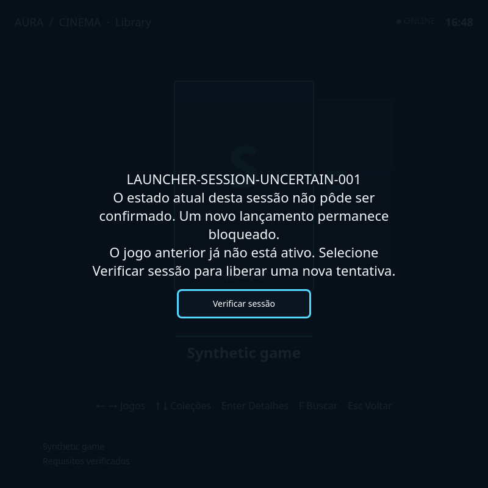
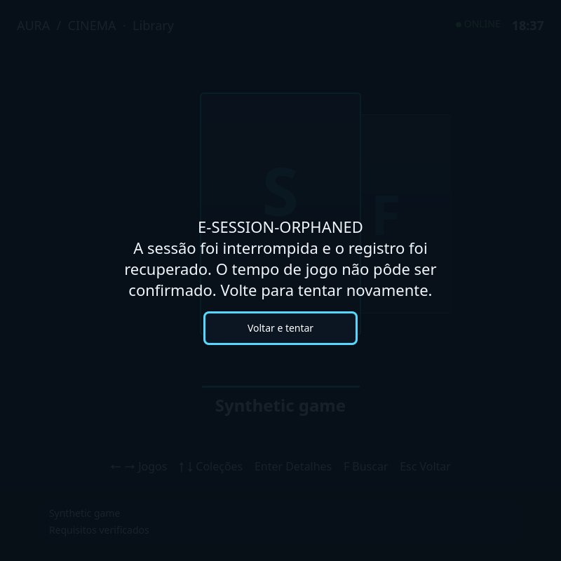
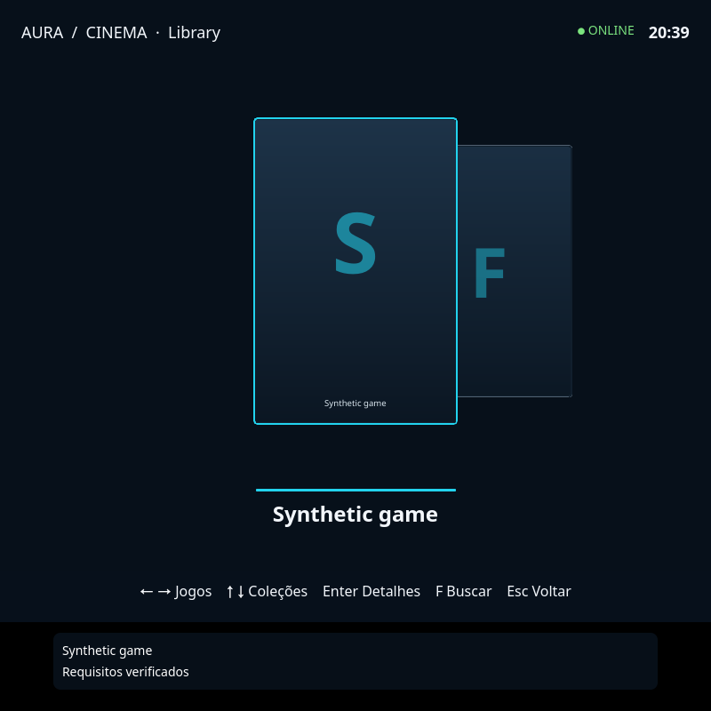
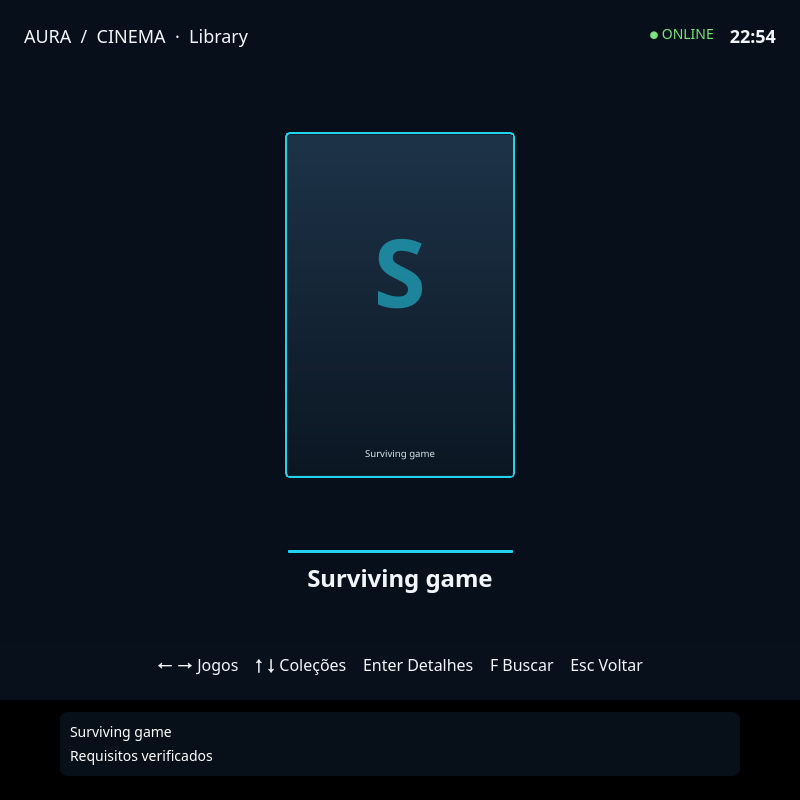
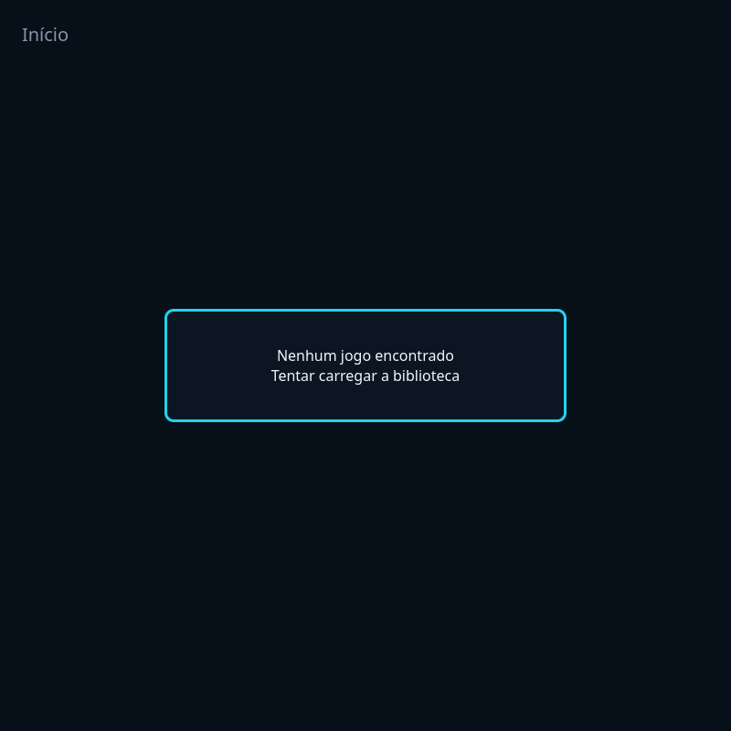

# R3 — prontidão e preparação visíveis nos detalhes

Assunção serial prospectiva em 2026-10-24 na base744d300bf1672275ce15c08cf2fe44d31d067ab1, mesma branch/checkout e executor. R2/year-alias local fechado, PR#267 CI40087147293 em curso. Nenhum outro executor observado nos paths. Main/host ativo59ecc2d8. Direção atual: desenvolvimento contínuo sem senha/autenticação até nova direção expressa; nenhuma instalação/preflight neste lote.

Baseline de código: LauncherGamePage recebe ações/descritivos, mas não publica prontidão. LauncherBridge só consulta readiness após Jogar; _auto_prepare mantém threads/erros reais, sem observação pública. Router faz fail-open quando a consulta falha, útil para launch, mas isso não pode ser exibido como prontidão comprovada.

Primeiro slice: endpoint autenticado somente leitura para prontidão e estado da preparação existente; ação explícita de preparar reaproveita _auto_prepare sem launch e sem novo job/supervisor. Observação de consulta falha é unknown, mantendo o preflight de launch como autoridade. Componente de detalhes consome estado público, exibe atividade indeterminada real (sem percentual inventado), erro/recuperação e ignora callbacks de jogo/página anteriores. Primeira composição: detalhes do shell Home; Jornada autorada e hardware conservam aceites próprios.

Handoffs antes de editar: JLS cede launcher_ui.py, LauncherMain.qml, LauncherShell.qml e teste de integração existente. R2 cede página/teste QML (este último não será editado salvo necessidade), app.py shared e README de continuidade. Novos componente/testes sem claim anterior. Reconciliar e devolver paths cedidos após checkpoint integrado. Contratos de sessão/launch existentes e cache/identidades preservados.

Próxima ação: controles negativos no endpoint e UI, implementação mínima, regressões HTTP/QML e gates integrais na árvore congelada. Sem mutação de dados reais no teste; runner isolado com PYTEST_DEBUG_TEMPROOT removido.

## Focadas e controles

Baseline HTTP: endpoint readiness/prepare inexistente (404) e observador separado ausente. Log01 tem12 falhas, das quais9 eram erro da factory do teste sem on_launch obrigatório; factory corrigida antes da prova positiva, sem mudar produção para acomodar fixture. Não contar essas9 como reprodução funcional. Resto confirma ausência de contrato.

Backend positivo:54 passed incluindo regressões antigas de launch. Broad final:64 passed em25,08s (04). Depois acrescida exceção da porta de preparar à regressão de falha/retry; rodada final dedicada passa em05, sem mudança de produção. QML negativo02:13 casos pass e2 fail (callback duplicado alterava estado, Enter não acionava). Corrigidos callback de uma só conclusão e Enter, com foco da janela de harness restaurado e conflito visible/visibility removido. QML final03 exit0, teste usa raiz LauncherMain real e ponte HTTP autenticada: detalhe→preparar→preparing→ready, sem spawn. Canal temporário em fixture privada; nenhuma credencial em argv/evidência nova. A sonda inicial tentou argumentos extras não aceitos pelo qmltestrunner e foi corrigida, sem mudar produção por esse erro.

Observação bounded2s do produto separada do fail-open legado de launch20s. GET não inicia nem consome preparação/erro; POST explícito reutiliza worker e lock existentes. Falha da consulta é unknown. Atividade publicada depende de thread real e não é percentual. Polling enquanto preparing e leitura única após resposta perdida de POST; sem repetir mutação automaticamente. Troca de jogo/página e callbacks duplicados descartados. Home/detalhes é a primeira composição; cartões/Jornada autorada/hardware permanecem em aceite próprio.

Ruff/format integrais723arquivos e mypy306fontes verdes (06). Digests de escopos compartilhados são reconciliação de fonte/documentos, sem novo aceite físico dos itens antigos. Próxima operação: gates de arquitetura/status e integral isolada em fonte congelada. Log /tmp/steamzero-r3-readiness-full.log, cobertura /tmp/steamzero-r3-readiness-coverage.json. Aguardar saída terminal; não interromper nem editar src/tools/tests. Sem senha ou preflight de instalação.

Integral iniciada em2026-10-24T11:05:54Z, operação ativa no runner isolado, log e snapshot1266 em/tmp conforme acima; não repetir antes de saída terminal. Memória disponível4,6GB e disco113GB no início, nenhum teste/QML próprio concorrente. Estados before/after das focadas:12984files/2124dirs/1437433483bytes/mtime1792839271376207207, sem delta em cada execução.

Enquanto a integral corre, R2/year-alias foi integrado pelo PR267/mainad742ca3 após oito jobsCI40087147293 e comparação equivalente sem regressão. Nenhuma mudança de fonte local para acompanhar o merge remoto. Nova baseCIpush40088910465 em andamento; árvore local será alinhada somente limpa, depois dos commits.

Limite operacional já conhecido: prepare_game materializa e revarre, mas _launch_preflight ainda pode rejeitar a origem archive. Não afirmar que fixture de prontidão depois de preparar prova essa jornada real. Próximo slice deve reproduzir com archive temporário e preservar ID/preferências ao resolver a projeção gerenciada, usando o materializador existente. Nenhuma alteração desse slice durante a integral atual.

Retomada13:10UTC: integral anterior sem sessão/processo nem logs/cobertura temporários; saída desconhecida, não aprovada. Não há teste em andamento. Novo pedido de migração priorizado, fonte e focadas preservadas. Retry explícito agora revalida requisitos depois de falha antes de começar trabalho novo; teste de mudança externa acrescentado. Gates finais e logs persistentes serão no handoff de24/10.

26/10: os logs públicos de baseline e callback negativo receberam somente
normalização de espaços finais para o check de whitespace do Git. Resultados
negativos e tracebacks foram mantidos; os bytes brutos e hashes originais foram
preservados no recibo privado de recuperação. Isso não é nova execução.

## Continuidade de 28/10 — archive preparado com identidade preservada

Base `3f010cec`, branch de continuidade e PR #268 conferidos, remoto sem
 divergência e oito jobs CI anteriores verdes (run 40753525934).
Pedido atual autoriza código, testes, commit/push/PR; sem instalação ou autenticação.

Baseline controlado: a varredura publicava um archive PS5, mas `_load_library_cache`
o descartava ao reclassificar `archive-needs-extraction`. Além disso, o preflight
recusava qualquer archive e `inspect` nunca retornava `current`. Não houve prova
de troca de ID; a identidade canônica é a origem compactada.

Correção: reidratar archives recuperáveis apenas sob a política `extract` declarada;
resolver no preflight compartilhado um único alvo base pelo classificador existente.
O manifesto gerenciado v2 guarda hash da origem e hashes de todas as entradas.
Markers antigos precisam de nova preparação, sem promoção implícita. Bytes ausentes
ou alterados podem ser preparados novamente; symlinks, ownership/identidade inválida
e manifesto divergente bloqueiam. Seleção ambígua não escolhe primeiro arquivo e
multidisco mantém seu contrato independente. Nenhuma nova fonte de catálogo ou executor.

Evidência: `tests/integration/test_launcher_archive_preparation.py` usa scan real,
ZIP sintético, transação e releitura do catálogo, mantendo ID e preferências em disco;
regressões do materializador cobrem corrupção, origem alterada, legado, symlink,
manifesto inválido, ausência e ambiguidade. A parametrização real em
`test_launcher_readiness_qml.py` percorre LauncherMain → detalhes → Preparar via
Enter → bridge autenticada → materializador → rescan → pronto, sem spawn.
Fonte e Qt/offscreen apenas; não prova gameplay, release instalada ou hardware.
Logs locais regeneráveis em `build/agent-runs/r3-archive/`; nenhum payload privado
foi usado. Resultados integrais registrados no fechamento abaixo.

### Fechamento em fonte — 28/10/2026

| Item | Commit | Prova |
|---|---|---|
| Projeção verificada e alvo único | `d41923f48bd2c9a1bca32ab2dc33f5c517ac967e` | hashes, ownership, symlinks, legado, ausência, corrupção, recuperação e ambiguidade |
| Identidade e continuidade do preparo | `eb39b4b6f2d0b6ec4c51ffd1361ed64b08ce56c5` | scan/preparo/rescan/reabertura e LauncherMain/HTTP/Qt offscreen |

Integral com cobertura: **6.893 passed, 48 skipped, 1 failed**, 20 warnings,
2075,98 s. Cobertura **85,573587%** (gate de 85% atendido). O resultado bruto
não é uma integral verde. A única falha foi
`test_archive_without_materialization_is_refused_before_emulator`: o teste
substituía `_current_game` por um registro fora das bibliotecas permitidas e
esperava o texto do veto incondicional antigo. O preflight agora resolve uma
projeção validada; a fixture foi ajustada para ZIP real numa raiz controlada,
com o mesmo código E-CONTENT-INCOMPLETE, motivo exato do archive não preparado
e uma nova asserção que reprova qualquer consulta ao runtime. Nenhum teste foi
removido, pulado ou afrouxado. Essa mudança de contrato está no commit eb39b4b6.

Reteste final da área: **53 passed em 14,59 s**, incluindo o módulo inteiro de
runtime remediation, materializador, BIOS/preflight, HTTP e QML do Launcher.
Os seis arquivos de produto/testes anteriores conservaram seus SHA-256 durante
a integral e o reteste; somente a fixture de remediation mudou após a integral.
O código de produto não mudou após a execução ampla. A tentativa ampla anterior
foi interrompida para trocar a releitura do manifesto por entradas já verificadas;
ela não constitui aprovação. Logs brutos preservados em build/agent-runs/r3-archive.

Ruff check/format, mypy (306 fontes), independence e boundaries passaram.
Catálogo/digests/visões regenerados sem promover outros itens; validação específica
de status acompanha o commit documental. A referência a py.typed de um agregador
sem digest não exigiu criar artefato nem alterar o catálogo por conveniência.
A comparação de cobertura com CI canônico fica para o SHA publicado: o baseline
local de núcleo era 85,398001%, mas tem seleção diferente da integral com QML.
Os 48 skips mantêm seus motivos originais; não contam como aprovação.

Estado pessoal antes/depois sem delta nos runners. Nenhuma instalação, release,
merge, deploy ou mudança de boot. Somente readlink de /opt/steamzero/current:
`releases/2.0.0rc1-59ecc2d8f0f6`; runtime ativo e rollback não foram revalidados.
Aceite instalado/físico e capturas da release ficam pendentes de autorização
própria. CI novo permanece pendente até publicação, sem herdar o run anterior.
Próximo lote seguro: prontidão/progresso no cartão, reutilizando as portas existentes.

Reprodução: carregar .steamzero-dev/env.sh e executar pelo runner isolado
`tests/integration/test_launcher_archive_preparation.py` e
`tests/integration/test_launcher_readiness_qml.py -q`. Na interface, abrir os detalhes
do archive e acionar Preparar; o preflight usa o alvo extraído verificado quando
os demais requisitos de runtime estiverem satisfeitos.

Validação documental: a primeira tentativa encontrou disputa de claim no teste
de remediation (12passed/1failed); cessão serial reconciliada e visões regeneradas.
Reteste final do módulo de status: **13 passed**, sem delta no estado pessoal;
status-check aprovado. O fechamento preserva resultados brutos e separa o reteste.

## Continuidade — cartão e andamento observado, 28/10/2026

Base52b9ebf8 e PR268 conferidos: oito jobs do run40780398054 terminaram verdes,
incluindo QML canônico. Essa evidência fecha o CI anterior, não prova instalação.
Baseline da fatia nova: LauncherHome não tinha observador nem estado/progresso
no cartão; o teste raiz procurava selectedGameReadiness e falhou nas duas variantes.

Um único LauncherReadiness segue o foco semântico, com debounce200ms, e publica
badge do cartão nativo e faixa operacional da Home/Cinema. A faixa reserva área
da cena para manter título e atalhos visíveis. Nenhum passeio pela biblioteca
inicia preparo. Header/ausência de seleção/Home oculta não consultam a porta.
Preparar continua explícito nos detalhes. Ao voltar durante extração, o mesmo
GET autenticado observa preparando/erro/pronto e conserva seleção. A porta atual
não publica totais: a barra é indeterminada, sem porcentagem estimada. ReducedMotion
usa texto estático, sem animar a barra ou spinner. Consulta sem callback expira
em8s, admite retry e invalida resposta atrasada; POST incerto mantém a observação
sem repetir a mutação. Nenhum catálogo/executor/cache paralelo foi criado.

Focadas finais:31passed, incluindo gesto/foco/timeout/retorno/busca, HTTP,
ZIP real e transação. QML adiciona regressões de seleção rápida, resposta antiga,
header/Home oculta, timeout/retry, Cinema e reducedMotion. Captura PNG de fixture
real em Qt/offscreen inspecionada: build/agent-runs/r3-cards/02-preparing.png;
é artefato local regenerável, não captura de release instalada nem prova GPU/FPS.
Sem delta no estado pessoal nos runners. Logs em build/agent-runs/r3-cards/.
Fonte de produto, CI visual canônico, instalação e hardware mantêm aceites separados.
Resultados integrais são registrados no fechamento desta fatia.

Regressão ampla antes do checkpoint: **128 passed em72,90s**, cobrindo todas as
integrações test_launcher_*.py. Arquivos de produto/teste congelados por SHA-256
antes da integral; nenhum gate físico promovido.

### Fechamento do cartão em fonte — 28/10/2026

| Item | Commit | Prova |
|---|---|---|
| Observação limitada e apresentação somente leitura | `d9d8f42ba05f09851cf81430a00866ba3d96b289` | timeout, resposta antiga, leitura sem preparar, andamento sem porcentagem |
| Cartão selecionado e retorno Home/Cinema | `d93bae2e09e9cf1d6fad6b4494473365807ef57f` | 128 integrações do Launcher; ZIP/transação reais e Qt/offscreen |

Integral oficial: **6.894 passed, 48 skipped, zero failed**, 19 warnings,
2270,17s (37m50s), runner exit0. Cobertura da integral: **85,559251%**.
Os cinco arquivos de produto/teste congelados conservaram SHA-256 durante a
execução. Nenhum produto mudou após a integral. Os48skips mantêm seus motivos.

A comparação exploratória com a integral anterior (que terminou com uma falha
de fixture) mostrou delta de−0,014pp em caminhos Python não alterados. Reteste
dirigido: **111 passed em15,52s**; a execução agregada ficou85,562118%.
Foi acrescentado somente um teste após a integral: uma biblioteca é retirada
depois do scan real, e o preflight deve recusar seu archive antes do runtime.
Esse teste protege custódia, sem afrouxar o contrato nem mudar produção.

A comparação de não regressão usa o **baseline verde de núcleo do CI**, mesma
seleção `-m "not visual"`, mesmos52.128statements e17.626branches. Artefato
coverage-python-3.14 do run40780398054, head52b9ebf8, artifact12856673513:
663.174bytes comprimidos, somente dados baixados para build/agent-runs/r3-cards/
baseline-ci-coverage, recibo/hash local em baseline-receipt.json. Baseline:
**85,395819%**. Núcleo atual: **6.498 passed, 48 skipped, 397 deselected**,19warnings,
680,68s, runner exit0; **85,435961% >= 85,395819%**. Não houve regressão nesse
comparativo. Cobertura da integral e do núcleo são reportadas separadamente.
Não se repetiu a bateria QML depois de acrescentar o teste de custódia.

Ruff check/format (728arquivos), mypy306, independence, boundaries e status-check
aprovados. A documentação final regenera apenas os digests afetados e as visões;
validação específica do catálogo acompanha o commit documental. WORKLOG é append-only.

Nenhuma instalação, release, merge, deploy, boot ou autenticação privilegiada.
Readlink somente: releases/2.0.0rc1-59ecc2d8f0f6; runtime efetivo e rollback não
revalidados. A captura funcional é de fonte com fixtures e Qt/offscreen, sem
aceite instalado/físico, controle real, desempenho ou promoção da Theme Engine.

Reprodução da captura: carregar .steamzero-dev/env.sh e executar
`STEAMZERO_CAPTURE_READINESS=1 rtk proxy .venv/bin/python tools/run_tests_isolated.py tests/integration/test_launcher_readiness_qml.py -q`.
Próximo lote seguro: conferir se o gap existente
GAP-AURA-LAUNCHER-BRIDGE-DISCONNECT-RECOVERY ainda é reproduzível e fechar a
jornada de reconexão se necessário, usando os serviços e workstreams existentes.
Começar por tests/integration/test_launcher_request_timeout.py e
 tests/integration/test_launcher_return_cycle.py. Instalação e provas físicas
permanecem pendentes de autorização/aceite próprios; não iniciar autenticação.

## Recuperação de consulta da bridge — 28/10/2026

Base2a3129b0. CI40793431084 terminou com oito jobs verdes, incluindo visual canônico.
A definição histórica de GAP-AURA-LAUNCHER-BRIDGE-DISCONNECT-RECOVERY documenta
watchdog já corrigido em fonte e recaptura instalada ainda pendente. Esse gap
permanece aberto; esta fatia fecha defeitos de consulta/retry demonstrados em fonte.

Baseline HTTP controlado com a fonte anterior: três regressões QML. O retry
zerava model e destruía LauncherShell, seleção, página e trava de sessão; JSON null
virava ready sem catálogo; resposta antiga podia substituir um retry mais recente.
Log válido: build/agent-runs/r3-bridge/baseline-http.log. Tentativa inicial de fixture
com método QML read-only não foi usada como prova do produto.

Correção mínima: manter o último modelo válido, aplicar resposta validada por
geração e identidade do canal, cancelar consulta de modelo substituída e XHR
expirado pelo watchdog existente. O handle é o XMLHttpRequest já criado, sem
catálogo, executor ou supervisor adicional. O estado UNSENT prova o cancelamento
lógico conforme o [contrato Qt](https://doc.qt.io/qt-6/qml-qtqml-xmlhttprequest.html).
Não se assume EOF TCP imediato nem cancelamento de operação já recebida pelo serviço.
O texto de timeout de launch agora informa ausência de confirmação, em vez de
alegar que o jogo não iniciou. Correlação/ACK perdido permanece no gap próprio.

A recuperação apresenta erro legível com foco e alvo de48px, Enter para retry e
Escape para voltar ao cache/sair quando não há catálogo. Foco retorna à superfície
visível. HTTP real da fixture controla resposta antiga, erro503, JSON inválido e
peer retido; 128 integrações Launcher passaram em80,95s. Capturas Qt/offscreen
inspecionadas: build/agent-runs/r3-bridge/02-query-unavailable.png e
03-query-recovered.png. Sessão ativa é estado controlado da fixture; não houve
spawn nem prova de jogo físico. Fonte e testes são congelados antes dos gates.

Os limites permanecem: sem instalação, release, merge, deploy, boot ou autenticação
privilegiada. Não promover Central, Theme Engine, Studio, Aura, hardware ou desempenho.
Gates integrais e comparação de cobertura serão registrados no fechamento.

### Falha do gate e sincronismo da fixture

A primeira integral terminou com **6.894 passed, 48 skipped e uma falha**, em
2.247,76 s: `test_ui_credential_journey_e2e.py`. A localização exata corrigiu a
suspeita inicial de falha na matriz de controles. O teste envia POST de mudança
de modo à sua fixture e clica em Testar sem aguardar esse ACK; as duas conexões
podiam ser processadas na ordem inversa. O produto não participa dessa corrida.
O caso passou sozinho sem alteração. Um injetor local de 250 ms na resposta de
modo reproduziu as mesmas três reprovações QML do gate (baseline de 13,11 s).

O harness agora aguarda a resposta HTTP 200 antes da próxima ação. Todas as
asserções de sucesso, rejeição, segredo preservado e revogação permanecem.
Com o mesmo atraso controlado, a jornada passou em 6,60 s. Não há autenticação
real, alteração de credenciais do operador, espera fixa na UI ou mudança de
produto. O harness sem claim ativo foi reservado serialmente na frente existente;
o item SZ-UI-DESKTOP-AUDIT registra a manutenção de sua prova.

Logs: build/agent-runs/r3-bridge/full.log, credential-focused.log,
credential-delayed-baseline.log e credential-delayed-fixed.log. O núcleo passou
com 6.498 passed/48 skipped/397 deselected em 668,57 s; cobertura 85,435961%
>= 85,395819% do CI verde 40793431084, mesmos denominadores. Estado pessoal
monitorado permaneceu inalterado. Uma nova integral é justificada pela falha e
pela correção do harness; seu resultado será acrescentado no fechamento.

### Fechamento verificável — 29/10/2026

| Item | Commit | Prova |
|---|---|---|
| SZ-AURA-LAUNCHER: recuperação de consulta | `b4b7196d4b4f368d2074b92706a8389853f22ea9` | 128 integrações Launcher em 80,95 s; baseline HTTP com três regressões na base; seis casos Qt de retry/erro/retorno/cancelamento, incluindo dados inválidos |
| SZ-UI-DESKTOP-AUDIT: sincronismo da fixture | `9e23c1f3e8c3f3fc0be1495dd46b2b636da1c5d7` | atraso controlado de 250 ms reproduz a corrida antes da correção e passa após aguardar o ACK; asserções preservadas |

**Segunda integral: 6.895 passed, 48 skipped, zero failed**, 26 warnings,
2.350,47 s (runner exit 0). Log `build/agent-runs/r3-bridge/full-final.log` e
recibo `full-final-result.json`. Cobertura integral: **85,567853%**, reportada
separadamente do núcleo. A comparação equivalente de núcleo permaneceu em
**85,435961% >= 85,395819%**, sem regressão. Os seis hashes congelados coincidem
com o conteúdo commitado; o primeiro resultado reprovado foi preservado, sem
alterar goldens, skips, limites de cobertura ou asserções para obter aprovação.

Ruff check, Ruff format --check (728 arquivos), mypy (306 fontes), independence,
boundaries e status-check aprovados. Recibos em static-final-results.json.
O catálogo e as visões recebem somente a validação documental específica após
estes registros; não se repete a integral por mudança de digest/documentação.
O estado pessoal monitorado ficou idêntico antes/depois em ambas as integrais.

Autorização vigente: commit/push/atualização do PR #268 na branch de continuidade,
sem force push, merge, release, instalação, boot ou autenticação privilegiada.
Em 29/10, somente readlink confirmou `releases/2.0.0rc1-59ecc2d8f0f6`;
runtime efetivamente ativo e rollback não foram revalidados. Nenhuma ação
privilegiada foi executada. As capturas locais são de fonte Qt/offscreen com
HTTP e sessão sintéticos, sem spawn, controle físico ou medida de desempenho.

A recaptura instalada de GAP-AURA-LAUNCHER-BRIDGE-DISCONNECT-RECOVERY e o aceite
físico de prontidão permanecem abertos. Próxima investigação segura:
GAP-AURA-LAUNCHER-SESSION-ACK-LIFETIME. O requestId chega ao QML no retorno do
POST /launch; perder esse ACK ainda não permite correlacionar a tentativa de
modo seguro. Não adotar recibo antigo por gameId/nome. Reproduzir primeiro com
resposta do POST retida/perdida e efeito controlado, usando LauncherBridge,
LaunchRouter, recibo e observador de sessão existentes. Não há novo catálogo ou
supervisor neste lote.

Próximo comando de baseline: carregar .steamzero-dev/env.sh e executar
`rtk proxy .venv/bin/python tools/run_tests_isolated.py tests/integration/test_launcher_receipt.py tests/integration/test_launcher_session_observation.py -q`;
depois acrescentar a reprodução do ACK perdido antes de escolher o contrato.
Conferir CI do SHA publicado no PR antes de qualquer integração/release autorizada.

## ACK perdido de lançamento — 29/10/2026

Base 4c829a8744118a1a0ccdfc86252fe67489f63976, CI 40831063419 com oito jobs
verdes, incluindo visual canônico. Continuidade serial autorizada para fonte,
commit/push/PR #268; sem autenticação, instalação, release, merge ou boot.

Baseline HTTP/QML: três casos reprovados em 10,53 s. Após POST aceito com ACK
perdido, a UI entrava em failed e liberava nova tentativa; uma recusa pré-spawn
não podia ser correlacionada; pedido que nem chegara ao serviço era tratado
como falha conclusiva. Log: build/agent-runs/r3-launch-ack/baseline-qml.log.
O gate de foco existente distinguiu corretamente canal ausente antes do envio:
esse caso continua sendo falha comprovadamente anterior a qualquer efeito.

Contrato aditivo: /model anuncia launchCorrelation.clientRequestId; somente
quando anunciado, QML envia um identificador por tentativa no POST /launch e
consulta /session com o mesmo clientRequestId. O requestId de recibo do servidor
continua distinto. A bridge associa as duas identidades sob o lock existente;
retém apenas o último pedido aceito, até a próxima aceitação ou o fim da bridge.
Repetição exata desse pedido retido devolve o mesmo recibo sem novo efeito;
reuso com argumentos diferentes é recusado. IDs são ASCII allowlisted, 1–128
caracteres, validados antes do efeito. Clientes/modelos antigos conservam as
rotas legadas, sem inventar correlação por nome ou gameId.

O recibo retido alimenta a mesma _session_locked, sem segundo observador,
catálogo ou supervisor. Uma leitura perdida ou consumo por observação legada
não apaga o único notStarted correlacionado. Confirmação exige o sessionId exato
do recibo; tentativa pendente, delayed, unconfirmed ou sessão externa não viram
running. GET com identidade divergente não consulta/adota a tentativa atual.
Uma resposta de POST antiga é descartada pela geração/identidade da UI.

Timeout após envio mantém launching e a trava, informa incerteza e continua
somente leituras; não há repetição automática de POST. A leitura correlacionada
pode confirmar running, confirmar notStarted ou conduzir ao retorno canônico.
ACK que expira depois da confirmação não rebaixa a sessão para erro. Se o pedido
não foi recebido, permanece não confirmado, com orientação para a Central.

O percurso por teclado reproduziu também foco roubado para launcherHome escondida:
closeSessionOverlay restaurava Home após a recusa mesmo com detalhes visíveis.
A recuperação agora foca o botão da falha e depois a superfície visível. Enter
real confirma a dispensa e a nova tentativa; o harness não força foco.
Logs de reprodução e correção: keyboard-flow.log, focus-diagnostic.log,
keyboard-final.log. Nenhum teste existente foi enfraquecido.

Regressão final: 145 integrações Launcher passaram em 87,10 s, inclusive os
17 novos casos (quatro Qt/HTTP e treze de contrato). Cobrem ACK perdido, primeira
observação perdida, ACK expirado depois de running, pedido não recebido,
notStarted/recuperação, IDs inválidos, sessão externa, identidade substituída e
replay concorrente com efeito único. Recibos e sessão são controlados, sem spawn.
Estado pessoal monitorado inalterado. Capturas 01–04 no diretório local do lote,
fonte Qt/offscreen fullscreen 800x800, sem alegação de Deck/hardware/desempenho.

Limites: a retenção não é persistida entre processos/reboots e não é histórico
ilimitado de idempotência. Não prova confirmação de jogo Steam sem recibo.
GAP-AURA-LAUNCHER-SESSION-ACK-LIFETIME permanece aberto para esses limites e a
prova instalada/física; o lote fecha o ACK perdido com a bridge viva. Os demais
aceites de prontidão, desconexão física e instalação permanecem independentes.
Gates integrais e cobertura equivalente serão acrescentados no fechamento.

### Fechamento do ACK perdido — 29/10/2026

| Item | Commit | Prova |
|---|---|---|
| SZ-AURA-LAUNCHER: correlação, retenção e foco | `36e01f701eba1185f1957e2b30105bd754da0284` | 145 integrações Launcher; 17 casos novos, quatro Qt/HTTP com teclado real e treze de contrato |

**Integral concluída: 6.912 passed, 48 skipped, zero failed**, 19 warnings,
2.857,35 s, runner exit 0. Recibo full-result.json e log full.log em
build/agent-runs/r3-launch-ack. Cobertura integral: **85,576152%**.
Núcleo: **6.511 passed, 48 skipped, 401 deselected**, 19 warnings, 848,76 s,
runner exit 0. Comparação equivalente de seleção not visual:
**85,447227% >= 85,398687%** do CI verde 40831063419, head 4c829a87.
O código Python novo muda os denominadores: atuais 52.164 statements/17.644
branches; baseline 52.128/17.626. Não se alegam denominadores idênticos.
Artefato 12879485133, coverage-python-3.14, 663.143 bytes comprimidos; origem,
hash e totais preservados em baseline-receipt.json. Sem regressão de cobertura.

Ruff check/format (729 arquivos), mypy (306 fontes), independence, boundaries e
status-check verdes. Cinco hashes de fonte/teste permaneceram intactos durante
os gates e coincidem com o commit funcional. Nenhum golden, skip, limite de
cobertura ou teste existente foi alterado para acomodar o resultado.
Estado pessoal monitorado idêntico antes/depois nos gates concluídos; nenhum
warning de escritor externo. Validação documental específica acompanha o commit.

A primeira tentativa de integral foi interrompida por SIGTERM, saída 143, sem
resumo de pytest nem recibo terminal; **resultado desconhecido, não aprovado**.
Não havia pytest ativo após a interrupção. Remetente do sinal não determinado.
Log full-interrupted.log e full-interrupted-result.json preservados. Repetiu-se
somente a integral, em sessão separada; núcleo/cobertura não foram repetidos.
A passagem concluída acima é a prova integral válida, com o mesmo fonte.

Sem instalação, release, merge, deploy, boot ou autenticação privilegiada.
Readlink somente: releases/2.0.0rc1-59ecc2d8f0f6; runtime ativo e rollback não
revalidados. Capturas 01–04 inspecionadas de fonte Qt/offscreen, sem spawn nos
17 casos novos. O botão de recuperação tem foco visível e Enter executa o retry;
o retorno preserva library:second. Nenhuma prova física ou de desempenho.

Próxima reprodução segura: encerrar/recriar somente uma bridge de fixture com
sessão controlada já aceita e verificar a continuidade entre processos. O
LaunchPlan.context_payload existente guarda apenas gameId/focusId e
consume_context remove esse contexto; não há clientRequestId persistido neste
lote. Começar por src/steamzero/launcher/launch.py, launcher/app.py e
adapters/launcher_session.py, usando o estado canônico existente. Não migrar
schema, adotar sessão por nome/PID/gameId ou promover Steam sem recibo por
inferência. Provas instaladas/físicas e autorização de host continuam pendentes.

### Retomada entre processos — 29/10/2026

Continuidade serial na mesma branch, base b55890b0; CI dessa base concluído
com sucesso no run 40845684020. Escopo transferido explicitamente do workstream
Journey para WS-2026-10-RECOVERY-R3-LAUNCH-READINESS antes da implementação.
Autorização vigente cobre fonte, gates, commit/push/PR #268; sem instalação,
autenticação, release, merge, deploy ou boot.

Baseline real em processos separados: o Launcher originador encerrou, mantendo
o CLI/owner canônico e o jogo sintético vivos. A bridge nova consumiu somente
jogo/foco, e o QML ficou idle em vez de acompanhar a sessão: uma falha em 7,67 s,
build/agent-runs/r3-bridge-restart/baseline.log. Não foi inferência por nome/PID.

Migração explícita e aditiva do contexto: v1 mantém consumo único de foco;
novos lançamentos de emulação publicam v2 com schemaVersion, owner e
launchRequestId ULID pré-alocado antes do spawn. A CLI recebe
--launch-request-id; o controlador valida a identidade e a reserva pela criação
canônica já existente. IDs usados ou lifecycle indisponível são recusados antes
de configurar/spawn. O schema SQLite permanece 23, sem migração de banco.
O teste anterior de contexto gerado pelo Router passa a exigir persistência v2;
os testes legados de consumo v1 permanecem. O prefixo --json do argv foi
preservado para compatibilidade, após regressão detectada pelo teste existente.

O contexto é referência, nunca prova de execução. A mesma observação read-only
agora aceita ID exato, sempre filtrado por jogo e owner e com a guarda existente
de PID/start_ticks. A bridge nova não consulta a última sessão como alternativa.
O shell inicia não confirmado, bloqueia novo POST e acompanha somente essa
identidade; ausência, erro de leitura ou divergência preservam a incerteza.
Isso também cobre a morte do Launcher antes de o CLI criar a linha canônica.
Uma linha posterior válida permite continuar a observação, sem relançar o jogo.
O término canônico consome apenas o contexto v2 próprio e devolve o mesmo foco;
jogo removido do catálogo não impede observar seu término exato.

Publicação exclusiva usa core.fs.write_tmp/publish_link; corrida não sobrescreve
contexto pendente. A publicação rastreada preserva symlink e arquivo alheio;
a leitura preserva contextos estruturados versionados inválidos.
Falha de execução conhecida pode remover somente o próprio contexto; exceção
incerta o mantém. Nenhum segundo catálogo, supervisor ou gerenciador de sessão.

Prova focada final: 33 testes em 14,66 s, incluindo cinco de lifetime/CLI e 28
de retomada; dois exercitam Router, CLI, SQLite, bridge HTTP e LauncherMain em
processos distintos, com dois reinícios da bridge e zero novos lançamentos.
Cobrem sessão já confirmada e sessão ainda não criada, retorno, IDs divergentes,
owner externo, PID reutilizado, leitura ausente, concorrência e dados preservados.
Outros 50 casos de regressão focada passaram antes do último caso de lifetime;
regressão ampliada teve 344 passed e uma falha de ordenação do argv, corrigida
no produto e revalidada pelo teste original, sem relaxar sua asserção.
Logs locais em build/agent-runs/r3-bridge-restart. Capturas 01–03 inspecionadas,
fonte Qt/offscreen fullscreen 800x800, sem dado pessoal ou prova de hardware.

Limites: v1 não ganha correlação retroativa; Steam sem recibo continua pendente.
Se a linha exata nunca for criada, a retomada permanece não confirmada; não há
retry/cancelamento automático nem fabricação de notStarted após perder o owner.
A retenção do clientRequestId da bridge viva continua limitada ao último pedido,
sem histórico persistente de replay. Não se alegam retomada após reboot, owner
morto, instalação, hardware ou desempenho. GAP-AURA-LAUNCHER-SESSION-ACK-LIFETIME
permanece aberto nos limites residuais. Gates integrais no fechamento abaixo.

### Fechamento da retomada entre processos — 29/10/2026

| Item | Commit | Prova |
|---|---|---|
| SZ-AURA-LAUNCHER: contexto v2, CLI e observação exata após reinício | `b9f190f7026bc0e064096f25adc6a3ac5e74558f` | 33 focados de retomada/lifetime; dois percursos Qt/HTTP entre processos, com dois reinícios e zero novos lançamentos |

**Integral concluída: 6.945 passed, 48 skipped, zero failed**, 19 warnings,
2.197,55 s, runner exit 0. Cobertura integral: **85,583796%**.
Núcleo: **6.542 passed, 48 skipped, 403 deselected**, 23 warnings,
587,02 s, runner exit 0. Comparação equivalente not visual:
**85,466579% >= 85,412847%** do CI verde 40845684020, head b55890b0.
Denominadores atuais: 52.260 statements/17.696 branches; baseline:
52.164/17.644. Os acréscimos de código mudam os denominadores; a seleção é
equivalente, sem regressão de cobertura. Artefato 12885815142,
coverage-python-3.14, 663.726 bytes comprimidos, SHA-256
5d06a4976f3fbe54bf1a5b7c93a83ae0e590edfc91a067862674d02de7a177e7.
Recibos, cobertura e logs locais: build/agent-runs/r3-bridge-restart.

Ruff check/format (730 arquivos), mypy (306 fontes), independence, boundaries
e status-check verdes. Os 13 hashes de fonte/testes permaneceram iguais durante
os gates e coincidem com o commit funcional. Nenhum golden, skip, limiar ou
teste foi relaxado para passar. A migração v1/v2 está explicitada acima.
Estado pessoal monitorado idêntico antes/depois dos gates concluídos, sem
warning de escritor externo. Validação documental: 13 testes do catálogo
passaram em 7,17 s; digests/views regenerados e status-check aprovado.

A primeira integral deste lote terminou com SIGTERM 143 aos 27%, sem resumo
de pytest: **resultado desconhecido, não aprovado**. Nenhum pytest deste projeto
permaneceu ativo. Não houve atribuição do remetente nos registros consultados;
não se afirma causa raiz. Log full-interrupted.log e recibo próprio preservados.
O acompanhamento temporário passou a emitir progresso e registrar siginfo,
repassando cancelamento ao grupo filho. Uma prova curta identificou o remetente,
repassou SIGTERM e recolheu o filho. A repetição integral supervisionada terminou
com saída 0 e signals vazio; isso não prova a causa da interrupção anterior.
Somente essa passagem integral concluída conta. Núcleo e estáticos não foram
repetidos; fonte/testes permaneceram intactos. Nenhuma guarda foi contornada.

Sem instalação, release, merge, deploy, boot ou autenticação privilegiada.
Readlink conferido: releases/2.0.0rc1-59ecc2d8f0f6; runtime e rollback não
revalidados. Capturas 01–03 de fonte Qt/offscreen 800x800 inspecionadas; jogo
sintético e CLI/owner reais em processos distintos, sem uso do acervo pessoal.
Aceites de Central Desktop, Theme Engine, Theme Studio, Aura e hardware intactos.

Próxima reprodução segura: recusa pré-spawn com resultado perdido depois que o
Launcher originador encerra, antes de existir linha canônica. Não liberar retry
por ausência de linha nem fabricar notStarted; avaliar recuperação pela fonte
de verdade existente. Começar pela regressão atual:
`.venv/bin/python tools/run_tests_isolated.py tests/integration/test_launcher_restart.py tests/integration/test_emulation_session_lifetime.py -q`,
com o perfil .steamzero-dev/env.sh. Steam sem recibo e provas instaladas/físicas
continuam independentes e pendentes. Publicar estes commits e conferir CI do SHA.

### Recusa pré-spawn recuperável após perder a resposta — 29/10/2026

Continuidade serial na mesma branch, base c9345cf1, autorizada para fonte,
gates, commit/push/PR #268. Escopo reservado no workstream antes da edição.
Sem instalação, autenticação, release, merge, deploy ou boot.

Baseline com CLI/controlador/SQLite reais e stdout fechado: a recusa tipada
E-CONTENT-UNSUPPORTED não fez spawn, mas desapareceu com a resposta. A linha
canônica pré-alocada permaneceu ausente: um teste falhou em 1,14 s. Log local
build/agent-runs/r3-refusal-restart/baseline.log. Ausência de linha continua
sem significar notStarted; a correção persiste prova pelo owner que recusou.

Somente pedido com ULID válido, lifecycle disponível e ID ainda livre registra
uma recusa SteamZeroError da fase anterior ao spawn. Usa o create_game_session
transacional existente, estado failed, timestamps terminais iguais, sem PID,
exit code ou tempo de jogo observado. A metadata recebe source=emulation e
launchAcknowledgment {schemaVersion:1,state:notStarted}; failure_code guarda
somente o código registrado. Não persiste detail, stderr ou caminho privado.
Não há tabela nova nem mudança do schema SQLite 23. Chamada legada sem ID,
exceção genérica, identidade usada e falha de persistência não fabricam prova.
Uma corrida de INSERT não substitui a sessão existente, e uma tentativa
recusada não toma ownership de outro jogo ativo.

O observador read-only projeta o acknowledgment somente na consulta exata por
ID/jogo/owner, com estado terminal e campos coerentes, versão inteira reconhecida
e código conhecido. Consulta pela última sessão mantém o contrato anterior.
A bridge reaberta recompõe mensagem allowlisted pelo catálogo público de erros;
não adota texto cru de metadata. A recusa restaurada conserva contexto e prova
entre GET perdido, leituras repetidas e outro reinício. Somente um novo pedido
explícito, depois das validações de foco, prontidão e sessão, consome o contexto
próprio e cria ID novo. Contexto substituído/alheio/symlink é preservado e recusa
o novo efeito. O contrato da bridge viva para recibos legados não foi ampliado.

Prova fonte: 59 focados passaram em 22,86 s com PYTHONPATH removido do ambiente
inicial; incluem os 26 novos casos de recusa, os 28 de retomada e cinco de
lifetime. O percurso Qt/HTTP recria a bridge duas vezes depois que o originador
encerra, perde a primeira resposta GET em cada execução e não faz outro launch.
Enter dispensa o erro, abre detalhes e inicia uma única nova tentativa com ID
diferente; CLI/owner e jogo sintético reais retornam ao mesmo cartão. Capturas
01–03 inspecionadas: fonte Qt/offscreen fullscreen 800x800, sem dados pessoais.
Regressão ampliada: 371 testes Launcher/CLI/controlador em 209,71 s antes da
última guarda de ownership e da correção de ambiente; o gate completo cobre
essa composição final. Estado pessoal monitorado inalterado nos testes concluídos.

O CI anterior, run 40878965028/head c9345cf1, terminou com sete jobs verdes e
dois casos reprovados no gate visual (389 passed/13 skipped): os subprocessos
de test_launcher_restart.py não recebiam src no PYTHONPATH. Pytest configurava
pythonpath apenas no seu processo; o perfil local escondia essa dependência.
Retirar PYTHONPATH reproduziu a falha em 0,99 s; import direto confirmou
ModuleNotFoundError. A fixture agora passa o caminho do checkout explicitamente
ao filho e mostra stdout/stderr quando ele falha. A prova de 59 casos acima
inclui os dois cenários antigos nesse ambiente. Sem instalar pacote, alterar
o CI, alargar timeout, relaxar teste ou pular o caso. Logs base-ci-failed.log,
ci-env-baseline.log e clean-env-focused.log no diretório local deste lote.

Limites: se o owner morrer antes de persistir prova ou o armazenamento falhar,
a retomada permanece não confirmada. A fase posterior à preparação não recebe
garantia inventada. V1, Steam sem recibo, replay ilimitado, reboot e prova física
continuam independentes. GAP-AURA-LAUNCHER-SESSION-ACK-LIFETIME segue aberto nesses
limites. Gates integrais e cobertura serão acrescentados no fechamento.

### Fechamento da recusa recuperável — 29/10/2026

| Item | Commit | Prova |
|---|---|---|
| Fixture do gate visual sem dependência do perfil | `aed4856afd0c69922872d635b3ab1c33359dd038` | Reprodução sem PYTHONPATH; 59 focados verdes nesse ambiente, incluindo os dois cenários antigos |
| SZ-AURA-LAUNCHER: recusa canônica, reabertura e retry explícito | `e30bd4f98468e2077b077e97fdb9809deaab6dc5` | 26 casos novos; Qt/HTTP entre processos, duas reaberturas, GET perdido, um launch por Enter e retorno |

**Integral concluída: 6.971 passed, 48 skipped, zero failed**, 19 warnings,
2.067,19 s no resumo pytest, runner exit 0. Cobertura integral: **85,585727%**.
Núcleo: **6.567 passed, 48 skipped, 404 deselected**, 30 warnings,
630,51 s, runner exit 0. Seleção equivalente not visual, sem PYTHONPATH herdado:
**85,464311% >= 85,423695%** do job Python 3.14 aprovado 123465044453,
run 40878965028/head c9345cf1. O workflow dessa base falhou no visual pelas
fixtures descritas acima; não é apresentado como workflow verde.
Denominadores atuais: 52.295 statements/17.712 branches; baseline: 52.260/17.696.
Artefato de cobertura 12899867366, 664.880 bytes comprimidos, SHA-256
3f6e8b8b94cdb4a205b546df84ae9b0fb80159c65e8d8c29f5dafd56dcfa562b.
Recibo, logs e comparação em build/agent-runs/r3-refusal-restart.

Ruff check/format (731 arquivos), mypy (306 fontes), independence, boundaries
e status-check passaram. Seis hashes de fonte/testes permaneceram intactos nos
gates concluídos e coincidem com os commits funcionais. Estado pessoal monitorado
idêntico antes/depois, sem warning de escritor externo. Nenhum golden, skip,
timeout, limiar de cobertura ou asserção foi relaxado. Os gates completos e os
59 focados foram executados sem depender de PYTHONPATH do perfil de desenvolvimento.
Validação documental: 13 testes do catálogo passaram em 5,65 s; views/digests
regenerados e status-check aprovado, sem promoção dos eixos dos itens.

A primeira execução do núcleo terminou com SIGTERM 143 aos 90%, sem resumo:
**resultado desconhecido, não aprovado**. Nenhum pytest/runner deste checkout
permaneceu ativo. Log core-interrupted.log e recibo próprios preservados; o
remetente não foi identificado. O acompanhamento temporário, com saída periódica
e siginfo, passou prova curta de encaminhamento do cancelamento e coleta do filho.
A repetição do núcleo e a integral terminaram com saída 0 e signals vazio;
somente essas passagens contam, sem afirmar a causa da interrupção. Fonte/testes
não mudaram; estáticos não foram repetidos. O observador da integral mediu
2.075,46 s monotônicos; o campo auxiliar seconds do runner, baseado no relógio
de parede, foi 3.585,20 s. A divergência está preservada, sem atribuir causa ou
usá-la como medição de desempenho. A duração de teste acima é a do pytest.

Sem instalação, release, merge, deploy, boot ou autenticação privilegiada.
Readlink somente: releases/2.0.0rc1-59ecc2d8f0f6; runtime e rollback não revalidados.
Capturas 01–03 inspecionadas, fonte Qt/offscreen 800x800, sem prova física,
Deck, GPU/FPS ou promoção de Central Desktop, Theme Engine, Theme Studio e Aura.

Próximo baseline seguro: perda do owner de fixture depois da confirmação, com
jogo sintético ainda vivo, e nova observação antes/depois do fim do jogo. Não
inferir closed/notStarted por ausência de PID nem criar outro supervisor; ler os
contratos e reconciliadores existentes. Primeiro comando de regressão, após
carregar .steamzero-dev/env.sh:
`env -u PYTHONPATH .venv/bin/python tools/run_tests_isolated.py tests/integration/test_launcher_restart.py tests/integration/test_launcher_refusal_restart.py tests/integration/test_emulation_session_lifetime.py -q`.
Preservar os limites de owner sem prova persistida, armazenamento indisponível,
fase posterior à preparação, V1, Steam sem recibo, replay e instalação física.
GAP-AURA-LAUNCHER-SESSION-ACK-LIFETIME permanece aberto. Conferir CI do novo head.

### Perda do owner após running: recuperação explícita — 29/10/2026

Continuidade serial autorizada na branch codex/product-recovery-2026-10-16,
base 969933a16e0a59c4fc3043b053797ee621d7050f, CI 40906842436 concluído
com os oito jobs verdes. Mesmo checkout, executor e item SZ-AURA-LAUNCHER;
sem instalação, autenticação, release, merge, deploy ou boot. A candidata é
fonte/fixtures; nenhum aceite físico é herdado. state.py e launcher_process.py
são integração compartilhada, reservada prospectivamente no workstream para
commit funcional separado por último, sem escritor concorrente observado.

**Baseline reproduzido:** depois de confirmar running, encerrar somente o owner
positivamente identificado da fixture preservava o jogo destacado. Após o jogo
terminar por seu próprio mecanismo, GET retornava unknown e a linha canônica
permanecia running. O reconciliador só era chamado antes de outro lançamento,
que o Launcher bloqueava pela sessão pendente. O teste novo falhou no fonte
anterior (1 failed/1,66 s); log baseline.log em build/agent-runs/r3-owner-loss.
Ausência de PID não foi promovida a closed ou notStarted.

**Contrato final:** o controlador existente grava lifecycleOwner v1 (PID,
start_ticks, bootId e namespace PID) antes do spawn e gameProcess v1
(PID/start_ticks/grupo/sessão POSIX destacados) na transição canônica running.
Metadata JSON é aditiva, SQLite continua no schema 23. A sondagem é read-only:
exige desaparecimento/reutilização comprovados do jogo e do owner no mesmo
boot/namespace e ausência de processo ou thread vivos no grupo/sessão original.
Owner vivo mantém autoridade, mesmo após o jogo encerrar. Descendente com outro
grupo na mesma sessão, líder zombie com thread viva, leitura negada/malformada,
versão desconhecida ou prova antiga/incompleta impedem recuperação.

session.recover reutiliza o serviço/CLI existentes, com --game-id e
--session-id ULID opcionais somente para o percurso exato de emulação; a forma
Steam sem session-id preserva o contrato. Não aceita PID enviado pelo cliente.
O mesmo controlador reconcilia em transação com guarda da linha observada
(owner/jogo/estado/PID/ticks/metadata). Concorrência retorna bloqueio sem escrita.
Registro recuperado fica failed/E-SESSION-ORPHANED; não inventa exit_code nem
played_seconds/duration_source, preservando checkpoints anteriores. Repetição
é idempotente. O reaper existente reutiliza a mesma transição; não há outro
catálogo, supervisor, loop de lifecycle, tabela, sinal ou adoção de processo.

A bridge só aceita recuperação explícita da identidade confirmada/restaurada,
com token e corpo fechado. GET não altera o lifecycle canônico. Verificar sessão aparece
apenas quando a prova permite; pendência bloqueia duplicação. A resposta POST
pode se perder: somente GET canônico conduz a interface ao erro recuperado.
Voltar e tentar exige gesto novo; outro Enter nos detalhes lança exatamente uma
nova sessão e retorna ao mesmo cartão. Replay da última recuperação aceita é
limitado ao par exato durante esta execução e limpo no novo launch aceito.

**Prova focada:** 53 passed em 10,52 s sem PYTHONPATH inicial, com CLI e owner/jogo
sintéticos reais, RPC e HTTP, guards transacionais, namespace/boot/proc negado,
descendente vivo e Qt/HTTP entre processos distintos. Nenhum processo do
operador foi sinalizado. O percurso Qt perde a resposta da recuperação, mantém
zero launches automáticos e faz um launch novo por Enter; checkpoint de tempo e
exit desconhecido são preservados. Estado pessoal monitorado ficou inalterado.
Cinco PNGs 800x800 Qt/offscreen inspecionados e persistidos nesta evidência:

[01 jogo preservado](owner-loss/01-game-survives-owner-loss.png),
[03 registro recuperado sem estimativa](owner-loss/03-canonical-failure-without-estimate.png),
[04 retry explícito](owner-loss/04-explicit-retry-running.png) e
[05 retorno canônico](owner-loss/05-canonical-return.png).
São capturas de fixture/fonte, sem prova instalada, Deck, hardware, GPU/FPS ou
promoção das outras superfícies. A descrição acessível também acompanha o estado
incerto. A regressão ampliada inicial deixou log parcial aos 52%, sem resumo e
sem runner ativo; resultado desconhecido, não aprovado, sem causa atribuída.
Os gates integrais e a comparação de cobertura serão registrados no fechamento.

Limites: registros anteriores sem as identidades tipadas, outro boot/namespace,
owner morto antes de running persistido, armazenamento indisponível, processos
que escapam do contrato de sessão destacada, V1, Steam sem recibo, replay entre
execuções e prova instalada continuam independentes. GAP-AURA-LAUNCHER-SESSION-ACK-LIFETIME
permanece aberto. Nenhuma estimativa de tempo ou encerramento por conveniência.

Checkpoint de gates: Ruff check, format (736 arquivos), mypy (307 fontes),
independence/boundaries e status-check verdes após regenerar os digests.
Núcleo: 6.619 passed, 48 skipped, 405 deselected, 26 warnings em 617,84 s;
runner/observador 0, signals vazio, 16 hashes intactos, estado pessoal monitorado
inalterado. Cobertura 85,509905% >= 85,431457% do CI Python3.14 aprovado da base
969933a1, workflow40906842436/artifact12912681501 (665.285 bytes, recibo/hash local
reutilizado); delta +0,078448 ponto percentual. Comparação em
build/agent-runs/r3-owner-loss/coverage-comparison.json.

A primeira integral mostrou um F no harness check_launcher_shell.qml; o heartbeat
repetia a mesma linha, não dois casos distintos. Foi interrompida pelo executor
com Ctrl+C (siginfo SIGINT/terminal, filhos encerrados); não é gate aprovado.
O log parcial foi preservado como full-interrupted-on-failure.log. A reprodução
isolada confirmou 1 failed/62 deselected em 0,76 s: o harness buscava o botão
Voltar e tentar por children[1], posição ocupada pela nova ação. Corrigiu-se a
seleção pelo objectName, mantendo todas as assertivas de mensagem, opacidade,
altura e comportamento. Contrato do produto e runtime não mudaram. A reserva
do harness foi registrada antes de editar; é o 17º hash da composição final.
116 testes (63 handheld/offscreen +53 deste lote) passaram em112,13 s depois da
correção, sem mudar estado pessoal. A integral será repetida com fail-fast para
preservar o resumo de qualquer reprovação; não se repete o núcleo/estáticos de
fonte pois seus 16 hashes são os mesmos e só mudou esse harness visual excluído
do núcleo. A mudança do teste elimina suposição de ordem, não uma exigência.

Status-check bloqueou o reinício antes de qualquer pytest: claim antigo ativo
do harness na Jornada. A reserva do destino precedeu a edição, mas faltou
ceder a origem; reconciliação serial registrada em ambos os workstreams, sem
alterar outros paths/estados ou alegar handoff prévio completo. Nenhum escritor
concorrente observado. A integral ainda não havia sido reiniciada.

### Fechamento da recuperação do owner — 29/10/2026

| Item | Commit | Prova da composição final |
|---|---|---|
| SZ-AURA-LAUNCHER: sondagem, controlador/CLI/RPC, ação Qt e retorno | `116815d118dc6f26dcf7d2f0960ba9761eaae8ae` | 53 casos novos; jogo e descendente preservados, POST perdido, um retry por Enter, mesmo cartão |
| Integração compartilhada: guarda transacional, argv exato e harness sem índice de botão | `7c63f4f079af0106e3d3fcb74e298a170637832d` | 116 focados/handheld, mantendo assertivas; hashes finais e gates abaixo |

**Integral aprovada:** 7.024 passed, 48 skipped, zero failed, 31 warnings em
2.247,58 s (pytest). Runner 0; observador 0, signals vazio, 2.256,38 s monotônicos.
Núcleo: 6.619 passed/48 skipped/405 deselected/26 warnings em617,84 s, runner0.
Cobertura comparável core85,509905% >= CIverde85,431457% da base969933a1,
delta +0,078448 ponto percentual. Integral85,637897% é registrada separadamente.
Ruff check/format736, mypy307, independence/boundaries e status-check passaram.
Os 16 hashes do núcleo continuam intactos; o 17º é somente o harness visual
corrigido, excluído daquele núcleo. Todos os 17 coincidem com a composição dos
dois commits funcionais. Nenhum teste/golden/limiar foi enfraquecido ou removido.

Estado pessoal monitorado antes/depois dos gates concluídos idêntico:3 arquivos,
5 diretórios,860.896 bytes e mesmo max_mtime_ns. Regressão ampliada inicial sem
resumo continua desconhecida. A integral interrompida pelo executor após o F do
harness não conta como aprovação; sua reprodução/correção e a passagem final
ficam distintas. Logs, hashes, cobertura e recibos em build/agent-runs/r3-owner-loss.
O bloco estático inicial tinha status obsoleto após novas fontes; só a validação
regenerada e verde conta. Sem alteração dos eixos de outros itens.

Host: apenas readlink, releases/2.0.0rc1-59ecc2d8f0f6. Runtime e rollback não
revalidados; nenhuma instalação, release, autenticação, merge, deploy ou boot.
Prova instalada/física e reboot continuam pendências externas, fora deste lote.
As cinco capturas são somente fonte Qt/offscreen. O gap de lifetime permanece
aberto nos limites acima; não promove Central Desktop, Engine, Studio ou Aura.

Próximo baseline seguro: recuperação canônica concluída, GET terminal perdido e outro reinício do Launcher. Observar mensagem/foco/contexto e zero lançamentos automáticos antes de alterar contrato; não inferir notStarted para jogo que já executou. Reutilizar contexto e serviço canônicos, sem outro supervisor/banco. Após carregar .steamzero-dev/env.sh: env -u PYTHONPATH .venv/bin/python tools/run_tests_isolated.py tests/integration/test_launcher_owner_loss.py tests/integration/test_launcher_owner_loss_qml.py tests/integration/test_launcher_restart.py -q. Registros sem prova tipada, outro boot/namespace, perda antes de running persistido, V1, Steam sem recibo e prova física continuam independentes; GAP lifetime aberto. Sem instalação/auth/release/merge/deploy/boot.

Publicar somente a continuidade no PR268 em um checkpoint e conferir remoto/CI.
CI da base40906842436 está verde; o novo run será registrado no PR após o push,
sem alegar aprovação remota antecipada nem gerar commit circular de SHA próprio.

Validação documental de fechamento:13 testes do catálogo passaram em6,14s via
runner isolado sem PYTHONPATH inicial; estado pessoal monitorado inalterado.
Views/digests regenerados; status-check verde. WORKLOG recebe somente esta
sessão de fechamento, sem editar o histórico. SHA/run remotos devem ser
conferidos no PR268 após o checkpoint de push autorizado.

### GET terminal perdido após recuperação e novo reinício — 29/10/2026

Continuidade serial autorizada no único checkout/branch, base
490b4722e79a2059df4eb1f68aa48d6fad7d6c4f. CI40952684734 terminou com os oito jobs
aprovados; cobertura CI Python3.14 85,477196% >=85,431457% da base anterior.
Artefato12932966379,668.122 bytes, CRC e SHA-256
51857be7c0d494856b817318ccbddb3455ef2c0b48ea8962af91c1d4cb14cef7 conferidos
no fechamento anterior. A linha remota e o PR268 em rascunho foram conferidos.
Candidata atual é fonte/fixtures; sem instalação, auth, release, merge, deploy
ou boot. Os cinco caminhos já estão sob claim exclusivo R3; sem outro escritor
neste escopo observado. WORKLOG permanece intocado até o fechamento.

**Baseline:** 1 failed/2 deselected em1,04s. A primeira observação da linha
failed/E-SESSION-ORPHANED consumia o contexto v2 owned antes de a resposta HTTP
chegar. Perdendo o GET terminal e reiniciando a bridge, não havia referência
para recuperar o erro/foco. O registro canônico continuava correto; o defeito
estava no consumo antecipado do contexto de apresentação, não no reconciliador.
Log baseline.log em build/agent-runs/r3-terminal-restart.

**Correção:** a bridge retém o contexto e o recibo correlacionado do erro órfão
até um novo lançamento explícito validado. Uma tentativa viva precisa de recibo
confirmed e sessão exata antes de vincular o contexto owned lido sem mutações;
reabertura usa a referência exata já existente. Não fabrica notStarted para
jogo que executou. A nova leitura bounded do contexto não remove, repara nem
recria arquivos; owner/schema/ID/jogo/foco permanecem validados. Não há outro
catálogo, estado persistido, supervisor, writer de lifecycle ou schema novo.

O retry revalida a sessão canônica e o contexto depois das validações de foco,
prontidão e sessão ativa, antes de consumir somente o contexto próprio. Mantém
a compatibilidade da recusa pré-spawn e do arquivo já ausente: GET não o recria;
um novo pedido explícito pode publicar outro contexto após a prova terminal.
Arquivo substituído, outro owner/ID/jogo/foco, symlink ou conteúdo ilegível é
preservado sem novo efeito. A guarda de sessão anterior só é atualizada após
revalidar o erro retido; assim a própria sessão antiga não esconde a prova do
retry. A retenção termina com o pedido seguinte e libera o recibo antigo.

**Focados:**84 passed em39,15s, sem PYTHONPATH inicial, incluindo18 casos novos
(17 de contrato/guardas e um percurso visual adicional). Fluxo Qt/HTTP reutiliza
CLI/owner/jogo sintéticos reais: owner termina, jogo é preservado, recuperação
explícita confirma failed; todo GET terminal é perdido. Uma segunda bridge
perde novamente o terminal, uma terceira recupera o mesmo erro e foco sem
launch/recovery automáticos. Enter dispensa, abre detalhes e lança uma única
sessão com outro ID, retornando ao cartão. As leituras preservam exit/tempo e
o registro canônico; os testes com recibo vivo também cobrem retry noutro jogo.
Estado pessoal monitorado idêntico antes/depois. Tipos dos dois módulos, lint
e formato dos quatro Python alterados passaram durante a implementação.

Captura final:1 passed/1 deselected em11,49s; cinco PNGs Qt/offscreen800x800,
sem dados pessoais, no diretório terminal-restart desta evidência.

[01 GET perdido](terminal-restart/01-terminal-get-lost.png),
[02 segundo GET perdido](terminal-restart/02-terminal-get-lost-again.png),
[04 retry explícito](terminal-restart/04-explicit-retry-running.png),
[05 retorno ao cartão](terminal-restart/05-canonical-return.png).

Capturas não provam instalação, Deck, hardware ou GPU/FPS. Eixos preservados;
GAP-AURA-LAUNCHER-SESSION-ACK-LIFETIME continua aberto para closed com resposta
perdida, contextos/provas ausentes, V1, Steam sem recibo, outro boot/namespace e
prova física. O aceite de sucesso closed continua independente da retenção
específica do erro órfão. Gates integrais/cobertura no fechamento abaixo.

### Fechamento do replay terminal órfão — 29/10/2026

| Item | Commit | Prova |
|---|---|---|
| SZ-AURA-LAUNCHER: erro/contexto retidos, leitor owned read-only e retry validado | `997c3cd9391ae88960c7ba5797413140fc5acbe8` | 84 focados,18 novos; duas perdas de GET e reaberturas, terceiro processo restaura erro/foco, um launch por Enter e retorno |

**Integral concluída:**7.042 passed/48 skipped/zero failed/24 warnings em
2.297,92s pytest; runner0 e observador0, signals vazio (2.306,66s monotônicos).
Núcleo:6.636 passed/48 skipped/406 deselected/19 warnings em613,21s; runner0.
Core85,514477% >=CIverde85,477196% da base490b4722 (workflow40952684734,
Python3.14 aprovado,artifact12932966379), delta+0,037281 ponto percentual.
Integral85,643825% registrada separadamente. Comparação/recibos em
build/agent-runs/r3-terminal-restart/coverage-comparison.json e logs no mesmo
diretório. Ruff check/format736, mypy307, independence/boundaries/status verdes.
Cinco hashes intactos coincidem com o commit funcional; nenhuma repetição de
integral por microalterações, relaxamento de testes/goldens/skips ou limiar.

Estado pessoal monitorado idêntico antes/depois dos gates:3 arquivos,
5 diretórios,860.896 bytes, mesmo max_mtime_ns. Cinco PNGs inspecionados e
persistidos, fonte Qt/offscreen800x800; sem prova física ou medição GPU/FPS.
Contextos substituídos/ilegíveis são preservados; ausência não é reparada por
GET e o retry explicitamente validado mantém a compatibilidade de publicação
nova. O registro canônico e exit/tempo não são reescritos pela apresentação.

Host somente readlink:releases/2.0.0rc1-59ecc2d8f0f6; runtime/rollback não
revalidados. Nenhuma instalação, auth, release, merge, deploy ou boot. Evidência
de fonte não promove Central Desktop, Launcher, Engine, Studio ou Aura. Outros
códigos de falha e sucesso closed conservam seu consumo anterior; esse aceite
fica independente. GAP-AURA-LAUNCHER-SESSION-ACK-LIFETIME continua aberto.

Próximo baseline seguro: término normal closed com GET terminal perdido e novo reinício, observando foco/contexto e zero lançamentos automáticos. Manter o owner de fixture até o término canônico; não converter sucesso em erro órfão nem fabricar exit/tempo. Reutilizar contexto, recibos e serviço existentes. Após carregar .steamzero-dev/env.sh: env -u PYTHONPATH .venv/bin/python tools/run_tests_isolated.py tests/integration/test_launcher_restart.py tests/integration/test_launcher_return_cycle.py tests/integration/test_emulation_session_lifetime.py -q. V1, provas/contextos ausentes, Steam sem recibo, outro boot/namespace e prova instalada/física permanecem independentes; GAP lifetime aberto. Sem instalação/auth/release/merge/deploy/boot.

Publicar uma vez a continuidade/PR268 após o fechamento documental; conferir
SHA remoto e resultado terminal do CI. O run novo será registrado no PR, junto
da comparação entre artefatos Python3.14 aprovados, sem commit circular de SHA.

Validação documental:13 testes do catálogo passaram em6,54s, runner isolado
sem PYTHONPATH inicial, estado pessoal monitorado preservado. Views/digests
regenerados, status-check aprovado; WORKLOG recebe somente este fechamento.
SHA e run remotos devem ser consultados no PR268 após o checkpoint de push.

### Sucesso closed com GET perdido e reinício — 29/10/2026

Continuidade serial autorizada na raiz/branch únicas, base
24b3dcb9e5917ae6d51cc4b5087d5295ac81c116. CI40966373727 terminou aprovado:
sete jobs na primeira tentativa e o visual após uma única reexecução sem
alterar fonte/teste/workflow/timeout. A primeira falha no clique Saves da Jornada
não foi reproduzida; causa não confirmada, logs/25 diagnósticos e resultado
registrados no PR268, sem alegar correção. Cobertura CI3.14 da base85,478942%,
artifact12939315169/668.448 bytes/SHA-256
368cf1e307779584ae0a39301cb7985625a7bf2cf80b16bed1ebf316831d2858.

Candidata atual é fonte/fixtures do sucesso closed, sem instalação/auth/release/
merge/deploy/boot. Sete paths já exclusivos R3, sem escritor concorrente observado.
WORKLOG só no fechamento. Nenhum outro catálogo, supervisor, writer ou schema.

**Baseline:**1 failed/19 deselected em1,50s. A primeira consulta closed apagava o
contexto v2 owned antes de entregar a resposta. Perdendo o GET e reiniciando,
a referência/foco desapareciam. O registro canônico estava fechado; não se
inferiu término por PID. Log baseline.log em build/agent-runs/r3-closed-restart.

**Contrato corrigido:** closed canônico e erro órfão confirmado retêm contexto/
recibo correlacionados até a próxima ação de lançamento validada. Referência
v2 exata ou recibo confirmed são exigidos; leituras não adotam a última sessão
arbitrária. O novo pedido revalida canônico/foco/prontidão/contexto antes de
consumir somente o arquivo próprio. Mantém v1 one-shot, notStarted apenas com
prova pré-spawn e os outros erros independentes. Não transforma sucesso em
E-SESSION-ORPHANED, não cria exit_code/tempo e não recria contexto ausente.

A migração de contrato é deliberada: as assertivas antigas de apagar v2 no GET
foram substituídas pela permanência da identidade owned correta em restart,
refusal-restart e owner-loss. Gestos, contadores, idempotência, correlação,
estados e preservação de dados seguem exigidos. O foco passa por novos processos,
não só por payload em memória. O docstring do leitor legado/v2 foi alinhado.
Uma primeira regressão teve7 falhas/73 aprovações: seis assertivas de consumo
antigo e um checkpoint de fixture colocado num INSERT que não publica playtime.
A fixture usa agora transições canônicas running→closed para esse checkpoint;
nenhum produtor real foi alterado para passar o teste.

**Focados:**122 passed em71,37s, incluindo17 casos novos (16 de contrato e um
percurso visual adicional). Guardas de owner/ID/jogo/foco, contexto substituído/
symlink/ilegível/ausente, mudança canônica e recibo vivo preservam ausência de
efeitos indevidos. Retry no mesmo jogo e noutro jogo requer pedido novo e é
idempotente. Leituras mantêm a linha canônica e seus checkpoints de exit/tempo.

Qt/HTTP/CLI/controlador reais com jogo de fixture destacado: owner é mantido até
o término normal, sem sinal nesse percurso. Duas bridges perdem os GETs closed;
a terceira restaura o mesmo cartão sem falha ou ação automática. Enter abre
detalhes e outro Enter inicia uma única nova sessão; novo término normal volta
ao cartão e mantém referência ao novo ID. O registro anterior closed fica
byte-equivalente nos campos retornados, incluindo exit_code/played_seconds/
duration_source. Não é prova de um emulador ou acervo pessoal.

Captura final:1 passed/2 deselected em11,04s. Seis PNGs Qt/offscreen800x800
inspecionados e persistidos nesta evidência, sem dados pessoais:

[01 jogo/owner ativos](closed-restart/01-original-game-running.png),
[02 GET closed perdido](closed-restart/02-closed-get-lost.png),
[03 segundo GET perdido](closed-restart/03-second-closed-get-lost.png),
[05 próximo lançamento explícito](closed-restart/05-explicit-next-running.png),
[06 retorno da sessão nova](closed-restart/06-next-canonical-return.png).

Estado pessoal monitorado preservado nos focados. Não promove instalação,
hardware, Deck, GPU/FPS ou eixos das outras superfícies. Outros erros, v1,
Steam sem recibo, prova/contexto ausente e outro boot/namespace seguem
independentes. GAP-AURA-LAUNCHER-SESSION-ACK-LIFETIME permanece aberto.
Gates integrais e cobertura serão registrados no fechamento.

### Fechamento do retorno closed após GET perdido — 29/10/2026

| Item | Commit | Prova |
|---|---|---|
| SZ-AURA-LAUNCHER: referência closed retida e novo launch explícito revalidado | `a9a2e8edbf85b912a8a346bd2ca19949cfbe52e1` | Baseline1falha;122 focados,17 novos; owner termina naturalmente, duas perdas de GET, terceira bridge restaura cartão, uma nova sessão por gestos e retorno |

Integral7.059 passed/48 skipped/0 failed/19 warnings/2.490,81s; núcleo6.652 passed/48 skipped/407 deselected/19 warnings/746,04s. Runner e observador0, signals vazio. Core85,519153% >=CIverde85,478942% (base24b3dcb9/run40966373727/artifact12939315169) e >=core local85,514477%; integral85,647076% separada.
Observador integral2.502,24s monotônicos; sete hashes intactos coincidem com o
commit funcional. Ruff check/format736, mypy307, independence/boundaries/status
verdes. Não houve repetição de integral por microalterações nem alteração de
goldens/skips/limiares. O alinhamento de linhas do core anterior/atual não
mostrou perda de cobertura em linhas inalteradas antes cobertas nos dois módulos.
Comparação, manifestos e logs em build/agent-runs/r3-closed-restart.

O contrato v2 muda deliberadamente: GET closed não consome a referência owned;
o próximo launch explícito revalida e consome somente seu contexto. Assertivas
antigas de limpeza migradas mantendo gestos, contadores, correlação, estado e
idempotência; v1 one-shot continua independente. Preserva linha canônica,
exit/playtime e contexto alheio/substituído/ilegível. Sem outro catálogo,
supervisor, writer ou schema.

Estado pessoal monitorado idêntico:3 arquivos,5 diretórios,860.896 bytes e mesmo
max_mtime_ns antes/depois. Seis PNGs800x800 inspecionados, fonte Qt/offscreen;
não provam instalação/hardware/Deck ou GPU/FPS. Cinco eixos e gaps preservados.
Host somente readlink:releases/2.0.0rc1-59ecc2d8f0f6; runtime/rollback não
revalidados. Nenhuma instalação, auth, release, merge, deploy ou boot.

Próximo baseline seguro: catálogo alterado/jogo removido antes da reabertura após closed com GET perdido. Observar prova canônica exata, retorno a foco válido e zero launches automáticos; preferir vizinho da mesma seção conforme o contrato existente. Registrar primeiro o comportamento, sem presumir novo defeito, adotar a sessão latest ou criar outro catálogo. Após carregar .steamzero-dev/env.sh: env -u PYTHONPATH .venv/bin/python tools/run_tests_isolated.py tests/integration/test_launcher_restart.py tests/integration/test_launcher_return_cycle.py tests/unit/test_launcher_session.py -q. Reservar prospectivamente qualquer path adicional antes de editar. V1, Steam sem recibo, provas/contextos ausentes, outro boot/namespace e prova física seguem independentes; GAP-AURA-LAUNCHER-SESSION-ACK-LIFETIME aberto. Sem instalação/auth/release/merge/deploy/boot.

Fechar documentação e publicar uma vez a continuidade/PR268; conferir SHA remoto
e novo CI terminal. Resultado remoto/artefato CI3.14 serão registrados no PR,
sem commit circular de SHA. A falha anterior de Saves permanece registrada com
causa não confirmada, sem alegar correção; recorrência exige diagnóstico.

Validação documental:13 testes do catálogo passaram em10,06s, runner isolado0,
estado pessoal monitorado preservado. Views/digests regenerados e status-check
aprovado; WORKLOG recebe apenas o fechamento desta sessão.

### Catálogo alterado antes do retorno closed — 29/10/2026

Continuidade serial autorizada no checkout/branch/executor únicos, base
ac41c04cd89890858b205dea05f678f8245a97f0. CI40981206167: oito jobs aprovados
na primeira tentativa, coreCI85,486462%>=85,478942%; artefato12944359633,
668.635 bytes,SHA-25681a9de33431a433385e4dd35dcbaaeb35fd0e6105e524abe719d28ad61f04620.
Candidata em fonte: catálogo sem o jogo anterior após GET closed perdido e
reinício; duas seções distinguem topo da Home de vizinho na seção de origem.
Registrar baseline antes de corrigir. Reutilizar domínio restore_context,
contexto owned/recibos/controller existentes. Sete paths previstos já exclusivos
R3; domínio session.py/teste unitário são somente leitura, sem nova cessão.
Fonte/testes/commits/push/PR268 autorizados; sem instalação/auth/release/merge/
deploy/boot. Eixos/gaps preservados, WORKLOG somente no fechamento.

**Baseline reproduzido:**1 failed/3 deselected em6,88s no Qt6.11.2 local,
sem alterações de produto. Depois do primeiro término normal e perda de GET,
a reabertura sem o jogo foi para top:first em vez de library:survivor. Log em
build/agent-runs/r3-removed-return/baseline.log. O domínio já resolve o vizinho;
o shell ignorava essa política e usava focusMap.initial quando o ID sumia.

**Correção:** model publica returnFocus/returnDiagnostics calculados pelo
restore_context existente. returnContext/launchRecovery permanecem com a
identidade/foco originais; nada reescreve arquivo ou lifecycle para obter um
destino visual. LauncherMain passa o destino e o shell só o aceita se estiver
no mapa atual; mantém fallback legado para consumidores sem o campo. Sem
novo schema persistido, catálogo, supervisor ou resolução duplicada de vizinho.
Comentário do entry point foi alinhado à retenção v2 até novo launch validado.

93 focados passaram em72,00s, incluindo10 novos:9 de projeção/HTTP e um percurso
Qt completo. V1/v2 com vizinho, seção removida e Home vazia; contexto ausente,
foco preservado/inválido, diagnóstico e bytes do contexto intactos em leituras
repetidas. Modelo não lança/reconcilia lifecycle. Qt usa owner até término
natural, perde GET em duas bridges, restaura vizinho na terceira, exige gestos
para uma nova sessão do jogo sobrevivente e retorna a esse cartão. Guardas de
identidade antiga/nova e linha canônica preservadas. Estado pessoal monitorado
inalterado. Fixtures de CLI usam ID do novo jogo, sem mudar produtor real.

LauncherShell.qml e test_launcher_app.py são exclusivos R3 e compartilhados
na WS de Diagnóstico; integração com LauncherMain.qml dependente em commit
próprio por último. Sem alterar claims ou arquivos de domínio reservados.

Captura final:1 passed/3 deselected em16,13s. Seis PNGs Qt/offscreen800x800
inspecionados e persistidos, dados sintéticos sem informações pessoais:

[01 jogo/owner ativos](removed-return/01-original-game-running.png),
[02 GET closed perdido](removed-return/02-closed-get-lost.png),
[03 reabertura sem o jogo e GET perdido](removed-return/03-second-closed-get-lost.png),
[05 próximo jogo explícito](removed-return/05-explicit-next-running.png),
[06 retorno ao vizinho](removed-return/06-next-canonical-return.png).

A captura03 mostra bloqueio de duplicação enquanto a resposta está ausente,
com o vizinho já selecionado;04 mostra o retorno confirmado. Não comprovam
emulador/acervo real, instalação, hardware, Deck ou GPU/FPS. Cinco eixos e
GAP-AURA-LAUNCHER-SESSION-ACK-LIFETIME permanecem inalterados.

A primeira integral foi interrompida por SIGTERM aos2.070,80s: observador143,
remetente1517788/UID1000/SI_USER. Não houve fechamento do runner integral. O
pytest registrou1 failed/2.042 passed/46 skipped/2.071,55s: o runner Qt de
test_a_ordem_de_resposta_inverte (importador ES-DE, fora do código alterado)
retornou-15 sem denominador final. Cast engine também registrou SIGTERM. É uma
passagem interrompida, não aprovação nem prova de regressão do Launcher.
Remetente já encerrado na inspeção; causa do sinal não confirmada. Logs/recibo
preservados como full-interrupted* e esde-ordem-interrupted.txt em
build/agent-runs/r3-removed-return. Sete arquivos de produto/teste seguem
congelados. Investigar com caso focado e melhorar atribuição de ancestralidade
no observador temporário; sem ignorar sinal, relaxar teste ou timeout.

Caso ES-DE original isolado:1 passed/8 deselected em34,38s, sem mudar produto,
harness, timeout ou teste. Isso não prova a causa do cancelamento. Observador
temporário passou a registrar ancestry no início e metadados do remetente no
sinal; a prova curta identificou o sender e repassou SIGTERM/recolheu o filho,
sem ignorar cancelamento. A integral será retomada com PTY e a mesma árvore
congelada; não se atribui causa à diferença de modo de terminal. Ruff/mypy/
fronteiras/independência permanecem válidos nos mesmos sete hashes. Apenas
digests/views/status documentais são atualizados para registrar a interrupção.

### Fechamento do retorno ao catálogo alterado — 30/10/2026

| Item | Commit | Prova |
|---|---|---|
| SZ-AURA-LAUNCHER: projeção do destino pelo domínio e percurso com jogo removido | `edcfc20256d574e068406c8ac8a15d729327e559` | Baseline1falha/6,88s;93 focados/72,00s,10 novos; seis PNGs fonte Qt/offscreen |
| Integração compartilhada por último: shell, consumidor e testes HTTP | `f6738ec498ab0ccfbf6c5bccc6b4220695d8a5b2` | +9 cenários existentes do shell/4,23s; integral certifica a árvore integrada de sete arquivos |

Integral7.069 passed/48 skipped/0 failed/19 warnings em3.096,25s. Runner e observador0, signals vazio; observador3.106,75s. Cobertura integral85,650326% >=integral85,647076% da baseac41c04c, delta+0,003251 ponto percentual.
Comparação equivalente integral↔integral em coverage-comparison.json, logs e
manifestos em build/agent-runs/r3-removed-return. Core CI↔core CI será comparado
entre artefatos Python3.14 aprovados no PR, sem misturar seleções. Ruff736,
mypy307, independence/boundaries/status verdes. Sete hashes íntegros coincidem
com a integração final; não instalar o checkpoint backend parcial isoladamente.
Nenhum golden, skip, limiar, gesto, correlação ou contador foi relaxado.

A primeira passagem continua registrada como interrompida: SIGTERM143 aos
2.070,80s, runner Qt-15 e resumo parcial1 failed/2.042 passed/46 skipped. Caso
ES-DE original isolado passou1/8deselected/34,38s; não houve alteração de fonte,
teste ou timeout para esse caso. O observador temporário passou a registrar
ancestralidade/remetente e provou encaminhamento do cancelamento em ensaio
curto. A retomada integral concluiu0/signals vazio; isso não prova a origem do
sinal nem uma correção de infraestrutura. Só a passagem concluída conta como
gate; estáticos não foram repetidos nos mesmos bytes.

Estado pessoal monitorado idêntico antes/depois:3 arquivos,5 diretórios,
860.896 bytes e mesmo max_mtime_ns. Seis PNGs800x800 inspecionados/persistidos;
fonte Qt/offscreen, sem emulador/acervo real, instalação/hardware/Deck ou GPU/FPS.
Contexto original e linha canônica preservados; modelo publica destino e
causa separados da identidade. Não cria catálogo, supervisor, writer ou schema.
V1 e consumidores sem a projeção conservam compatibilidade. Cinco eixos e gaps
preservados, sem edição de arquivos de domínio reservados.

Host somente readlink:releases/2.0.0rc1-59ecc2d8f0f6; runtime/rollback não
revalidados. Sem instalação, auth, release, merge, deploy ou boot. Fonte/testes/
commits/push/PR268 autorizados na continuidade, checkout e executor únicos.

Próximo baseline seguro: seção de origem inteira removida ou catálogo vazio antes da reabertura após closed com GET perdido. A projeção HTTP já cobre esses destinos; falta percorrer o Qt com resposta ausente e comprovar foco utilizável. Na Home vazia, Enter deve acionar a recarga existente library.add/library.retry pelo _retry, mantendo zero launches/recoveries automáticos e a referência canônica exata. Registrar comportamento antes de presumir defeito; reutilizar mapa/domínio e canais existentes, sem novo catálogo ou writer. Após carregar .steamzero-dev/env.sh: rtk proxy env -u PYTHONPATH .venv/bin/python tools/run_tests_isolated.py tests/integration/test_launcher_app.py tests/integration/test_launcher_owner_loss_qml.py tests/integration/test_launcher_focus_bootstrap.py -q. Manter claims e integração compartilhada por último; não editar domínio reservado sem handoff prospectivo. V1, Steam sem recibo, provas/contextos ausentes, outro boot/namespace e instalação/hardware continuam independentes; GAP-AURA-LAUNCHER-SESSION-ACK-LIFETIME aberto. Sem instalação/auth/release/merge/deploy/boot.

Fechar documentação e publicar uma vez a branch de continuidade/PR268. Conferir
SHA remoto e CI terminal. Resultado remoto e artefato de cobertura registrados
no PR, sem commit circular. O episódio histórico de Saves mantém causa não
confirmada; não apresentado como corrigido por aprovações posteriores.

Validação documental:13 testes do catálogo passaram em13,56s, runner isolado0
e estado pessoal monitorado preservado. Digests/views regenerados, status-check
aprovado. WORKLOG recebe somente o fechamento desta sessão.

### Seguimento do gate de cobertura CI — 30/10/2026

Checkpointf31395963e9efdf2331bb74ddb82b138d2fb8308 publicado e SHA conferido.
CI40997943230 aprovou os três jobs Python e smokes; a comparação adicional
coreCI↔coreCI falhou:85,48545276234063% <85,48646151659442% da baseac41c04c,
delta-0,0010087542537888794pp. Artefato12951429445,668.541 bytes, tamanho/CRC/
SHA-2569b4639a9c3843532b21cd60785ee0ccbdd90922980a450c4e1e952b2d7525595 verificados.
Não tratar arredondamento85,49% como ausência de queda, nem repetir CI para
obter um acaso favorável. Diagnóstico em ci-coverage-regression.json local.

Launcher_ui.py ganhou cobertura e nenhuma linha inalterada coberta se perdeu;
launcher/session.py também ganhou pelo consumo público. A perda foi em arquivos
não alterados: linux_runtime.py405/arco403→405 (fallback SATA) e screencast_web.py
arcos86→88/110→saída (provider None). Teste de armazenamento usa somenteMMC; os
testes sem-provider restauram o global após headers, antes de o handler acabar.
Receber HTTP200 não sincroniza a execução posterior dos guardas.

Escopo prospectivo reservado na WS R3, sem claim ativo concorrente encontrado:
tests/unit/test_linux_runtime.py e tests/unit/test_screencast_web.py. Fontes
respectivas somente leitura; sete hashes funcionais anteriores preservados.
Registrar prova no SZ-AGG-TESTS sem promover eixos/capacidade instalada. Fixture
SATA/NVMe/MMC explícita e HTTP com fim observado, mantendo estado do provider
até conclusão; sem enfraquecer asserções, timeout maior ou limiar menor.

Seguimento focado:76 passed/36,88s,4 novos casos públicos de volume SATA/NVMe/
MMC com evidência conflitante na partição para exigir leitura do disco-base.
HTTP real mantém provider no estado pretendido até fim observado do handler;
SSE entrega um keep-alive antes de desconexão controlada por relógio da fixture,
sem sleep arbitrário e sem mexer no relógio global do processo. Confirma limpeza
de writers, headers e resposta JSON; preserva asserts anteriores e prazos5s.

Cobertura focada dos dois módulos91,567852%, limiar85% mantido. Arcos403→405,
86→87/88,110→111/saída e96→97/saída executados; heartbeat91/92 observado. O
primeiro reforço teve2 falhas/74 aprovações ao exigir EOF de SSE keep-alive;
a asserção inadequada foi substituída pela limpeza de recurso observável,
conservando os asserts originais. Logs/JSON próprios preservados, sem alterar
produção para passar. A comparação global CI continua pendente até novo head.

CI40997943230 encerrou com oito jobs aprovados, inclusive visual; isso não
substitui o gate adicional de cobertura reprovado. Não houve reexecução desse
run. Seguimento unitário exige novo checkpoint revisado e não promove aceites
de UI/hardware. Sete hashes originais mais dois testes congelados em manifesto
próprio; a integral anterior e seus recibos permanecem preservados.

Os nove cenários afetados passaram em cinco repetições sequenciais (45 aprovações),
com o runner isolado, sem sleeps aleatórios ou nova rodada remota. Estado pessoal
monitorado preservado; logs/recibos coverage-guards-repeated.*. Produção segue
idêntica ao checkpointf3139596; o próximo gate integral usa manifesto de nove
arquivos e logs guards-full.*, preservando a integral anterior.

Fixture final injeta desconexão na escrita HTTP depois de um keep-alive real;
o relógio da fixture apenas virtualiza a espera. A validação final foi
76 passed/37,34s, cobertura focada91,567852% e os mesmos arcos completos.
Cinco novas repetições sequenciais dos9 casos também passaram (45 aprovações)
com essa fixture final, logs coverage-guards-io-repeated.*. Nenhum timeout ou
limiar foi aumentado/reduzido. A fonte de produção não mudou.

Ruff/mypy/independência/fronteiras passaram no checkpoint; um scopeDigest de
evidência documental ficou obsoleto após a nota de repetição e é regenerado
pelo helper oficial antes da validação de status final. Não se altera o
verificador nem se ignora sua falha; o log anterior está preservado.

### Fechamento local do determinismo de cobertura — 30/10/2026

| Item | Commit | Prova |
|---|---|---|
| SZ-AGG-TESTS: fixtures de partições e finalização HTTP com provider estável | `0749d8e80ad8c97e422e81883181f735ca1fdd2b` | 76 focados/37,34s;9 cenários5x/45 aprovações;4 casos novos de volume, guardas e heartbeat observados |

Integral do seguimento7.073 passed/48 skipped/0 failed/19 warnings/2.762,51s; runner/observador0, signals vazio,2.774,28s monotônicos. Cobertura integral85,658854% >=85,650326% da integral anterior, delta+0,008528pp.
Arcos403→405,86→87/88,110→111/saída e96→97/saída executados também na integral;
heartbeat91/92 presentes. Nove hashes conferidos, incluindo os sete originais.
Produção inteira idêntica ao checkpointf3139596: árvore Git src
c987db69ad965f9ef344e47500337b4709d0d9e9, sem novo código de runtime ou imagens de UI.
Ruff736/mypy307/independence/boundaries/status verdes; scopeDigest documental
obsoleto foi regenerado oficialmente, sem alterar o verificador. Source/deps,
workflow, limiar85%, goldens, skips e prazos não foram alterados. Corpo/status,
limpeza de writers e processamento antes da restauração são exigidos.

Cobertura focada91,567852% é somente dos dois módulos, não substitui comparação
global. CI40997943230 terminou com oito jobs aprovados, mas o gate adicional de
core85,485453%<85,486462% permanece registrado como reprovado no headf3139596.
Artefato/ZIP/JSON originais preservados em ci-original-head-*; o run não foi
reexecutado. O novo head precisará superar a mesma base aprovadaac41c04c e
mostrar os arcos críticos no artefato Python3.14. Não adotar a base menor nem
usar arredondamento ou tentativas aleatórias como aprovação.

Estado pessoal monitorado idêntico:3 arquivos,5 diretórios,860.896 bytes e mesmo
max_mtime_ns. Sem novo aceite físico ou promoção dos cinco eixos; a evidência
Qt/offscreen do produto anterior permanece vinculada aos mesmos bytes de
runtime. Host apenas readlink59ecc2d8f0f6, runtime/rollback não revalidados.
Sem instalação/auth/release/merge/deploy/boot. Claims dos dois testes foram
reservados prospectivamente, sem proprietário ativo concorrente; não se editou
produção fora do R3. Código e testes anteriores continuam congelados.

Próximo baseline seguro: seção de origem inteira removida ou catálogo vazio antes da reabertura após closed com GET perdido. A projeção HTTP já cobre esses destinos; falta percorrer o Qt com resposta ausente e comprovar foco utilizável. Na Home vazia, Enter deve acionar a recarga existente library.add/library.retry pelo _retry, mantendo zero launches/recoveries automáticos e a referência canônica exata. Registrar comportamento antes de presumir defeito; reutilizar mapa/domínio e canais existentes, sem novo catálogo ou writer. Após carregar .steamzero-dev/env.sh: rtk proxy env -u PYTHONPATH .venv/bin/python tools/run_tests_isolated.py tests/integration/test_launcher_app.py tests/integration/test_launcher_owner_loss_qml.py tests/integration/test_launcher_focus_bootstrap.py -q. Manter claims e integração compartilhada por último; não editar domínio reservado sem handoff prospectivo. V1, Steam sem recibo, provas/contextos ausentes, outro boot/namespace e instalação/hardware continuam independentes; GAP-AURA-LAUNCHER-SESSION-ACK-LIFETIME aberto. Sem instalação/auth/release/merge/deploy/boot.

Fechar documentação/WORKLOG e publicar um checkpoint do seguimento, motivado
pela validação de cobertura reprovada. Conferir SHA remoto, novo CI terminal,
metadados/hash/CRC do artefato e não regressão contra a base aprovada. Resultado
remoto será registrado no PR268, sem commit circular. Interrupção SIGTERM e
falha histórica de Saves continuam preservadas com causas não confirmadas.

Validação documental do seguimento:13 testes/9,71s, runner0, estado pessoal
monitorado preservado. Digests/views regenerados e status-check aprovado.
A comparação integral mostra somente ganhos nos dois módulos-alvo: Linux
+2 linhas/+2 ramos, receptor web+2 ramos; nenhum outro módulo perdeu cobertura.
WORKLOG recebe apenas o fechamento desta sessão de seguimento.

### Retorno com seção removida ou Home vazia — 30/10/2026

Assunção serial na mesma branch/checkout/executor, base remota7bb07ea7.
CI41007481488 dessa base terminou com8jobs aprovados na primeira tentativa,
inclusive visual; core85,49540202112085% >=85,48646151659442% da baseac41c04c,
arcos críticos de armazenamento/receptor presentes, artefato12956132502 validado.
Este lote usa os dois paths já reservados na WS R3: test_launcher_owner_loss_qml.py
 e check_launcher_owner_loss.qml. Domínio/session e demais claims continuam
somente leitura. Fonte de produção idêntica à árvorec987db69ad965f9ef344e47500337b4709d0d9e9.

O baseline de seção inteira removida e catálogo vazio passou2 casos/19,23s;
a falha controlada na recarga também passou1/9,09s. Não foi reproduzido defeito
de produto: a política existente resolve top:first ou empty:action. A entrega
acrescenta3 regressões à jornada Qt/HTTP/CLI real existente (4→7 casos), sem
alterar runtime, catálogo, schemas, executor, supervisor ou writers.

Cada caso encerra naturalmente o jogo de fixture, perde o GET closed em duas
bridges e reabre uma terceira. Se a seção library saiu inteira, Return abre
os detalhes de first em top e outro Return inicia somente essa nova sessão;
seu término retorna a top:first. Se o catálogo está vazio, setas sobem ao header
e voltam à ação; Enter aciona library.add→_retry→GET /model, sem launch/recovery.
A variante503 falha somente a recarga explícita: mostra erro e retry com foco,
outro Enter obtém o modelo real e conserva navegação. Contadores HTTP observam
1→2 GETs ou1→2(503)→3; não se infere recarga apenas por alteração visual.

Os bytes do contexto são comparados entre fases sem lançamento. GameId,
focusId e launchRequestId continuam originais, assim como a linha terminal
com saída/tempo/failureCode. A sessão nova da seção sobrevivente tem outro ID,
o jogo e o foco corretos. Na Home vazia continuam zero launches/recoveries e
a referência exata após reload/erro/retry. Sem forceActiveFocus ou clique no
harness para entregar foco artificialmente.

Bateria focada:60 passed/84,19s, incluindo test_launcher_app, os7 percursos
owner-loss e o bootstrap de teclado. Estado pessoal monitorado preservado
(3arquivos/5diretórios/860.896bytes/max_mtime_ns1793069983507245137).
A primeira coleta de capturas passou3/27,05s, mas a revisão encontrou um frame
vazio após reload; não é evidência aceita. Coleta/log/imagens originais retidos
em build/agent-runs/r3-empty-return/capture-before-render-wait*. A captura agora
aguarda polish do Qt e fim do fade, sem sleep arbitrário ou timeout maior.
Uma tentativa de esperar um frame novo em cena offscreen ociosa falhou3 casos
na coleta (21,12s); log capture-next-frame-timeout.log preservado. A espera não
exige um frame espontâneo de uma cena ociosa: polish e grabToImage sincronizam
layout/captura, com fade semanticamente concluído. Coleta final e gates
integrais serão registrados no fechamento abaixo.

Limites: execução de fonte Qt6.11.2/offscreen800×800 com dados controlados,
sem prova de acervo/emulador real, instalação, hardware, Deck ou desempenho GPU.
Central Desktop, Launcher, Engine, Studio e Aura mantêm aceites independentes;
eixos e gaps preservados, inclusive GAP-AURA-LAUNCHER-SESSION-ACK-LIFETIME.
Sem instalação/auth/release/merge/deploy/boot. Host apenas readlink da candidata
anterior59ecc2d8f0f6; runtime e rollback não revalidados.

Refinamento da prova visual: polish/fim do fade sozinho não tornou a captura
assíncrona posterior representativa. A coleta polish-only passou3/26,85s, mas
um PNG permaneceu vazio;2 casos/18,00s comprovaram pixels da ação via grabImage
enquanto o grabToImage posterior ainda gravava preto. Esses PNGs não são aceites.
Coletas e logs preservados nos destinos capture-polish-only e
capture-async-after-verified-frame, dentro do diretório ignorado do lote.
O harness agora verifica tamanho/visibilidade e pixels não pretos da ação
na imagem real da janela; a captura salva esse mesmo snapshot QtTest. Demais
capturas usam o mesmo grabImage, com polish, sem mudar fonte do produto ou
goldens. Não se afirma defeito de renderização física nem causa upstream.

Coleta final:3 passed/4 deselected/27,03s, com o snapshot QtTest e guardas de
pixels/fade. Dez PNGs800×800,240.369bytes, revisados individualmente; sem tokens,
caminhos privados ou dados de acervo. Seus hashes e os dois hashes de testes
ficam nos recibos locais images.json/tested-files.json. Os arquivos persistidos
em empty-return/ são somente desta coleta final, sem imagens vazias aceitas.

Erro controlado: [HTTP503 e retry focado](empty-return/empty-offline/05-empty-reload-error.png).
Retorno sem seção: [cartão de outra seção](empty-return/section/04-closed-return-restored.png),
[lançamento explícito](empty-return/section/05-explicit-next-running.png) e
[retorno canônico seguinte](empty-return/section/06-next-canonical-return.png).
Home vazia: [retorno](empty-return/empty/04-closed-return-restored.png) e
[recarga navegável](empty-return/empty/05-empty-reload-navigable.png).

### Seguimento de determinismo do parser anti-bitrot — 30/10/2026

Primeira integral deste lote:7.076 passed/48 skipped/0 failed/24 warnings em
2.449,83s; runner/observador0, signals vazio,2.459,75s monotônicos. Testes verdes
não substituem a comparação adicional, que reprovou85,65601148428728% contra
85,65885412965305% da base7bb07ea7 (delta−0,00284264536577pp). A única perda é
bitrot.py336 e arco329→336; nenhum outro módulo mudou sua cobertura.
Recibo local local-coverage-regression.json. Integral/log/relatório/manifests
foram retidos como before-bitrot-* com hashes em before-bitrot-retention.json;
não serão sobrescritos ou adotados como uma base menor.

A causa é a cobertura depender de um fuzz com64 exemplos de bytes aleatórios:
para chegar ao guarda estrutural é preciso JSON válido que não seja um objeto
com as chaves obrigatórias. Bytes malformados exercitam outra recusa, no parser.
Foi reservado prospectivamente tests/integration/test_bitrot.py na mesma WS R3,
sem claim ativo concorrente, com evidência em SZ-AGG-TESTS; fonte bitrot.py
somente leitura. Dois casos públicos determinísticos (lista e objeto vazio)
exigem E-STATE-INTEGRITY com razão estrutural e preservação byte a byte do arquivo.
O fuzz64 continua intacto, sem seed fixada, limiar menor, exclusão ou teste removido.

O módulo passou8 testes/1,66s, cobertura90,833333%, limiar85% mantido. Linha336 e
arco329→336 executados. Os dois testes Qt e suas dez imagens continuam com os
mesmos hashes; toda produção permanece idêntica à base7bb07ea7. O checkpoint
integral será repetido por esta alteração concreta de teste e pelo gate de
não regressão reprovado; não se trata de repetir a mesma execução por sorte.
Manter o alvo de comparação85,65885412965305% e o coreCI85,49540202112085%.

Cinco repetições sequenciais do módulo passaram (8×5=40 aprovações), todas
com90,833333% e o mesmo guarda336/arco329→336 executado. Recibos bitrot-repeat-*
e bitrot-repeated-results.json; runner isolado e estado pessoal preservado.

### Seguimento dos leitores padrão do probe — 30/10/2026

Segunda integral:7.078 passed/48 skipped/0 failed/24 warnings/2.440,09s;
observador0/signals vazio/2.449,97s. Bitrot336/arco329→336 foi restaurado. A
comparação continuou reprovada85,65601148428728%<85,65885412965305%, mas a única
perda agora é resource_probe.py57/arco56→57; nenhum outro módulo perdeu cobertura.
Segundo resultado e três hashes anteriores preservados em before-resource-*,
com metadados/hashes em before-resource-retention.json. Não se baixa a base.

Os testes de ResourceProbe injetavam leitores, sem cobrir os guardas dos leitores
padrão contra arquivos reais inválidos. O consumidor com defaults consulta /proc;
a cobertura incidental anterior é compatível com caminhos/processos variáveis,
mas não há prova do PID/evento específico que a produziu. Não se atribui uma
causa física inventada. tests/unit/test_resource_probe.py foi reservado antes da
edição, sem claim ativo concorrente; fonte resource_probe.py somente leitura.

Dez casos novos usam snapshot público em proc_root temporário com os leitores
padrão: environ regular (atribuição ui), ausente, diretório, symlink, maior que
1MiB (unknown); stat ausente (proc-incomplete); PermissionError/OSError na abertura
de stat/environ. Erro de open é injetado somente no arquivo sintético, com escopo
restaurado. Preservam arquivos/bytes/symlink e não expõem path ou marcador nos
snapshots. Não consultam /proc real para produzir a prova.

O primeiro grupo de5 casos passou27 testes, mas sua cobertura de módulo84,91%
reprovou o limiar85%; log resource-focused.log mantido. O grupo completo cobre
os dois leitores e seus erros:40 testes/2,10s (32 probe+8 bitrot),87,59% probe,
90,83% bitrot e88,79% combinada, limiar85% intacto. Guardas44→45 e56→57 e os
tratamentos47–50/59–62 estão cobertos, assim como bitrot336/329→336. Não se
substitui integral por essa cobertura focada nem se muda limiar/exclusões.
Os12 casos determinísticos novos de ambos os módulos passaram5 vezes (60
aprovações), com runner isolado e estado pessoal monitorado preservado.

O checkpoint final usa4 hashes (os3 anteriores intactos mais probe). A terceira
integral é motivada por este ajuste concreto dos leitores e pela comparação
reprovada, sem rerun aleatório da mesma fonte. Produção continua idêntica à
árvorec987db69ad965f9ef344e47500337b4709d0d9e9 da base7bb07ea7; Qt e10PNGs intactos.

### Fechamento integrado local — seção/Home vazia e leitores determinísticos

| Item | Commit | Evidência |
|---|---|---|
| SZ-AURA-LAUNCHER: seção removida, Home vazia,503/retry e captura do snapshot QtTest | `ed6064a3f7126e1ecfd34380e5b5c3c1260e8c47` |60 focados/81,77s;3 capturas/27,03s;10PNGs revisados |
| SZ-AGG-TESTS: estrutura JSON e leitores padrão read-only | `b399ab21ddf73d0bd129053b6bd029ff634ccb25` |40 focados/2,10s;12 casos novos5x/60 aprovações; guardas explícitos |

Composição ed6064a3f7126e1ecfd34380e5b5c3c1260e8c47/b399ab21ddf73d0bd129053b6bd029ff634ccb25: 7088 passed, 48 skipped, 19 warnings in 2598.81s (0:43:18); runner/observador0, signals vazio,2611,85s monotônicos. Cobertura integral85.66169677501884% >=85.65885412965305%, delta+0.0028426453657885986pp. Quatro hashes conferidos; source tree c987db69ad965f9ef344e47500337b4709d0d9e9 idêntico à base7bb07ea7. Guardas bitrot336/329→336 e leitores44→45,56→57,47–50/59–62 presentes; storage/http anteriores mantidos. Nenhum módulo perdeu linhas/ramos; somente resource_probe61/62 ganharam. Ruff736/mypy307/independence/boundaries/status aprovados. Fonte/fixture Qt6.11.2/offscreen800×800,60 focados/81,77s e3 capturas/27,03s;10PNGs240.369bytes revisados. Qualidade:40 focados/2,10s e12 novos casos5x/60 aprovações; fuzz64 intacto e dados pessoais monitorados preservados. Sem novo aceite instalado/físico ou promoção de eixos/gaps.

A primeira integral7076/48/0 e a segunda7078/48/0 não contaram como aprovação
da não regressão: ambas85,65601148428728%<85,65885412965305%, com perdas
respectivamente em bitrot336 e resource_probe57. Diagnósticos, entradas que
faltavam e resultados corrigidos acima permanecem preservados. Não houve
redução de base, limiar, fuzz ou exclusão; cada nova integral acompanhou uma
alteração concreta do teste. A terceira integral validou os4 hashes finais.
As19warnings finais não são apresentadas como correção dos avisos anteriores.

A produção não mudou neste lote. Não houve instalação/auth/release/merge/
deploy/boot. Apontador do host apenas observado em59ecc2d8f0f6; runtime e
rollback não revalidados. Prova de emulador/acervo real, hardware, Deck e
desempenho continua independente; GAP-AURA-LAUNCHER-SESSION-ACK-LIFETIME aberto.

Próximo baseline seguro: repetir owner loss e recuperação órfã quando o jogo ou a seção de origem já não estão no catálogo. Confirmar que a observação/recovery usa o gameId/sessionId original, que resposta perdida não libera lançamento automático e que somente um gesto posterior abre o destino válido do domínio. Reutilizar a mesma jornada Qt/HTTP/CLI e os paths existentes; não presumir defeito nem editar launcher/session.py ou navigation.py reservados sem handoff prospectivo. Após carregar .steamzero-dev/env.sh: rtk proxy env -u PYTHONPATH .venv/bin/python tools/run_tests_isolated.py tests/integration/test_launcher_owner_loss.py tests/integration/test_launcher_owner_loss_qml.py tests/integration/test_session_recovery_identity.py -q. V1, Steam sem recibo, prova/contexto ausentes, outro boot/namespace e instalação/hardware continuam independentes; GAP-AURA-LAUNCHER-SESSION-ACK-LIFETIME aberto. Sem instalação/auth/release/merge/deploy/boot.

Concluir validação documental, WORKLOG append-only e commit documental
isolado; um push do checkpoint completo na branch de continuidade. Conferir
SHA remoto, novo CI terminal e coreCI>=85,49540202112085% da base7bb07ea7,
com todos os guardas no artefato. Resultado remoto será registrado no PR268,
sem commit circular; históricos de SIGTERM/Saves e causas não confirmadas
continuam preservados.
