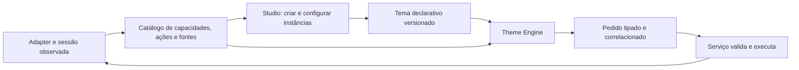

# Capacidades componíveis para temas e experiências

Complemento normativo da direção de 2026-10-16, decorrente da segunda orientação do proprietário. Toda função disponibilizada pela plataforma deve poder ser apresentada pelo criador do tema dentro dos contextos compatíveis. O Studio organiza instâncias visuais dessas capacidades; os serviços executam as operações. Os nomes de contratos propostos abaixo são desenho de destino, não APIs já implementadas.

## Unidade de composição

Separar cinco conceitos:

1. **Capacidade:** o que o backend consegue fazer neste runtime, versão, jogo, sessão, dispositivo e estado.
2. **Ação:** operação tipada, como selecionar disco, carregar estado ou iniciar compartilhamento.
3. **Fonte de dados:** coleção/estado público que alimenta listas, indicadores, screenshots e seletores.
4. **Instância visual:** uma apresentação configurada pelo tema, com ID próprio, layout, aparência, foco, transições e bindings.
5. **Receita de experiência:** coordena operações e recursos de uma sessão; pode ser escolhida por qualquer superfície.

Uma capacidade pode ter várias instâncias visuais, todas observando o mesmo estado. Um seletor de disquetes na moldura e outro no submenu operam a mesma unidade e o mesmo conjunto, sem duplicar estado ou executar duas trocas por um clique.

Liberdade de posição, composição e aparência não obriga um componente pronto com desenho fixo. Fornecer tanto widgets padrão acessíveis quanto primitivas: botão de ação, lista/repetidor, seleção, imagem, texto, progresso, slider quando a ação aceitar valor e agrupamentos. Assim o criador pode montar uma galeria própria com os mesmos dados.

## Contrato público a consolidar

| Entidade | Campos conceituais mínimos |
|---|---|
| Capacidade | ID/versão, contextos, adapter/runtime, disponibilidade, motivo, pré-requisitos, modo de aplicação, evidência de suporte |
| Ação | ID estável, schema de argumentos, resultado/eventos, permissões, confirmação aplicável, timeout, cancelamento, idempotência |
| Fonte | ID/versão, schema dos itens, paginação, ordenação/filtros públicos, revisão, estado vazio/erro/indisponível |
| Instância | ID, referência de capacidade, contexto, bindings, apresentação, foco, visibilidade, comportamento indisponível |
| Invocação | ID do pedido, sessão/jogo/participante/drive, revisão esperada, argumentos validados, estado de execução, erro e recuperação |

Disponibilidade de produto: `available`, `unsupported`, `notApplicable`, `unconfigured`, `temporarilyUnavailable`, `unknown`. Uma operação ocupada publica progresso/estado separadamente. Distinguir `requested`, `accepted`, `dispatched`, `observed`, `failed`, `cancelled` e `unconfirmed`; envio de comando não prova efeito.

Esses nomes são proposta de normalização; a implementação deve mapear os enums existentes sem quebrá-los. Uma atualização do registry altera somente as instâncias afetadas; o tema não consulta processos, portas ou arquivos privados.

O serviço revalida sessão, identidade do recurso, disponibilidade e revisão ao executar. Cliques repetidos são deduplicados por ID do pedido; operações concorrentes de mídia/save são serializadas. Resultado atrasado não muda outra sessão nem uma seleção mais nova. Não repetir cegamente comandos toggle depois de timeout.

## Recursos a expor

| Família | Ações e fontes | Formas de uso pelo tema |
|---|---|---|
| Sessão | Iniciar, pausar, retomar, sair; estado e motivo | Menu iniciar, menu radial, barra lateral, overlay |
| Compartilhamento | Descobrir, escolher destino, conectar, reconectar, parar; receptores e qualidade | Botão, submenu, painel de dispositivos, indicador na moldura |
| Mídia removível | Listar conjunto/unidades, inserir, ejetar, trocar, próximo/anterior quando aplicável | Disquetes na moldura, carrossel, lista rápida, atalho contextual |
| Saves | Listar saves/estados, criar checkpoint, carregar, proteger, renomear, backup/restore quando suportados | Galeria com screenshots, timeline, lista lateral, menus |
| Replay | Capturar clipe; listar/reproduzir; gravação de inputs quando o runtime permitir | Prévia no cartão, biblioteca de momentos, replay lateral |
| Melhorias | Listar pacotes compatíveis, planejar/aplicar/restaurar perfil; estado efetivo | Presets Original/Equilibrado/Melhorado, HD pack no menu |
| Periféricos | Cartões virtuais, NFC/Amiibo, e-Reader, memory cards, VMU, câmera, sensores | Coleção visual, inserir/remover, seleção de slot, display secundário |
| Multiplayer | Participantes, link, controles, lobby, conexão e sincronização | Assistente de dupla, perfis por jogador, convites quando implementados |
| Imagem/áudio/input | Saídas, roteamento, volume/mute, remapeamento, touch/motion disponíveis | Sliders, painel compacto, ações na moldura |
| Contexto | Manual, descrição, metadados, conquistas quando integradas, progresso real | Painéis de apoio, notificações, menus temáticos |

Uma capacidade pode funcionar antes, durante ou depois do jogo. HD pack com aplicação no próximo lançamento continua acessível pelo tema, mas deve informar quando terá efeito. Não publicar operações inexistentes só porque há um widget para elas.

## Studio

O Studio deve oferecer uma biblioteca pesquisável de capacidades, agrupada por finalidade e filtrável por plataforma/runtime. O criador escolhe uma fonte/ação, cria uma instância, posiciona-a e configura aparência, bindings, navegação e estados. Pode reutilizar a mesma composição em submenu, bezel, menu iniciar e lateral.

O inspector mostra contexto, parâmetros tipados, fontes compatíveis, disponibilidade, razão e modo de aplicação. A prévia inclui fixtures explícitas de sucesso, indisponível, lista vazia, erro, progresso e resultado não confirmado. Prévia sintética nunca dispara ações reais.

Salvar/reabrir/exportar/importar deve preservar IDs, bindings e foco. A validação detecta ações sem serviço, campos privados, tipos incompatíveis, fonte ausente, foco sem saída e capacidades exigidas mas indisponíveis. O próprio Launcher deve executar o mesmo documento, sem tradução manual adicional.

A cobertura do pacote enumera todas as ações publicadas e onde aparecem. Operações essenciais não colocadas pelo autor continuam acessíveis em menu de sistema recuperável; o criador pode tematizar a apresentação compatível, mas não eliminar saída, recuperação e indicadores críticos.

## Moldura interativa e input

Uma imagem de bezel enviada ao emulador não implementa uma moldura interativa. É necessário validar a superfície de composição durante gameplay no compositor/backend real: por exemplo, overlay do sistema com input roteado ou outro mecanismo suportado pelo adapter. A escolha técnica depende de Wayland/Gamescope/runtime; não presumir que um PNG ou uma janela QML ficará clicável por cima do jogo.

Ação de controle ativa o modo de interação ou seletor rápido. Comportamento de pausa é declarado por capacidade: se pausa não for segura/disponível, informar e usar modo compatível. O botão reservado não é entregue simultaneamente ao jogo e ao menu; ao fechar, foco/input retornam ao jogador correto. Segurar/soltar e pressões repetidas têm semântica testável, com teclado/toque equivalentes.

Sem overlay interativo disponível, preservar a função num menu rápido suportado. A ausência dessa superfície não deve inventar suporte ao bezel nem remover a capacidade operacional. O fallback aparece como limite do dispositivo, não como limitação artística do pacote.

## Saves, replay e retenção

Save normal do jogo, backup de save, save-state do emulador, rewind, gravação de vídeo e replay determinístico são capacidades diferentes. “Salvar jogo” não deve publicar save-state onde o core não o suporta, nem forçar um save interno sem API. A UI pode oferecer checkpoint quando suportado e explicar a diferença.

A galeria publica screenshot e, quando existente, clipe associado, tempo, jogo, participante, runtime/versão e compatibilidade. Load valida essas informações e preserva o estado anterior quando possível; incompatibilidade não é escondida. Replay de inputs exige ROM/build/configuração/estado inicial correspondentes; vídeo não substitui essa prova.

A indicação do proprietário de saves que “vão apagando” é tratada por padrão como desaparecimento visual/fade da lista. **Animação não exclui arquivo.** Rotação de autosaves exige política explícita de retenção (quantidade/idade/orçamento), proteção de slots manuais/favoritos, recuperação/quarentena e proibição de excluir o último save válido por acidente. O tema pode apresentar e acionar a política do serviço, nunca apagar dados por uma animação.

## Packs HD e periféricos

Pacotes de textura, shaders, graphic packs e patches têm compatibilidade e aplicação distintas. Separar efeito visual da engine de alteração nos gráficos do jogo. O serviço resolve jogo/região/versão/runtime, conflitos, origem, plano, backup, aplicação e readback; expõe aplicado, aguardando reinício ou não confirmado.

NFC/Amiibo e cartões e-Reader seguem catálogos de recursos do usuário com IDs estáveis. Inserir/remover, leitura e eventual escrita têm resultado e propriedade bem definidos. O tema pode desenhar cartões/figuras e a interação; não implementa emulação NFC nem obtém dumps. “Card do GBA” fica registrado como e-Reader na primeira hipótese; outros acessórios devem ser modelados separadamente quando identificados.

## Aceite transversal

O mesmo disco/save/destino deve aparecer numa moldura, num submenu e numa composição lateral autorada, acionar o mesmo serviço e atualizar todas as instâncias sem duplicação. O teste inclui indisponibilidade, resposta atrasada, troca de tema, nova sessão, erro e recuperação. A composição deve ser alterável no Studio e executada após reabrir o pacote. Fazer essa prova antes de expandir dezenas de botões específicos.
