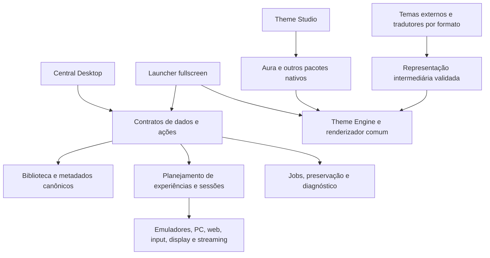

# Direção de produto e arquitetura do SteamZero

Esta direção incorpora a orientação expressa do proprietário em 2026-10-16. A promessa é reduzir o trabalho de configuração necessário para jogar, conservando controle fino para quem o deseja. A unidade de entrega é a experiência utilizável.

## Vocabulário normativo

| Nome | Responsabilidade | Aceite independente |
|---|---|---|
| SteamZero Central Desktop | Gerenciar biblioteca, plataformas, emuladores, configurações, mídia, dispositivos e diagnóstico | Jornadas com mouse/teclado, hierarquia lógica, escala e ajustes avançados funcionais |
| SteamZero Launcher | Navegar e jogar em tela cheia, com controle, foco, biblioteca, detalhes, sessão e retorno | Jornada completa no hardware, com qualquer tema homologado |
| Theme Engine | Renderizar composição, assets, layouts, bindings, transições, efeitos e interação declarativa | Contratos e desempenho medidos em cenas representativas |
| Aura | Tema nativo de referência do Launcher, demonstrando capacidades diferenciadas da engine | Pacote carregável, substituível e verificável pelo mesmo caminho usado pelos demais temas |
| Theme Studio | Ferramenta de autoria de temas e jornadas | Criar, validar, salvar, reabrir e executar o mesmo pacote no Launcher |
| Perfil de experiência | Preparação e execução de um modo de jogar em uma plataforma | Configuração, participantes, entradas, saídas, sessão e recuperação observadas |

Central e Launcher são as duas superfícies principais. Engine, Studio e serviços são capacidades de suporte. A Central pode compartilhar componentes e tokens acessíveis; a escolha do tema fullscreen não deve reorganizar ou recolorir involuntariamente o ambiente administrativo.

Os nomes legados `SZ-AURA-UI`, `SZ-AURA-LAUNCHER`, `inherit-aura`, IDs de pacote e entrypoints não serão renomeados em massa. São identificadores de compatibilidade até uma migração com plano, backup e testes. Documentação e interface passam a usar os nomes acima; o mapa de aliases preserva a leitura de preferências existentes.

## Decisões anteriores superadas

| Fonte anterior | Definição substituída | Direção atual |
|---|---|---|
| `AGENTS.md` seção 10 e `AURA-SURFACES.md` | AURA UI como sistema visual da central; AURA Launcher como identidade do produto fullscreen | Central Desktop e Launcher são produtos; Aura é um tema fullscreen |
| `PROJECT-VISION.md` e `PRD.md` | Duas superfícies AURA | Duas superfícies SteamZero, com aparência e navegação adequadas a cada contexto |
| `FRAMEWORK TEMA/01_VISAO_E_PRINCIPIOS.md` | Framework limitado à central e compatibilidade visual externa fora do escopo inicial | Esse recorte é histórico; o motor atual deve atender temas fullscreen nativos e importados |
| `THEME-ENGINE-AND-STUDIO.md` | AURA UI como consumidor/tema builtin | Preservar contratos técnicos úteis, adotando os consumidores e nomes desta direção |
| ADR 0028 | AURA Cinema associado ao shell | Recuperar sua direção cinematográfica como composição do pacote Aura; shell continua independente |

Compartilhar código de apresentação é permitido. Compartilhar implicitamente a preferência, as rotas administrativas ou a identidade do tema entre superfícies contraria esta direção.

## Arquitetura de destino

O backend permanece dono de identidades, requisitos, credenciais, persistência e ações. A engine recebe dados públicos e ações semânticas. Tema não instala emulador, não decide requisitos de BIOS e não gerencia processo de jogo.

O Launcher controla a máquina de navegação e sessão. Temas podem definir composição e organização declarativa, inclusive menus e transições, dentro de um contrato que conserva Voltar, foco, estados e ações essenciais. Studio é opcional para jogar ou instalar um pacote válido.

Reaproveitar core transacional, SQLite, jobs, adapters, read models e QML existentes. Extrair responsabilidades dos arquivos grandes conforme cada jornada for corrigida; uma reescrita geral não é pré-requisito.

## Central Desktop

Navegação proposta: Biblioteca; Plataformas; Emuladores; Experiências; Mídia e metadados; Dispositivos e transmissão; Temas do Launcher; Ferramentas e diagnóstico. Theme Studio entra como ferramenta de criação.

A página de jogo tem identidade e edição de correspondência, descrição, ano, gênero, desenvolvedor, jogadores, mídia, botão de atualização de dados/mídia, emulador escolhido, experiência selecionada, ajustes por jogo e preparação para jogar. Cada campo informa ausência real; erro de provedor não vira sucesso nem texto inventado.

A página de emulador apresenta versão, instalação, formatos, requisitos aplicáveis, controles, vídeo, áudio, saves, recursos específicos e ajustes avançados suportados pelo adapter. Um esquema genérico de firmware não substitui essa página. `não aplicável`, `desconhecido`, `ausente` e `válido` são estados distintos.

Herança de configurações proposta: padrão do adapter → dispositivo/modo → plataforma → jogo → override temporário da sessão. Cada valor exibe origem, valor efetivo e restauração da herança. A implementação deve reconciliar essa ordem com `launch_profile.py` e `emulator_config.py` antes de mudar persistência. Configurações próprias do usuário têm backup e diff; não são substituídas silenciosamente.

## Launcher

Jornada padrão pronta: iniciar → plataformas/coleções → lista de jogos → detalhes → jogar → sessão → retornar com seleção, filtro e posição preservados. Deve funcionar sem criar menus no Studio.

Entradas visíveis na Central: abrir Launcher, escolher tema fullscreen, testar prévia e aplicar/restaurar tema. No Launcher: biblioteca, busca, detalhes, experiência, ajustes rápidos, voltar e sair. A aparência acompanha a plataforma e o jogo sem interromper a orientação do usuário.

Erros, biblioteca vazia, dados incompletos, offline, carregamento e recuperação integram a composição do tema. O fallback permanece navegável. Reiniciar o Launcher não deve encerrar o jogo observado pelos serviços.

## Theme Engine e Aura

A capacidade maior do motor deve ser demonstrada por uma matriz de recursos, não pelo número de efeitos listados. Preservar a filosofia “renderize, não edite”: assets-fonte e receitas, com caches descartáveis.

O pacote Aura precisa declarar suas cenas e transições; um conjunto de cores acompanhado de um `LauncherCinema.qml` exclusivo não satisfaz esse contrato. Os componentes nativos podem implementar primitivas reutilizáveis, mas o tema deve selecioná-las pelo contrato público. Trocar Aura por outro pacote deve preservar catálogo, input, launch/return e recuperação.

A primeira amostra deve demonstrar identidade por plataforma, fanart/vídeo, logo derivado por receita, composição de detalhe, transição, foco e OSD permitido pela sessão. Efeitos avançados adicionais entram quando orçamento e fallback forem medidos. Editor de timeline e marketplace não bloqueiam o primeiro Launcher excelente.

## Recursos disponíveis para autoria de temas

Todas as capacidades publicadas devem ser consumíveis como ações e fontes tipadas por instâncias visuais configuradas no Studio. O autor escolhe moldura, submenu, menu iniciar, lateral ou outra composição compatível. Sessão, discos, compartilhamento, saves/replay, melhorias e periféricos seguem o mesmo princípio; disponibilidade e execução continuam sob autoridade dos serviços.

O contrato normativo está em [CAPACIDADES-COMPONIVEIS.md](CAPACIDADES-COMPONIVEIS.md). As jornadas de [compartilhamento](COMPARTILHAMENTO.md) e [multidisco](MULTIDISCO.md) têm critérios próprios. Uma imagem de bezel não comprova superfície interativa; um enum de protocolo não comprova descoberta; um fade de save não autoriza excluir o arquivo.

## Compatibilidade externa

### Consolidação expressa do proprietário — 30/10/2026

A definição detalhada e normativa está no
[relatório consolidado de Theme Engine e Studio, seção 22](../../01-product/THEME-ENGINE-AND-STUDIO.md#22-definição-consolidada--30102026).
Leia-o antes de alterar autoria, assets, tradução ou execução de temas. Ele
amplia o aceite sem promover o estado de runtime.

O SteamZero combina automação/organização/configuração de plataformas na Central
com experiência audiovisual e launch/return no Launcher. Temas nativos são a
função primária da plataforma criativa. Studio deve permitir construí-los pela
interface, sem edição manual de XML/código, usando os recursos do motor. A meta
de compatibilidade é reproduzir integralmente capacidades RetroFE/ES-DE nesse
mesmo motor; perdas observadas são lacunas a corrigir, não redução automática
do objetivo. Aeon Nox e os temas ES-DE auditados são casos iniciais de prova.

Assets pertencem à biblioteca canônica compartilhada. O mesmo master pode
alimentar vários temas, papéis e estados sem cópias persistentes por consumidor.
Artes distintas são permitidas; variações de cor, stroke, escala e efeito são
receitas não destrutivas. O caso obrigatório é a wheel com laterais monocromáticas
e centro colorido/contornado, derivada do mesmo logo-fonte. Organização e economia
devem ser verificadas separadamente do cache e do desempenho.

Importação traduz para documentos/IR SteamZero; dar Play os executa pela Theme
Engine. Preview e Launcher devem consumir a mesma revisão sem uma reconstrução
manual de aparência/comportamento. O motor responde por recurso e etapa, com
causa, contexto, perda e recuperação. Percentuais de parser ou fallback não
certificam reprodução integral. Fidelidade, fluidez, áudio, vídeo, navegação e
autoria amigável exigem comparação e observação na candidata/hardware indicados.

O relatório preserva a separação entre requisito, fundação existente e prova.
Não constitui migração do acervo pessoal, autorização de execução externa ou
certificação de superioridade de desempenho. A reprodução fiel e os recursos
nativos adicionais precisam de aceites próprios, nos itens e marcos existentes.

### Classificação por pacote

Cada pacote recebe uma classificação separada: reconhecido; importado; renderizado; navegável; launch/return integrado; validado visualmente e em desempenho. Declarar formato, versão, tema, digest, perdas, release e hardware. Percentual de propriedades reconhecidas não equivale a fidelidade visual.

| Ecossistema | Situação a recuperar | Critério para a primeira entrega |
|---|---|---|
| ES-DE | Compiladores e resolução de includes já existem | Tema real pinado, seleção por sistema, arte, vídeo, navegação e retorno no Launcher |
| RetroFE | IR, parser e inspeção existem | Layout real pinado, eventos/transições, menus, mídia, input e retorno no mesmo renderizador |
| BigBox | Importação de metadados LaunchBox não implementa tema BigBox | Estudo de formato + subconjunto declarativo reproduzível + relatório de incompatibilidades; depois uma jornada real |
| Steam Deck e Big Picture | Tema nativo chamado steamdeck não equivale a suporte a pacotes Steam | Separar integração com Steam, tradução de estilos suportados e tema nativo inspirado na experiência |
| Pegasus | Importador de metadata é uma capacidade distinta | Inventariar tema de referência e dependências antes de definir tradução ou integração |

BigBox usa views WPF/XAML; CSS Loader aplica CSS a superfícies do cliente Steam. Portanto, **inferência arquitetural:** não se pode prometer execução universal desses pacotes no runtime declarativo Qt apenas por converter cores. O objetivo de compatibilidade permanece, mas precisa de tradutores com limites públicos ou de integração explícita com o frontend original. Executar o frontend original é integração, não prova de renderização pela engine SteamZero. [BigBox Theming](https://feedback.launchbox-app.com/en/help/articles/0780913-getting-started), [CSS Loader Features](https://docs.deckthemes.com/CSSLoader/Features/).

Código, DLLs, QML, JavaScript e shaders arbitrários de terceiros permanecem fora da fronteira permitida. Recursos não traduzíveis geram diagnóstico. Em vez de reduzir o objetivo a uma paleta semelhante, escolher pacotes representativos, preservar aparência e comportamento suportados e ampliar cobertura iterativamente.

## Experiências por plataforma

Um perfil de experiência combina plataforma, runtime/versão, jogos, participantes, entradas, saídas, áudio, topologia local/remota, configuração, saves e recuperação. O catálogo de sistemas existente não substitui esse contrato operacional. Reutilizar `canonical_experiences` para identidade; manter separado do grafo visual de `experience_journey`.

| Experiência desejada | O que precisa ser demonstrado |
|---|---|
| GBA com dois jogadores automáticos | Runtime com suporte comprovado ao link, duas instâncias/participantes, inputs independentes, conexão efetiva entre jogos e saves isolados |
| Jogador 1 no monitor e jogador 2 no Deck | Seleção estável de saídas e controles, posicionamento, áudio, dock/undock e recuperação de saída removida |
| Uma imagem transmitida e outra local | Captura da superfície correta, pareamento, latência medida, input roteado, desconexão e continuidade local |
| Wii U com Steam Deck como GamePad | TV e GamePad separados, toque coordenado, movimento, botões, áudio e recursos adicionais conforme jogo/runtime, com limites declarados |
| PC e plataformas web | Descoberta ou cadastro, autenticação quando necessária, input, iniciar/encerrar e retornar; indisponibilidade remota legível |

“100% GamePad” é uma meta que exige uma matriz de funções e testes por jogo/hardware. Não promovê-la apenas por mapear botões. Dois processos GBA abertos não provam link multiplayer. Streaming de desktop não prova duas superfícies independentes.

A fala do proprietário usa “docker” em um contexto que também pode significar dock físico. O plano contempla dock como cenário local e registra Docker/host remoto como uma topologia adicional a esclarecer antes desse adapter; a ambiguidade não bloqueia o trabalho local nem autoriza assumir um servidor/container já existente.

O [catálogo completo de experiências](EXPERIENCIAS-POR-PLATAFORMA.md) amplia estas propostas para todos os manifestos e destinos PC/web. As propostas são diferenciadas por variante, runtime e jogo; a inclusão no catálogo não declara suporte. A [matriz de estado e execução](ESTADO-E-EXECUCAO.md) vincula cada família ao trabalho existente e às entregas faltantes.

## Critério de excelência

Uma entrega exige: cenário e versão identificados; navegação coerente; dados corretos; ação real; sucesso, erro e recuperação; persistência; ausência de perda de dados; captura/vídeo no hardware pertinente. Para fluidez, adotar inicialmente como orçamento de projeto 60 fps, frame time p95 até 16,7 ms e p99 até 33,3 ms em navegação aquecida, reportando também travamentos, memória e carregamento frio em 1280×800 e 1920×1080. Esses números são metas propostas, não medições existentes; definir cena, tamanho do catálogo, duração e tier antes de comparar.

Conclusão de um componente nunca promove automaticamente a jornada, o tema, o emulador ou outra superfície.
