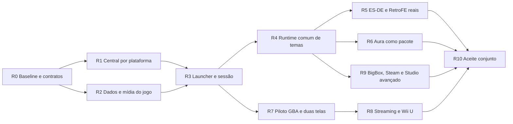

# Plano de recuperação por jornadas

Executar sobre a direção de 2026-10-16, conservando os cinco eixos de status. A ordem abaixo é uma proposta de execução concreta; não representa funcionalidades entregues. Abrir um item e workstream por lote antes da implementação, vinculando os itens existentes indicados. Não encerrar uma jornada apenas porque o componente já estava verde.

## Sequência e dependências

R1 e R2 podem avançar independentemente com contratos comuns. R5 e R6 validam a mesma engine por consumidores diferentes; nenhum pode ganhar atalhos exclusivos para parecer concluído. R9 começa por pesquisa/fixtures enquanto a base é estabilizada, mas implementação depende de R4. Estas dependências não autorizam delegação automática nem concorrência em arquivos compartilhados.

## R0 Baseline utilizável e autoridade documental

**Prioridade:** imediata. **Estado nesta entrega:** direção, reconstrução e snapshot concluídos; inventário operacional completo e conciliação dos claims permanecem para execução.

- Ler a direção e mapear aliases sem quebrar preferências: Central Desktop ← AURA UI; Launcher ← AURA Launcher; Aura ← tema fullscreen; Cinema ← composição do tema; Jornada ← grafo de navegação; experiência de jogo ← perfil operacional.
- Reconciliar o commit local com a linha de integração indicada pelo operador e com a release instalada. Não confundir a branch documental com código publicado.
- Inventariar cada ação visível: superfície/rota, ID, capacidade, endpoint, handler, efeito, estado retornado, erro, teste e prova instalada. Reaproveitar os censos de 12–15/10 como dados históricos, sem executar harness preso a release antiga como se medisse HEAD.
- Criar corpus mínimo: um jogo sem BIOS obrigatório, um com BIOS obrigatório, um com conteúdo extra, um PC/Steam, uma plataforma web; controlar os dados de teste e proteger os documentos ativos do usuário.
- Recuperar capturas históricas e fixar um tema ES-DE e um RetroFE reais por versão/hash/licença. Medir antes de alterar layout.
- Reconciliar `README`, visão, PRD, `AURA-SURFACES`, `THEME-ENGINE-AND-STUDIO`, ADR 0028 e roadmap por handoff dos arquivos reivindicados. Preservar história e manter ponteiros para os novos contratos.

**Aceite:** uma matriz reproduzível distingue `funciona`, `falha reproduzida`, `não aplicável`, `não implementado` e `não verificado`. A primeira jornada pode ser descrita por ações reais e estados observados, sem inventar endpoints. Mapear `SZ-AURA-UI`, `SZ-AURA-LAUNCHER`, `SZ-UI-DESKTOP-AUDIT` e o lote de coesão já existente.

## R1 Central com configuração aplicável

**Problema:** plataformas/emuladores recebem controles genéricos e caminhos incompletos.

**Pontos de partida:** `ui/qml/Emulation.qml::overviewCards`, `domain/emulation_workspace.py`, `domain/platform_composer.py`, `platform_manifests`, `domain/emulator_config.py`, `adapters/desktop_contracts.py`, `desktop_dashboard.py`.

**Entregas:**

- Navegação Plataforma → Emulador → Jogo → Ajustes com breadcrumb e retorno conservado.
- Requisitos derivados do manifesto/adapter: nenhum aviso de firmware por ausência de dados quando o requisito é inaplicável.
- Formulário de configurações por adapter com tipos, opções, defaults, limites, reinício necessário, escopo e origem do valor.
- Escrita pelo adapter, preview/diff, confirmação pertinente, readback e rollback; override por jogo não altera o global.
- Tratamento consistente de botões, foco, popups, rolagem, densidade e escalas; reaproveitar a correção de tokens sem esconder os componentes ainda incoerentes.

**Primeiro slice:** uma plataforma sem firmware aplicável e outra com requisito real, escolhidas pelos manifestos; listar, abrir, configurar, preparar jogo e voltar. **Aceite:** requisito inadequado ausente, ação real com resultado, persistência após reinício, configurações originais preservadas, erro recuperável, captura em desktop e viewport do Deck. Ampliar depois pela matriz de adapters, nunca copiar cartões genéricos para declarar cobertura.

**Status a vincular:** `SZ-EMULATION-PLATFORM-SCOPE`, `SZ-EMULATION-PLATFORM-CONTEXT`, `SZ-UI-DESKTOP-AUDIT`, `SZ-EMULATION-REAL-DUMP-VALIDATION`.

## R2 Página de jogo com dados e mídias completos

**Problema:** arte e dados descritivos percorrem caminhos distintos; interface não fecha descoberta, associação e atualização.

**Pontos de partida:** `scraping/screenscraper.py`, `scraping/dispatcher.py`, `scraping/registry.py`, `domain/game_record.py`, `metadata_import`, `domain/library_projection.py`, `launcher_catalog.py`, painel de mídia em `Emulation.qml`.

**Contrato:** identidade canônica → correspondência de provedor → metadados por campo com procedência → assets por tipo → persistência → invalidação das projeções → Central e Launcher atualizados.

**Entregas:** ação visível “Buscar dados e mídias”, revisão de correspondência ambígua, credenciais com estado legível, seleção por tipo, progresso real, atualização individual/lote e recuperação por item. Metadados editados manualmente não são sobrescritos sem política explícita. Resultado parcial lista o que faltou.

**Aceite:** ano, gênero, desenvolvedor e descrição de fixture conhecida chegam às duas superfícies; capa/fanart/logo se associam ao mesmo jogo; reinício e modo offline conservam dados; erro de autenticação, quota, rede e resultado vazio não apagam o existente. Validar também um provedor remoto real quando houver credenciais, separando essa prova dos fixtures.

**Status:** `SZ-MEDIA-SCRAPING`, `SZ-AURA-METADATA`, `SZ-AURA-RICH-MEDIA-PROJECTION`, `SZ-AURA-PLATFORM-MEDIA-SCOPE`.

## R3 Launcher com uma jornada pronta

**Problema:** caminhos Home/Cinema/Journey e sessão ainda não oferecem uma experiência única consistente.

**Pontos de partida:** `launcher/app.py`, `launcher/journey_runtime.py`, `adapters/launcher_ui.py`, `launcher_session.py`, `session_control.py`, `ui/qml/launcher/LauncherMain.qml`, `LauncherJourney.qml`, `LauncherShell.qml`.

**Entregas:** entrada “Abrir Launcher” na Central; jornada default sem autoria; busca/coleções/detalhe com mesmo catálogo; entrada por controle; erros acionáveis; sessão com ações conforme capabilities; contexto preservado no retorno. Definir a autoridade de navegação antes de consolidar caminhos; não remover um caminho com comportamento único sem equivalência demonstrada.

**Aceite:** abrir → escolher plataforma/jogo → jogar → pausar/retomar quando suportado → sair → retornar ao mesmo item/filtro/rolagem. Cobrir emulador, PC e web; testar launch recusado, processo morto, bridge indisponível e reinício do Launcher com jogo ativo. Fechar os residuais D-08, D-12/D-22 e D-23 pertinentes da matriz de 15/10.

**Status:** `SZ-AURA-LAUNCHER`, `SZ-AURA-SESSION-OSD`, `SZ-AURA-LAUNCHER-EXIT`, `SZ-LAUNCH-READINESS-PREPARATION`.

## R4 Runtime comum e preferências separadas

**Problema:** escolher tema administrativo, renderizar IR e montar cinema não são a mesma operação.

**Pontos de partida:** `domain/themes.py`, `theme_scene.py`, `scene_esde.py`, `scene_retrofe.py`, `theme_preferences.py`, `adapters/theme_catalog.py`, `ThemeScene*.qml` disponíveis no checkout, `LauncherCinema.qml`.

**Entregas:** contrato de pacote/cena e ações semânticas, ativação no Launcher, preferência fullscreen independente, fallback, invalidação e relatório de perdas. Inventariar os caminhos IR e sceneLayouts nativos antes de consolidar; um renderer comum pode admitir frontends de compilação distintos.

**Migração:** manter IDs antigos legíveis; snapshot da preferência; resolver destino por superfície; preview sem persistir; aplicar e reabrir; rollback para os mesmos IDs e arquivos. Sem substituição global de strings AURA.

**Aceite:** trocar dois pacotes nativos e uma cena importada sem alterar a aparência administrativa; retomar mesmo jogo/contexto; remover/corromper pacote e recuperar um tema seguro; API não entrega código externo. Tema instala/ativa sem exigir Studio nem instalação do frontend de origem quando executado pela engine SteamZero.

**Status:** `SZ-THEME-ENGINE`, `SZ-THEME-IMPORT-SURFACE`, `SZ-AURA-ESDE-RUNTIME-BRIDGE`.

## R5 ES-DE e RetroFE de verdade

Selecionar um pacote real de cada ecossistema, com origem, licença e hash. `xmb-menu` e um layout RetroFE já estudado são candidatos a confirmar no acervo; fixtures mini continuam úteis, mas não são o aceite visual.

Para cada pacote: inspecionar → compilar com perdas explícitas → prévia → instalar → ativar no Launcher → plataformas/jogos → detalhe → jogar → retornar → reiniciar → desfazer ativação. Validar imagens, vídeo, texto, menus, foco, eventos, transições e proporções. Comparar com execução/capturas da versão original equivalente.

**Aceite:** todas as etapas verificadas na release e hardware identificados; relatório de recursos suportados/parciais/não suportados; falhas essenciais impedem o selo de compatibilidade. Registrar frame times, memória, carregamento e input. A engine pode renderizar o pacote sem o executável original; usar o original apenas como referência não cria dependência de runtime.

**Status:** `SZ-THEME-IMPORT-ESDE-LAYOUT`, `SZ-THEME-ESDE-SCENE-RENDER`, `SZ-THEME-IMPORT-RETROFE`. Preservar os aceites estreitos desses itens e criar o item de jornada que eles ainda não comprovam.

## R6 Aura demonstrando a engine

Mover composição necessária para um pacote declarativo, preservando primitivas reutilizáveis no código. Fixar identidade de plataforma/jogo, efeitos derivados de asset-fonte, transições e estados de erro/offline. Usar as referências cinematográficas do ADR 0028 e o corpus visual recuperado.

**Aceite:** Aura entra pelo mesmo catálogo/validador/ativação de R4; não precisa de if específico no shell para oferecer sua composição; pode ser substituído sem perder funções; atende os orçamentos definidos e fallback de acessibilidade. Nenhum tema duplicado deve ser criado apenas para contornar uma limitação não resolvida no motor.

## R7 Piloto de experiência GBA e duas telas

**Primeiro trabalho:** prova de viabilidade do runtime e versão, incluindo suporte real a link. O core libretro mGBA listado hoje não constitui prova; pode ser necessário um adapter standalone. Escolher pelo teste de capacidade, não pelo nome.

Definir um plano de sessão com participantes, jogo por participante, input exclusivo, link, diretório/save por instância, janela/saída e áudio. Reaproveitar o supervisor de sessão, sem relaxar globalmente a invariante de sessão única: representar sessões filhas de uma sessão composta e validar concorrência/ownership.

**Aceite em duas etapas:** (a) dois participantes comunicam-se no jogo com inputs e saves isolados; falha de um processo limpa apenas recursos próprios; (b) jogador 1 no monitor e jogador 2 no Deck, dock/undock e saída removida recuperáveis. UI apresenta “Jogar em dupla” e preparação necessária; não pede ao usuário para montar linhas de comando.

**Fontes:** `canonical_experiences`, `input_profiles`, `domain/session.py`, `adapters/launcher_session.py`, `domain/launch_profile.py`, adapters de display/dispositivo encontrados no inventário. Abrir item operacional específico; não promover o catálogo de sistemas.

## R8 Streaming independente e Wii U

Depois de R7, comprovar captura por superfície e destino, input, pareamento/revogação, áudio, latência, desconexão e recuperação. Cast LAN real é pré-requisito; internet exige decisões próprias de transporte/relay.

Para Cemu: registrar versão e capacidades observadas, distinguir TV/GamePad, validar touch absoluto e suas coordenadas, movimento, botões e recursos adicionais exigidos pelos jogos. Publicar matriz por função com `suportado`, `parcial`, `indisponível`, `não verificado`. Só declarar simulação completa após cobrir o conjunto definido.

**Aceite:** uma superfície remota e outra local continuam independentes; falha de rede preserva jogo/saves e oferece retorno local; a receita Wii U é acionada pela mesma escolha de experiência nas duas superfícies do produto. Docker como host remoto, se confirmado, recebe estudo de GPU, captura, rede e dispositivos próprio; não é inferido do fluxo dock físico.

**Status:** `SZ-CAST-LAN`, `SZ-CAST-INTERNET`, itens de input/sessão e novo item de experiência Wii U.

## R9 Compatibilidade ampliada e Studio

BigBox: corpus XAML e inventário de bindings, views, controles e extensões. Provar um subconjunto declarativo antes de prometer pacotes; funcionalidades que dependem de código externo permanecem incompatíveis até decisão arquitetural explícita. Distinguir tema, metadata LaunchBox e integração com frontend.

Steam/Big Picture: definir se a solicitação concreta é importar estilos, executar Steam com seus temas ou usar um tema SteamZero com aquela linguagem visual. Essas opções cumprem objetivos diferentes e precisam de rótulos claros. O desejo de compatibilidade não será silenciosamente rebaixado a inspiração estética.

Pegasus: tratar metadata e tema como capacidades diferentes; pesquisar o contrato do tema escolhido antes de definir suporte.

Studio: priorizar editar e executar os mesmos documentos em R4–R6. Canvas, timeline e efeitos avançados ampliam autoria depois do ciclo abrir/salvar/reabrir/preview/ativar/rollback estar sólido. A engine não deve esperar o editor completo para aceitar pacotes válidos.

**Aceite:** uma matriz por formato e pacote, com teste real e perdas, e um documento criado no Studio que execute sem divergência no Launcher. `SZ-FRONTEND-LAUNCHBOX` e `SZ-THEME-STUDIO` permanecem com seus estados reais até suas próprias provas.

## R10 Aceite conjunto e expansão

A primeira entrega utilizável pode sair após R1–R6 e o ciclo de jogo local validado; não deve anunciar experiências especiais ainda abertas. O objetivo integral desta direção requer também R7–R9 dentro do escopo explicitamente homologado por formato/dispositivo.

Matriz obrigatória: desktop com mouse/teclado; Deck com controle/toque; handheld e dock; 1280×800 e 1920×1080; offline; mídia ausente; credencial ausente; pacote inválido; runtime indisponível; interrupção e recuperação. Testar ultrawide/escala fracionária conforme a cobertura anunciada. Expandir por famílias de adapters mantendo a mesma régua.

Toda linha de aceite precisa de cenário, versão do app, runtime, tema/hash quando aplicável, dispositivo, entrada, passos, resultado esperado/observado, captura ou vídeo e teste associado. Releases novas revalidam as jornadas afetadas; evidência antiga não é promovida pelo novo digest.

## Regras de execução dos agentes

1. Um lote fecha uma jornada ou um contrato necessário a ela; deve ter dono e dependências, sem reconstruir subsistemas já suficientes.
2. Trabalhar na branch própria, respeitar claims e registrar handoffs reais. Caso haja apenas dependência documental, preparar a alteração e integrar serialmente.
3. Baseline → causa → correção mínima completa → testes focados → gates do checkpoint → evidência → status. Usar os comandos com `rtk` conforme a instrução do workspace.
4. Não trocar sucesso operacional por `enabled=true`, captura offscreen ou existência de endpoint. A porta deve executar e o estado confirmar o efeito.
5. Separar evidência desta branch, integração, release instalada e hardware. Não copiar autorização de instalação/entrada física de outra sessão.
6. Não fazer instalação, publicação ou alterações no host neste lote de planejamento. Futuras etapas seguem `AGENTS.md` e autorização vigente.
7. Encerrar o lote com ação seguinte específica e caminho das evidências. Não abrir novos temas ou novas frentes para evitar terminar a jornada atual.

## Próxima entrega concreta

Iniciar R0/R1 pelo fluxo **Central → plataforma → emulador → requisitos aplicáveis → jogo → preparação → retorno**, usando dois sistemas de requisitos diferentes. Entregar matriz de ações, correção do fallback de requisitos, readback real e testes; preparar a validação física sem presumir autorização de host. Em seguida fechar R2 sobre o mesmo jogo e usar esse mesmo conjunto para R3. Esse encadeamento constrói uma referência completa que os demais sistemas deverão reproduzir.
